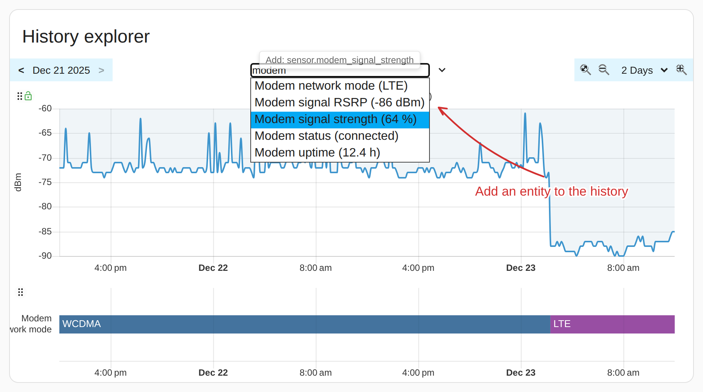
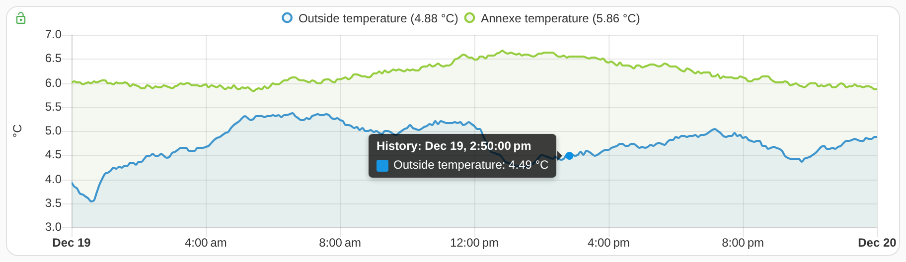
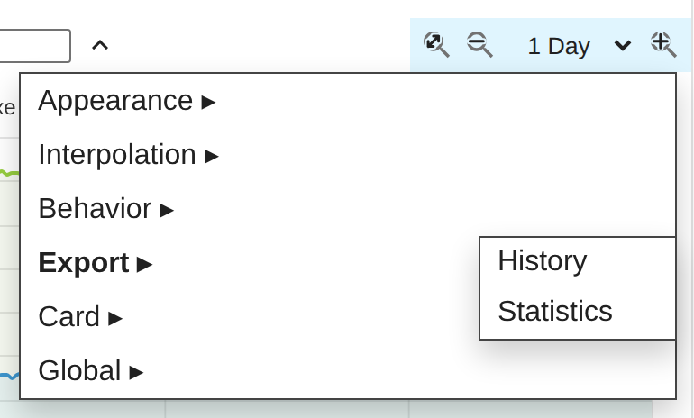
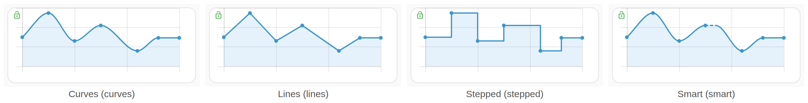
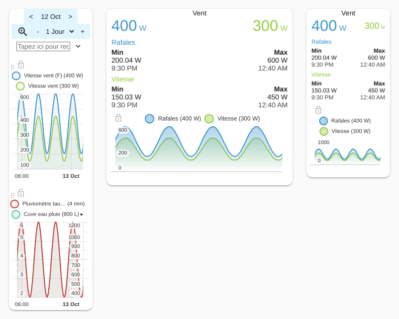
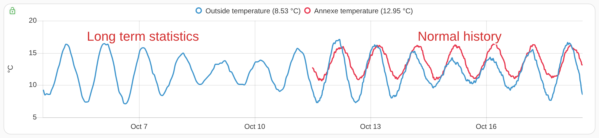

[](https://github.com/hacs/integration)
[](https://github.com/Cook23/history-explorer-card/releases)
[](https://github.com/Cook23/history-explorer-card/stargazers)


<a href="https://buymeacoffee.com/thierry_couquillou" target="_blank"></a>

# History explorer card

> **A custom history card for Home Assistant — fork of [SpangleLabs/history-explorer-card](https://github.com/SpangleLabs/history-explorer-card).**
> 📖 [README_Full.md](https://github.com/Cook23/history-explorer-card/blob/v1.2-dev/README_Full.md) — the complete documentation · What this fork adds: [FORK_DESCRIPTION.md](https://github.com/Cook23/history-explorer-card/blob/v1.2-dev/FORK_DESCRIPTION.md) 🇬🇧 / [FORK_DESCRIPTION_FR.md](https://github.com/Cook23/history-explorer-card/blob/v1.2-dev/FORK_DESCRIPTION_FR.md) 🇫🇷

---

> [!IMPORTANT]
> **The history explorer part of the card is stable; the mini-graph-card part is in beta** — its YAML, `look: mini`, the values over a graph, the aggregation. Feedback is welcome in the [discussions](https://github.com/Cook23/history-explorer-card/discussions) or in an [issue](https://github.com/Cook23/history-explorer-card/issues).

*Developed with Claude Code, which modifies, reviews and tests the card, and runs its automated tests in a real browser against a simulated Home Assistant, with mouse and touch input.*

---

## Overview

A highly interactive history card for Home Assistant. Pan, zoom, and explore the history of the entities across any time range, with full support for line charts, bar charts, timelines and compass arrow graphs.


---

## 📋 Version highlights

- **v1.2.84** — Automatic colors by what a curve measures.
- **v1.2.83** — Color, fill and arrow length from an entity or attribute, chosen in the menus.
- **v1.2.82** — Arrows as long as an entity's value; the fill read indirectly, as the color.
- **v1.2.77** — YAML export of the card, a graph or a curve.
- **v1.2.60** — A steady automatic Y axis; long ranges drawn at once (a year in 0.4 s).
- **v1.2.59** — Time ranges up to 10 years.
- **v1.2.27** — Only what the screen can show is loaded.
- **v1.2.18** — mini-graph-card's YAML read as is.
- **v1.2.15** — Gesture settings; the options menu in submenus.
- **v1.2.9** — Values over a graph, `look: mini`; attributes as curves.
- **v1.2.6** — The graph menu, cut and paste.
- **v1.2.4** — Two Y axes; colors from thresholds or another entity; the info panel everywhere.
- **v1.2.2** — The curve menu in submenus; the tooltip on a click.
- **v1.2.0** — Beta: dragging on touch screens reworked.

📖 [CHANGELOG.md](https://github.com/Cook23/history-explorer-card/blob/v1.2-dev/CHANGELOG.md)

---

## Table of contents

- [Install](#install)
- [Quick configuration](#quick-configuration)
  - [YAML graphs](#yaml-graphs)
  - [YAML export](#yaml-export)
  - [Info panel](#info-panel)
  - [Running as a sidebar panel](#running-as-a-sidebar-panel)
- [Usage](#usage)
  - [Adding entities](#adding-entities)
  - [Navigation](#navigation)
  - [Tooltip](#tooltip)
  - [Managing graphs](#managing-graphs)
  - [Y axis](#y-axis)
  - [Menus](#menus)
  - [CSV export](#csv-export)
- [Detailed configuration](#detailed-configuration)
  - [Graph types](#graph-types)
    - [Lines](#lines)
    - [Bars](#bars)
    - [Timelines](#timelines)
    - [Compass arrows](#compass-arrows)
  - [Colors](#colors)
  - [Values over a graph, look: mini](#values-over-a-graph-look-mini)
  - [Time range](#time-range)
  - [Long term statistics](#long-term-statistics)
  - [UI configuration](#ui-configuration)
  - [Persistence](#persistence)
- [Options](#options)
  - [Graph and entity options](#graph-and-entity-options)
  - [Curve and graph options](#curve-and-graph-options)
  - [Color options](#color-options)
  - [Value and header options](#value-and-header-options)
  - [Y axis options](#y-axis-options)
  - [Tooltip options](#tooltip-options)
  - [Data options](#data-options)
  - [Card options](#card-options)
  - [CSV export options](#csv-export-options)
  - [Gesture options](#gesture-options)

---

## Install

- **Marketplace** (recommended; HACS before Home Assistant 2026.11) — *Settings › Marketplace › Add from link*, `https://github.com/Cook23/history-explorer-card`, then **Install**.
- **Manually** — copy `history-explorer-card.js` into `config/www`, then add the resource `/local/history-explorer-card.js` (*Settings › Dashboards › ⋮ › Resources*, type JavaScript module).

Then reload the page (in the Home Assistant app: *Settings › Companion app › Debugging › Reset frontend cache*) and add the card from *+ Add card*: *History Explorer Card*.

📖 [Install](https://github.com/Cook23/history-explorer-card/blob/v1.2-dev/README_Full.md#install)

---

## Quick configuration

### YAML graphs

Graphs written in the YAML, shown each time the dashboard opens — the entities added from the card come after them; without `graphs:`, every entity is added from the card:

```yaml
type: custom:history-explorer-card
graphs:
  - type: line
    title: Temperatures
    options:
      ymin: -10
    entities:
      - entity: sensor.outside_temperature
        color: '#3e95cd'
      - entity: climate.salon
        attribute: current_temperature   # an attribute; forecast.0.temperature: a sub-attribute
  - type: timeline
    title: Doors and motion
    entities:
      - entity: binary_sensor.door_barn
        name: Barn door
      - entity: binary_sensor.pir_*      # a wildcard
```

An attribute that is a number is shown as a curve, in the unit Home Assistant shows it in (`unit:` to set it), from the history only (Home Assistant keeps no statistics of attributes); anything else as a timeline.

📖 [YAML configuration](https://github.com/Cook23/history-explorer-card/blob/v1.2-dev/README_Full.md#yaml-configuration-for-preconfigured-graphs) · [Attributes](https://github.com/Cook23/history-explorer-card/blob/v1.2-dev/README_Full.md#attributes)

### YAML export

*Export ▸ YAML ▸* (the options menu ▾, a graph's or a curve's menu) copies the settings of the card, the graph or the curve to the clipboard, the menus' choices included:
- *Simplified* — what differs from the defaults;
- *Complete* — everything that applies.

**In Home Assistant's card editor** — set the card up in the preview with its menus, export it from the options menu, and paste it in place of the editor's YAML.

📖 [Exporting the configuration as YAML](https://github.com/Cook23/history-explorer-card/blob/v1.2-dev/README_Full.md#exporting-the-configuration-as-yaml)

### Info panel

The card can replace the history graph of Home Assistant's more info popup: the switch *Global ▸ Enhanced native history* of the options menu, or `defaultInfoPanel: true`. To have it on every page, not only after a dashboard was opened:

```yaml
# configuration.yaml
frontend:
  extra_module_url:
    - /hacsfiles/history-explorer-card/history-explorer-card.js?hacstag=...   # the URL of the card's resource
```

📖 [Info panel](https://github.com/Cook23/history-explorer-card/blob/v1.2-dev/README_Full.md#info-panel--replacing-the-ha-more-info-popup)

### Running as a sidebar panel


The card on a page of its own, in Home Assistant's sidebar:

- **Dashboard** — *Settings › Dashboards › Add dashboard › New dashboard from scratch*: a title and an icon, **Add to sidebar** on, then **Create**.
- **View** — open it, **Edit dashboard**, then edit its view (✏ beside its name): **Layout**: *Panel (single card)*, then **Save**. A view already holding sections keeps its layout: add a view (**+**) with that one instead.
- **Card** — **+ Add card**: *History Explorer Card*; it takes the whole page.

📖 [Running as a panel in the sidebar](https://github.com/Cook23/history-explorer-card/blob/v1.2-dev/README_Full.md#running-as-a-panel-in-the-sidebar)

---

## Usage

https://github.com/user-attachments/assets/ccc401af-be63-4838-b540-0079e92ca915

### Adding entities



- **1** — type a name or an id in the entity selector (`*` as a wildcard: `*door*`, `sensor.*`).
- **2** — click an entry, or press Enter; for an entity with attributes, its value or one of its attributes.
- **3** — the curve menu opens, the best type pre-selected: pick one to add the curve.

```yaml
recordedEntitiesOnly: true          # only the entities recorded in the database
filterEntities: 'sensor.*energy*'   # or a list; excludeFilterEntities removes matches again
```

📖 [Adding entities](https://github.com/Cook23/history-explorer-card/blob/v1.2-dev/README_Full.md#adding-entities)

### Navigation

- **Pan and zoom** — drag left or right to pan. Zoom with the magnifiers − and +, Ctrl + the wheel, or a box drawn on the graph (drag up or down with a mouse, or turn the magnifying glass on). A long press on the glass chooses what its box zooms — the time, the Y axis or both; a double-click gets the default range back.
- **Date and real time** — `<` `>` move the window; a click on the date opens a calendar, a double-click goes back to the present. A window reaching the present follows it: the curves grow and slide.
- **Tooltip and points** — click near a curve to put it in the tooltip: it follows the pointer from value to value. Hover a curve to see its nearest point; a long press (or a right click) shows or hides all its points; **Alt** shows every curve's.
- **Touch screen and pen** — a swipe scrolls the page; two fingers zoom (horizontally the time, vertically the Y axis) and pan. To drag a label, the ⠿ handle or the Y axis labels: tap, then press again right away and drag. A pen's tip works as a finger, its button (where the browser passes it on) as a right click.

📖 [Interactive navigation](https://github.com/Cook23/history-explorer-card/blob/v1.2-dev/README_Full.md#interactive-navigation)

### Tooltip



- **Mode** — `selected`: the curves clicked; `nearest`: the value pointed at; `mixed`: both; `all`: every curve's value at that time.
- **Set by** — the screen's width (`tooltip.largeScreen`, `tooltip.smallScreen`), the card's (`tooltip.largeChart`, `tooltip.smallChart`), or *Behavior ▸ Tooltip ▸*.
- **Size** — `tooltip.size`: `full`, `compact`, `slim` or `auto`.

📖 [Tooltip](https://github.com/Cook23/history-explorer-card/blob/v1.2-dev/README_Full.md#tooltip)

### Managing graphs


- **Click** — on a curve's name, hides or shows it; on its value, opens the entity's dialog.
- **Double-click** — on a label, takes the curve out into its own graph; on the chain icon 🔗 of linked graphs, merges them back.
- **Drag** — a label reorders the curves, or moves the curve onto another graph; the ⠿ handle reorders the graphs.
- **Cut and paste** — *Cut* in a menu, then 📋 (into a graph) or ↓ / ↑ (a graph below or above) on the ⠿ zones.

```yaml
combineSameUnits: true   # entities with compatible units (W and kW) added to the same graph
```

📖 [Interactive graph management](https://github.com/Cook23/history-explorer-card/blob/v1.2-dev/README_Full.md#interactive-graph-management)

### Y axis


- **Automatic** — the Y axis scales itself (padlock open, green); the padlock locks it (red).
- **Pan and zoom** — drag its labels to pan it; hold **Shift** to drag and zoom it on the graph.
- **Two axes** — a second group of units goes on the right; *Behavior ▸ Y axis* moves a curve to the other axis.

```yaml
graphs:
  - type: line
    options:
      ymin: ~0       # ~: soft, lower where the values go lower
      ymax: 100
      ylock: true    # no pan nor zoom of the Y axis
```

📖 [Y axis scaling](https://github.com/Cook23/history-explorer-card/blob/v1.2-dev/README_Full.md#y-axis-scaling)

### Menus


- **A curve's menu** — a long press (or a right click) on its label: *Display ▸* (its type), *Appearance ▸* (color, points, min/max band, fill, width, line style; an arrow's length), *Interpolation ▸*, *Behavior ▸* (tooltip, Y axis lock, separate, merge back, cut, delete), *Export ▸* (its CSV, its YAML).
- **A graph's menu** — a long press on its ⠿ zone: the same for all its curves (*Export ▸* theirs), and *Cut* / *Delete the graph*.
- **The options menu** — the ▾ button beside the entity selector: the same for every curve of the card, *Export ▸* (CSV, YAML), *Card ▸* (back to the YAML's graphs or display), *Global ▸* (the info panel's switch, the gesture settings), *Tests (beta) ▸* (diagnostics: pen events, performance).

A choice made in a menu applies to every curve it concerns: the last one made wins, whatever its level.

The gesture settings (long-press duration, pointer precision, for a mouse or a pen and for a finger; the reading time of a word of a tooltip or a message) apply to every card, on every device:

```yaml
gestures:
  longPress: 500        # ms, mouse and pen
  longPressTouch: 500   # ms, finger
  precision: 8          # px, mouse and pen
  precisionTouch: 12    # px, finger
  readingTimePerWord: 400   # ms per word of a tooltip or a message
```

📖 [Menus](https://github.com/Cook23/history-explorer-card/blob/v1.2-dev/README_Full.md#menus) · [Gesture settings](https://github.com/Cook23/history-explorer-card/blob/v1.2-dev/README_Full.md#gesture-settings)

### CSV export



*Export ▸ History* or *Statistics ▸* (the options menu ▾, a graph's or a curve's menu) exports the values of the window shown as a CSV file — of the card's, the graph's or the curve's entities:

```yaml
csv:
  separator: ';'
  timeFormat: 'DD/MM/YYYY HH:mm:ss'
  statisticsPeriod: hour
  exportAttributes: true
  numberLocale: 'en-US'
```

📖 [Exporting data as CSV](https://github.com/Cook23/history-explorer-card/blob/v1.2-dev/README_Full.md#exporting-data-as-csv)

---

## Detailed configuration

### Graph types

#### Lines



- `lineMode` — `smart` (the default from the UI: a curve, and a flat dashed line over the silences of a sensor), `curves` (the default in YAML), `lines`, `stepped`.
- `interpolation` — in `curves` and `smart`: `monotone` (the default, never overshoots), `steffen`, `makima`, `catmullrom` (the smoothest), `bspline` (mini-graph-card's).
- `dashMode` — `solid`, `points`, `shortlines`, `longlines`, `pointline` or a pattern `[10, 4]`; `lineWidth`, the line's width.
- `showMinMax` — a band between the minimum and the maximum around the curve (`all`); `max` or `min`, only its half above or below the curve.
- `circular` — angles (unit `°`) drawn without a jump at 0/360.
- `showUnavailable` — gaps where the entity was unavailable; `showMissingState`, where a text state isn't in its `stateMap`.

📖 [Line appearance](https://github.com/Cook23/history-explorer-card/blob/v1.2-dev/README_Full.md#line-appearance)

#### Bars


Energy, gas or water that adds up is shown as bars, by *10 min*, *Hour*, *Day*, *Week* or *Month* (the interval selector on the graph), or *Raw*. A bar graph can hold curves too.

```yaml
entityOptions:
  sensor.rain_amount:
    type: bar
    interval: 10m
```

📖 [Bar graphs](https://github.com/Cook23/history-explorer-card/blob/v1.2-dev/README_Full.md#bar-graphs-for-total-increasing-entities)

#### Timelines


A state that isn't a number is shown as a timeline, each state named as Home Assistant names it, in its own color:

```yaml
stateTextMode: auto    # the states' names for their device class (default); raw; hide
stateColors:           # by entity, device class, domain or state
  door.on: blue
  binary_sensor.off: purple
  off: '#ff0000'
```

📖 [Timeline graphs](https://github.com/Cook23/history-explorer-card/blob/v1.2-dev/README_Full.md#timeline-graphs)

#### Compass arrows


An angle — a wind's direction — is shown as arrows, their length from another entity's value — the wind's speed:

```yaml
entityOptions:
  sensor.wind_bearing:
    type: arrowline
    arrowLength: sensor.wind_speed   # each arrow as long as the wind is fast (0 to 100: a part of the whole length)
    arrowMax: ~50                    # the whole length: 50 at least (a number alone: fixed)
```

In an arrow's menu, *Appearance ▸ Length ▸ Entity ▸*: an entity or attribute, then *Value* or *Thresholds ▸*, as for the color.

📖 [Compass arrow graphs](https://github.com/Cook23/history-explorer-card/blob/v1.2-dev/README_Full.md#compass-arrow-graphs)

### Colors

Without a color set, a curve takes the color of what it measures (its device class, else its unit), the next ones of its class in a graph each a color clearly told apart; *Color ▸ Automatic* gives it back.

`color` takes a color, thresholds on the value or on another entity's or attribute's value, or an entity holding the color. `fill` takes the same forms, plus `false` (none), `fade`, `light` (`true`) and `solid`:

```yaml
graphs:
  - type: line
    entities:
      - entity: sensor.heat_pump_power
        color:
          entity: sensor.heat_pump_mode   # without it: thresholds on the value (0: blue, 1.5: red…)
          heat: red
          cool: blue
          default: grey
```

In a curve's menu, *Appearance ▸ Color ▸* or *Fill ▸* *▸ Entity ▸*: an entity or one of its attributes, searched as in the entity selector, then *Value* (it holds the color or fill) or *Thresholds ▸* (on its value; the curve's own entity: on the curve's value).

📖 [Colors of curves and bars](https://github.com/Cook23/history-explorer-card/blob/v1.2-dev/README_Full.md#colors-of-curves-and-bars)

### Values over a graph, look: mini

- `showState` — each curve's current value, over its graph.
- `showStats` — its minimum, average and maximum over the window shown.
- `look: mini` — the look of mini-graph-card at once; the time can still be panned and zoomed, and any option set on the card wins.

<picture>
  <source media="(prefers-color-scheme: dark)" srcset="https://github.com/Cook23/history-explorer-card/raw/v1.2-dev/images/screenshots/narrow-and-mini-dark.png">
  
</picture>

*Left: a card 168 px wide. Middle and right: `look: mini`, 374 and 168 px wide.*

**Replacing a mini-graph-card** — change its `type` to `custom:history-explorer-card` and add `look: mini`, its other lines kept — its options are read as the card's own.

📖 [Values over a graph](https://github.com/Cook23/history-explorer-card/blob/v1.2-dev/README_Full.md#values-over-a-graph-a-compact-look) · [mini-graph-card compatibility](https://github.com/Cook23/history-explorer-card/blob/v1.2-dev/README_Full.md#mini-graph-card-compatibility)

### Time range

The time range shown when the card opens, where its window ends, and what the magnifying glass zooms:

```yaml
defaultTimeRange: 4h     # 24h by default; m, h, d, w, o (months), y — 10 years at most
defaultTimeOffset: 1D    # uppercase: snapped — here the current day, from midnight
defaultMagnifierMode: x  # what the magnifying glass's box zooms: x the time, y the Y axis, xy both (default)
```

📖 [Default view and time ranges](https://github.com/Cook23/history-explorer-card/blob/v1.2-dev/README_Full.md#default-view-and-time-ranges)

### Long term statistics



The card loads what the screen can show — the daily, hourly or 5-minute statistics, or the history, by how long a column of pixels lasts —, so a graph reaches beyond the history's retention and panning and zooming stay smooth.

```yaml
statistics:
  enabled: true    # default
  period: hour     # 5minute, hour, day, week, month
```

📖 [Long term statistics](https://github.com/Cook23/history-explorer-card/blob/v1.2-dev/README_Full.md#long-term-statistics) · [Aggregation](https://github.com/Cook23/history-explorer-card/blob/v1.2-dev/README_Full.md#aggregation)

### UI configuration

The card's look and layout — its header, its colors, its toolbars, its sizes, its cursor line, its time ticks:

```yaml
header: 'My history'   # ' ': none, its room kept; hide: none at all
uimode: dark           # force dark or light mode
cardName: my-card      # required with several cards on the same dashboard
uiColors:
  gridLines: '#ff000040'
uiLayout:
  toolbar: top         # top, bottom, both, hide
cursor:
  mode: all            # the vertical line following the pointer: auto, all, hide
timeTicks:
  density: high        # low, medium, high, higher, highest
```

**A narrow card** — under 300 px wide, it stays readable, as mini-graph-card does: the toolbar on several lines, the Y labels inside the plot, smaller text, shortened names, a slim tooltip.

📖 [Configuring the UI](https://github.com/Cook23/history-explorer-card/blob/v1.2-dev/README_Full.md#configuring-the-ui)

### Persistence

What is changed on the card — its entities, its graphs' order, its time range, an entity's options — is kept or not:
- the entities added from the UI are kept, on every device — and a card without YAML entities keeps its time range and its graphs' order too;
- the YAML entities show what the YAML says, unless these options say otherwise:

```yaml
enablePersistence: entities           # kept on this device
enableMultidevicePersistence: range   # kept and synced across the user's devices
```

Each takes `range`, `entities`, `order`, `all` or `none` (or a list), and can be set on a YAML entity for its own fields. The last one to speak wins: the YAML, when it changes, or the card.

📖 [Persistence](https://github.com/Cook23/history-explorer-card/blob/v1.2-dev/README_Full.md#persistence)

---

## Options

Each option can be set on the **card**, in **`entityOptions`**, on a **graph** or on an **entity**; the most specific wins: **entity → graph → `entityOptions` → card**. An option set at fewer levels says so in italics.

```yaml
type: custom:history-explorer-card
lineWidth: 2                  # the card
entityOptions:
  - match: "sensor.*_power"   # entityOptions
    lineMode: lines
graphs:
  - type: line
    options:                  # a graph
      showMinMax: statistics
    entities:
      - entity: sensor.*temperature*
        exclude: '*fridge*'   # an entity
```

Each option in **bold**, its aliases — other names it is read under — in *italics* under it; an option is spelled the same at every level.

### Graph and entity options

| Option | Description |
|---|---|
| **`graphs`** | **Default** not set: every entity added from the card<br>The graphs written in the YAML: each its `type`, `title`, `entities` and `options` — *the card's only* |
| **`title`** | **Default** none<br>The graph's title — *a graph's only* |
| **`entities`** | **Default** none<br>The graph's entities, each an `entity:` with its own options — *a graph's only* |
| **`options`** | **Default** not set<br>The options of every curve of the graph — also written on the graph itself — *a graph's only* |
| **`entity`** | **Default** none: required<br>The entity's id — `*` as a wildcard (`sensor.*`) — *an entity's only* |
| **`attribute`** | **Default** not set: the entity's state<br>One of the entity's attributes instead of its state (`forecast.0.temperature`: a sub-attribute) — *an entity's only* |
| **`name`** | **Default** the entity's name<br>The curve's name — *an entity's only* |
| **`exclude`** | **Default** not set<br>Entities left out of a wildcard `entity:`; a graph's and an entity's combine — see *1 — *a graph and an entity only* |
| **`entityOptions`** | **Default** not set<br>Options given by entity id, device class, domain or pattern — see *2 — *the card's only* |
| **`filterEntities`** | **Default** every entity listed<br>The entities the selector lists (`*` as a wildcard) — see *1 — *the card's only* |
| **`excludeFilterEntities`** | **Default** none<br>The entities the selector leaves out of `filterEntities` — see *1 — *the card's only* |
| **`recordedEntitiesOnly`** | **Default** `false`<br>`true`: the selector lists only the entities recorded in the database — *the card's only* |
| **`combineSameUnits`** | **Default** `false`<br>`true`: an entity added from the card goes into a graph of compatible units — *the card's only* |

*1 — `filterEntities`, `excludeFilterEntities`, `exclude`: a string or a list of strings, `*` as a wildcard; `exclude` also `{entity: '...'}` — see [Adding entities](#adding-entities).

*2 — `entityOptions`: every option but the card's only ones, given once for the entities it targets, by entity id, device class, domain or pattern.

### Curve and graph options

| Option | Description |
|---|---|
| **`type`**<br>*`graph`* | **Default** automatic, by the entity<br>The graph type: `line`, `bar`, `timeline`, `arrowline` (compass arrows) — *an entity's only* |
| **`lineMode`**<br>*`smoothing`* | **Default** `curves` in the YAML, `smart` added from the card<br>How values are joined: `curves`, `lines`, `stepped`, `smart` (curves, silences dashed) |
| **`interpolation`** | **Default** `monotone`<br>The curve's algorithm in `curves` and `smart`: `monotone`, `steffen`, `makima`, `catmullrom`, `bspline` |
| **`lineWidth`**<br>*`width`, `line_width`* | **Default** `2`<br>The line's width, in px |
| **`dashMode`**<br>*`line_style`* | **Default** `solid`<br>The line's style: `solid`, `points`, `shortlines`, `longlines`, `pointline`, or a dash pattern (`[10, 4]`) |
| **`showPoints`**<br>*`showSamples`, `show_points`* | **Default** `hover`<br>Dots on the values: `hover` (the one pointed at), `true` (all), `false` (none), or a radius |
| **`sizePoints`** | **Default** the line width + 2 px<br>The dots' diameter, in px |
| **`showLine`**<br>*`show_line`* | **Default** `true`<br>`false`: its points only, no line |
| **`showMinMax`** | **Default** `false`<br>A min/max band around the curve: `all`, `max`, `min`, `statistics`, `history`, `false` |
| **`hidden`** | **Default** `false`<br>`true`: hidden at first, its legend label struck through |
| **`legendVisible`**<br>*`show_legend`* | **Default** `true`<br>`false`: no legend label; `auto`: a graph's legend only with several labels |
| **`showCurrentValues`**<br>*`show_legend_state`* | **Default** `true`<br>`false`: no current value in its legend label |
| **`showGraph`**<br>*`show_graph`* | **Default** `true`<br>`false`: not drawn nor in the legend, its value still over the graph |
| **`fixedValue`**<br>*`fixed_value`* | **Default** `false`<br>`true`: its last value drawn flat over the whole window |
| **`tapAction`**<br>*`tap_action`* | **Default** `more-info`<br>What a click on its value does: `more-info`, `navigate`, `url`, `perform-action`, `call-service`, `none` |
| **`stateMap`**<br>*`state_map`* | **Default** not set<br>A text state drawn as a curve: each state at its place in the list — see [Text states as a curve](https://github.com/Cook23/history-explorer-card/blob/v1.2-dev/README_Full.md#text-states-as-a-curve) |
| **`showUnavailable`** | **Default** `false`<br>`true`: gaps where the entity was unavailable — *the card's only* |
| **`showMissingState`** | **Default** `false`<br>`true`: gaps where a text state isn't in its `stateMap` — *the card's only* |
| **`circular`** | **Default** automatic: an angle is circular<br>Angles drawn without a jump at 0/360: automatic, `false`, a period, or `2pi` — see *1 |
| **`interval`** | **Default** `hourly`<br>The bars' interval: `10m`, `hourly`, `daily`, `weekly`, `monthly`, `raw` (drawn as curves) |
| **`netBars`** | **Default** `false`<br>`true`: bars of a total that can decrease (net metering) |
| **`stacked`** | **Default** `false`<br>`true`: the bars stacked, not side by side — see *2 |
| **`barSpacing`**<br>*`bar_spacing`* | **Default** automatic: a small gap on both sides of each bar, by its interval<br>The room between two bars, in px — see *2 |
| **`arrowLength`** | **Default** not set: every arrow its whole length<br>The arrows' length: 0 to 100 %, or an entity giving it, scaled automatically — see [Compass arrows](#compass-arrows) |
| **`arrowMax`** | **Default** automatic: the largest value in the window and around it<br>The value of `arrowLength`'s entity giving the whole length; `~`: at least that |
| **`height`** | **Default** `lineGraphHeight` (250), `barGraphHeight` (150)<br>The graph's height, in px — see *2 and *3 |
| **`showGrid`** | **Default** `true`<br>`false`: no grid lines — see *2 |
| **`showTimeLabels`** | **Default** `true`<br>`false`: no time labels under the graph — see *2 |
| **`labelsVisible`** | **Default** `true`<br>`false`: no names left of a timeline's rows — *the card's only* |

*1 — `circular`: automatic for an angle (unit `°`, state class `measurement_angle`, an attribute named as a direction); `false` off; a number the period; `2pi` 2π. On an arrowline: a full turn of the arrows.

*2 — an option of the graph itself (its Y axis, its stacking, its bars' spacing, its height, its time labels, its grid, its Y labels): set on an entity or in `entityOptions`, it applies to the graph the entity is shown in; the graph's own value wins.

*3 — `height` on the card: the height of every line and bar graph; `lineGraphHeight` / `barGraphHeight` win over it.

### Color options

| Option | Description |
|---|---|
| **`color`**<br>*`color_thresholds`* | **Default** automatic: the color of what it measures (device class, else unit), else the palette's<br>The curve's color: a color, thresholds on a value, or an entity or attribute holding the color |
| **`fill`**<br>*`show_fill`* | **Default** the curve's color, light (a bar: solid)<br>The area under the curve (a bar: the bar): a color, `false` (none), `fade`, `light` (`true`), `solid` — or thresholds on a value |
| **`colorTransition`**<br>*`color_thresholds_transition`* | **Default** `hard`<br>Between color thresholds: `smooth` blended, `hard` one color per threshold |
| **`lineColor`**<br>*`line_color`* | **Default** not set: each curve its own color<br>A color, or a list giving each curve without its own `color` the one at its place in the graph — *the card and a graph only* |
| **`stateColors`** | **Default** automatic colors<br>A timeline's colors by entity, device class, domain or state (`door.on: blue`) — *the card's only* |
| **`stateColorSeed`** | **Default** `137`<br>The seed of the timelines' automatic colors — *the card's only* |

### Value and header options

| Option | Description |
|---|---|
| **`showState`**<br>*`show_state`* | **Default** `false`<br>`true`: its current value written large over the graph |
| **`showStats`**<br>*`show.extrema`, `show.average`* | **Default** `false`<br>Its `min`, `average`, `max` over the window, written over the graph (`true`: all three) |
| **`showStateFor` / `showStatsFor`** | **Default** `all`<br>Which curves the graph's `showState` / `showStats` are for: `all`, or `first` only — *the card and a graph only* |
| **`showIndicator`**<br>*`show_indicator`* | **Default** `false`<br>`true`: a dot in its color before its value over the graph |
| **`stateAdaptiveColor`**<br>*`state_adaptive_color`* | **Default** `true`<br>`false`: the values over the graph in the text's color, not their curve's |
| **`alignState`**<br>*`align_state`* | **Default** `left`<br>Where the values over the graph go: `left`, `center`, `right` — *the card and a graph only* |
| **`fontSize`**<br>*`font_size`* | **Default** `100`<br>The size of the values over the graph, in % — *the card and a graph only* |
| **`rounding`**<br>*`decimals`* | **Default** not set: 2 decimals at most<br>The number of decimals shown |
| **`stateTextMode`** | **Default** `auto`<br>The states' names in the timelines: `auto` (by device class), `raw`, `hide` — *the card's only* |
| **`showName`**<br>*`show_name`* | **Default** the graph's `title`, when it has one<br>`true`: the header shows the graph's name — *the card and a graph only* |
| **`showIcon`**<br>*`show_icon`* | **Default** `false`<br>`true`: the header shows an icon — *the card and a graph only* |
| **`icon`** | **Default** the entity's own icon<br>The header's icon (`mdi:home`) — *the card and a graph only* |
| **`iconImage`**<br>*`icon_image`* | **Default** not set<br>An image shown as the header's icon — *the card and a graph only* |
| **`alignHeader`**<br>*`align_header`* | **Default** `center`<br>Where the header's name and icon go: `center`, `default`, `left`, `right` — *the card and a graph only* |
| **`alignIcon`**<br>*`align_icon`* | **Default** `right`<br>Where the icon goes: `right`, `left`, `state` (beside the values) — *the card and a graph only* |
| **`fontSizeHeader`**<br>*`font_size_header`* | **Default** the theme's size<br>The header's text size, in px — *the card and a graph only* |
| **`nameAdaptiveColor` / `iconAdaptiveColor`**<br>*`show_name_adaptive_color` / `show_icon_adaptive_color`* | **Default** `false`<br>`true`: the header in the first curve's current color — *the card and a graph only* |
| **`look`** | **Default** not set: the card's own look<br>`mini`: mini-graph-card's look — a set of defaults — see [Values over a graph](#values-over-a-graph-look-mini) — *the card's only* |
| **`show`** | **Default** not set<br>mini-graph-card's block, read as the options it names (`show: { points: true }`) |

### Y axis options

| Option | Description |
|---|---|
| **`yAxis`**<br>*`y_axis`* | **Default** `auto`<br>Its Y axis: `auto`, `left`, `right` (`auto`: a second group of units on the right) |
| **`ymin` / `ymax`**<br>*`lower_bound` / `upper_bound`* | **Default** automatic: fitted to the values<br>The Y axis' bounds when the card opens; `~` and a value: a soft bound — see *1 |
| **`yminRight` / `ymaxRight`**<br>*`lower_bound_secondary` / `upper_bound_secondary`* | **Default** `ymin` / `ymax`<br>The right Y axis' bounds when the card opens; `~` and a value: a soft bound — see *1 |
| **`yrange` / `yrangeRight`**<br>*`min_bound_range` / `min_bound_range_secondary`* | **Default** not set<br>The smallest range the Y axis shows — see *1 |
| **`yScaleSteadiness` / `yScaleSteadinessRight`**<br>*`yScaleSteadinessLeft` / —* | **Default** `50`<br>The automatic Y axis, 0 to 100: 0 follows the values, 100 keeps a steady scale — see *1 |
| **`ylock`** | **Default** `false`<br>`true`: the Y axis can't be moved or zoomed by hand — see *1 |
| **`logarithmic`** | **Default** `false`<br>`true`: a logarithmic Y axis — see *1 |
| **`ystepSize`**<br>*`ystepsize`* | **Default** automatic: the tightest round step whose labels fit<br>The step between the Y axis' labels — see *1 |
| **`labelsLeft`**<br>*`show_labels`* | **Default** `true`<br>The left Y axis' labels: `true`, `false`, `hover` (while the pointer is over the graph) — see *1 |
| **`labelsRight`**<br>*`show_labels_secondary`* | **Default** `true`<br>The right Y axis' labels: `true`, `false`, `hover` (while the pointer is over the graph) — see *1 |
| **`yLabels`** | **Default** beside the plot — inside on a card narrower than 300 px<br>The Y labels `inside` the plot, or `outside` — see *1 |
| **`axisAddMarginMin` / `axisAddMarginMax`** | **Default** `false`<br>`true`: room added under / over a line graph's values, for curves going past them — *the card's only* |

*1 — an option of the graph itself (its Y axis, its stacking, its bars' spacing, its height, its time labels, its grid, its Y labels): set on an entity or in `entityOptions`, it applies to the graph the entity is shown in; the graph's own value wins.

### Tooltip options

| Option | Description |
|---|---|
| **`tooltip.largeScreen`**<br>*`largeScreenTooltip`, `large_screen_tooltip`* | **Default** `mixed`<br>The tooltip on a screen 640 px wide or more: `mixed`, `nearest`, `selected`, `all` |
| **`tooltip.smallScreen`**<br>*`smallScreenTooltip`, `small_screen_tooltip`* | **Default** `selected`<br>The tooltip on a screen narrower than 640 px: `mixed`, `nearest`, `selected`, `all` |
| **`tooltip.largeChart`**<br>*`largeChartTooltip`, `large_chart_tooltip`* | **Default** not set: the screen's tooltip<br>The tooltip in a card 600 px wide or more, instead of the screen's: `mixed`, `nearest`, `selected`, `all` |
| **`tooltip.smallChart`**<br>*`smallChartTooltip`, `small_chart_tooltip`* | **Default** not set: the screen's tooltip<br>The tooltip in a card narrower than 600 px, instead of the screen's: `mixed`, `nearest`, `selected`, `all` |
| **`tooltip.behavior`**<br>*`tooltipBehavior`, `tooltip_behavior`* | **Default** `auto`<br>`tooltip.largeScreen` and `tooltip.smallScreen` set at once; `auto` keeps theirs |
| **`tooltip.size`**<br>*`tooltipSize`* | **Default** `auto`<br>How much a tooltip shows: `full`, `compact`, `slim`, `auto` (by the card's width) — *the card's only* |
| **`tooltip.showLabel`** | **Default** `true`<br>`false`: no curve name before its value in the tooltip — *the card's only* |
| **`tooltip.showDuration`**<br>*`tooltipShowDuration`* | **Default** `false`<br>`true`: a timeline's or arrowline's tooltip shows how long the state lasted — *the card's only* |
| **`tooltip.showColorsLine` / `tooltip.showColorsTimeline`**<br>*`showTooltipColorsLine` / `showTooltipColorsTimeline`* | **Default** `true`<br>`false`: no color boxes in the tooltips of line and bar graphs / of timelines — *the card's only* |
| **`tooltip.stateTextMode`** | **Default** `stateTextMode`'s<br>The states' names in the tooltip: `auto`, `raw`, `hide` — *the card's only* |

### Data options

| Option | Description |
|---|---|
| **`unit`** | **Default** the entity's own unit<br>The unit shown instead of the entity's — see *1 |
| **`scale`** | **Default** `1`<br>The values multiplied by this factor — see *1 |
| **`valueFactor`**<br>*`value_factor`* | **Default** `0`<br>The values multiplied by 10 to this power (`-3`: 400 W shown as 0.4) — see *1 |
| **`process`** | **Default** not set: the values as they are<br>A JavaScript expression changing each value (`state`) before it's drawn |
| **`pointsPerHour`**<br>*`points_per_hour`* | **Default** not set: a point per column of pixels<br>Points per hour (`2`: one per half hour), instead of one per column of pixels |
| **`groupBy`**<br>*`group_by`* | **Default** `interval`<br>A point per `interval` (see `pointsPerHour`), per `hour`, or per `date` (day) |
| **`aggregateFunc`**<br>*`aggregate_func`* | **Default** `avg`<br>A group's value: `avg`, `median`, `min`, `max`, `first`, `last`, `sum`, `delta`, `diff` |
| **`statistics.enabled`** | **Default** `true`<br>`false`: the history only, no long term statistics — *the card's only* |
| **`statistics.period`** | **Default** `hour`<br>The long term statistics' period: `5minute`, `hour`, `day`, `week`, `month` — *the card's only* |
| **`statistics.force`** | **Default** `false`<br>`true`: the statistics only, the history only for the last minutes — *the card's only* |
| **`refresh.automatic`** | **Default** `true`<br>`false`: no refresh as new values come in — *the card's only* |
| **`refresh.interval`** | **Default** not set<br>A refresh every so many seconds — *the card's only* |
| **`siConversionFactor`** | **Default** automatic, from the units<br>The factor converting the entity's unit into its graph's, when units are combined — *an entity's only* |
| **`decimation`** | **Default** —<br>Accepted, no effect |
| **`statistics.mode` / `statistics.retention`** | **Default** —<br>Accepted, no effect — *the card's only* |

*1 — `scale` multiplies what is drawn; with `unit`, what is shown too (`scale: 0.001`, `unit: kW` for a power in W). `valueFactor` multiplies both by a power of 10, the unit kept. 📖 [Scaling values](https://github.com/Cook23/history-explorer-card/blob/v1.2-dev/README_Full.md#scaling-values-scale-unit-and-valuefactor)

### Card options

| Option | Description |
|---|---|
| **`header`** | **Default** `History explorer` and the card's version<br>The card's title; `' '`: none, its room kept; `hide`: none at all — *the card's only* |
| **`cardName`** | **Default** `default`<br>The card's name, under which its changes are kept — required for several cards on a dashboard — *the card's only* |
| **`defaultTimeRange`**<br>*`hours_to_show`* | **Default** `24h`<br>The time range shown when the card opens — see [Time range](#time-range) — *the card's only* |
| **`defaultTimeOffset`** | **Default** not set: the window ends now<br>Where the window ends when the card opens: an offset (`-1d`), uppercase to snap (`1D`: the current day) — *the card's only* |
| **`defaultMagnifierMode`** | **Default** `xy`<br>What the magnifying glass zooms: `x` the time, `y` the Y axis, `xy` both — *the card's only* |
| **`enablePersistence` / `enableMultidevicePersistence`**<br>*`enable_persistence` / `enable_multidevice_persistence`* | **Default** `none`<br>What the card remembers, on this device / on all the user's devices — see [Persistence](#persistence) — *the card and an entity only* |
| **`uimode`** | **Default** Home Assistant's theme<br>`dark` or `light`: the card's colors forced — *the card's only* |
| **`hour24`** | **Default** Home Assistant's clock setting<br>`true`: the 24-hour clock; `false`: the 12-hour one — *the card's only* |
| **`uiLayout.toolbar`** | **Default** `top`<br>Where the toolbar goes: `top`, `bottom`, `both`, `hide` — *the card's only* |
| **`uiLayout.selector`** | **Default** `top`<br>Where the entity selector goes: `top`, `bottom`, `both`, `hide` — *the card's only* |
| **`uiLayout.sticky`** | **Default** `hide`<br>The toolbars kept visible while scrolling: `top`, `bottom`, `both`, `hide` — *the card's only* |
| **`uiLayout.interval`** | **Default** shown<br>`hide`: no bar interval selector — *the card's only* |
| **`uiLayout.invertZoom`** | **Default** `false`<br>`true`: the magnifiers − and + swapped — *the card's only* |
| **`lineGraphHeight`** | **Default** `250`<br>The line graphs' height, in px — see *1 — *the card's only* |
| **`barGraphHeight`** | **Default** `150`<br>The bar graphs' height, in px — see *1 — *the card's only* |
| **`timelineBarHeight`** | **Default** `24`<br>A timeline row's height, in px — *the card's only* |
| **`timelineBarSpacing`** | **Default** `40`<br>The distance between the tops of two timeline rows, in px — *the card's only* |
| **`labelAreaWidth`** | **Default** `65`<br>The width of the Y labels' area, in px — *the card's only* |
| **`uiColors.gridLines`**<br>*`uiColors.gridlines`* | **Default** the theme's grid color<br>The grid lines' color — *the card's only* |
| **`uiColors.cursorLine`**<br>*`uiColors.cursorline`* | **Default** the grid lines' color<br>The cursor line's color — *the card's only* |
| **`uiColors.labels`** | **Default** the theme's<br>The labels' color — *the card's only* |
| **`uiColors.buttons`** | **Default** the theme's primary color, light<br>The buttons' color — *the card's only* |
| **`uiColors.selector`** | **Default** the card's background<br>The entity selector's background — *the card's only* |
| **`uiColors.closeButton`** | **Default** `#0000001f`<br>The bar interval selector's background — *the card's only* |
| **`cursor.mode`** | **Default** `auto`<br>The cursor line: on the graph pointed at (`auto`), every graph (`all`), none (`hide`) — *the card's only* |
| **`cursor.types`** | **Default** `[timeline]`<br>The graph types showing the cursor line — *the card's only* |
| **`timeTicks.density`**<br>*`timeTickDensity`* | **Default** `high`<br>How many time labels: `low`, `medium`, `high`, `higher`, `highest` — *the card's only* |
| **`timeTicks.densityOverride`** | **Default** not set<br>The time labels' density whatever the card's width: `low` … `highest` — *the card's only* |
| **`timeTicks.dateFormat`** | **Default** `normal`<br>`short`: shorter dates under the graphs — *the card's only* |
| **`defaultInfoPanel`** | **Default** not set: the menu's switch<br>`true`: the card replaces the history of Home Assistant's more info popup — *the card's only* |
| **`infoPanel`** | **Default** not set<br>The info panel's own options, as the card's — *the card's only* |

*1 — `height` on the card: the height of every line and bar graph; `lineGraphHeight` / `barGraphHeight` win over it.

### CSV export options

| Option | Description |
|---|---|
| **`csv.separator`** | **Default** `,`<br>The CSV's column separator — *the card's only* |
| **`csv.timeFormat`** | **Default** `YYYY-MM-DD HH:mm:ss`<br>The CSV's time format — *the card's only* |
| **`csv.statisticsPeriod`** | **Default** `hour`<br>The statistics export's period: `5minute`, `hour`, `day`, `week`, `month` — *the card's only* |
| **`csv.exportAttributes`** | **Default** `false`<br>`true`: the attributes exported with the values — *the card's only* |
| **`csv.numberLocale`** | **Default** not set<br>The numbers written in a locale's format (`fr-FR`) — *the card's only* |

### Gesture options

| Option | Description |
|---|---|
| **`gestures.longPress` / `gestures.longPressTouch`** | **Default** `500`<br>A long press's duration, in ms (200 to 2000): mouse and pen / finger — *the card's only* |
| **`gestures.precision` / `gestures.precisionTouch`** | **Default** `8` / `12`<br>The pointer's precision, in px (2 to 40): mouse and pen / finger — *the card's only* |
| **`gestures.readingTimePerWord`** | **Default** `400`<br>How long a tooltip or a message stays per word, in ms (100 to 1000) — *the card's only* |

📖 [Options](https://github.com/Cook23/history-explorer-card/blob/v1.2-dev/README_Full.md#options) · [full-reference-config.yaml](https://github.com/Cook23/history-explorer-card/blob/v1.2-dev/full-reference-config.yaml) — every option, at every level, with its default
