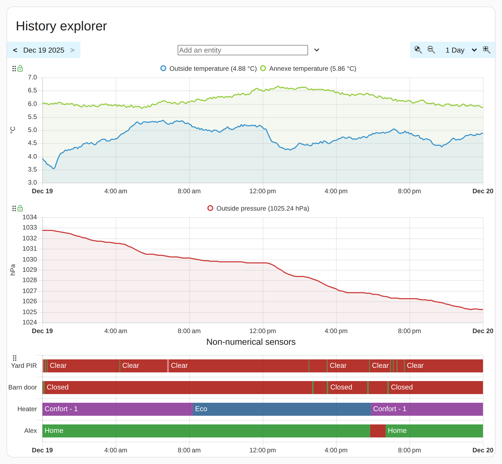
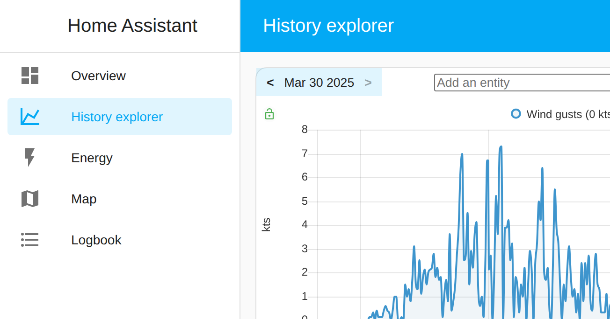
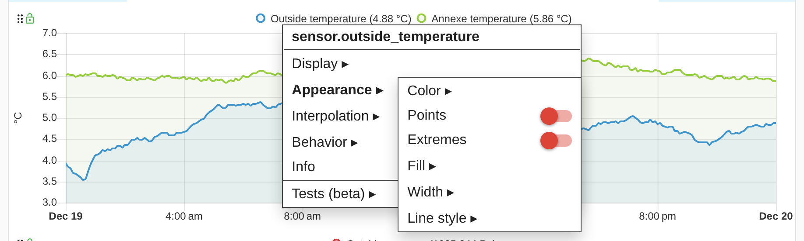
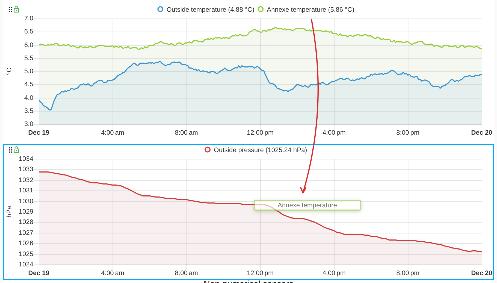
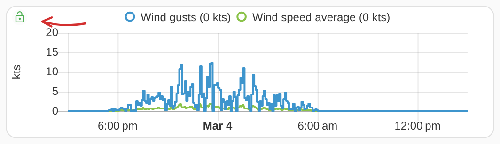
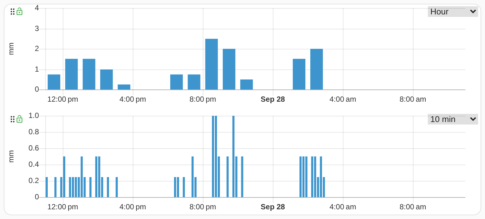
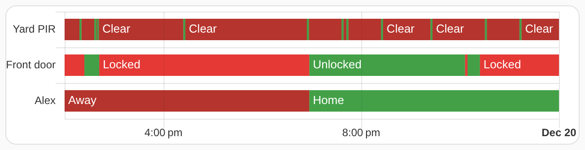
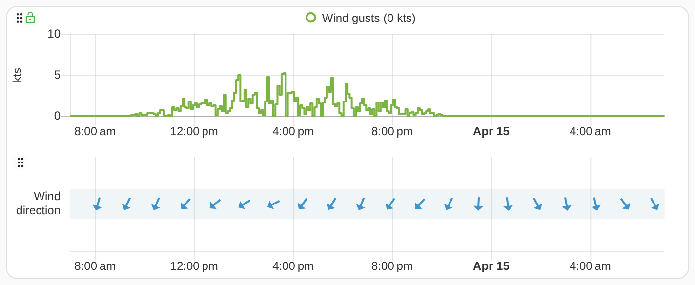

[](https://github.com/hacs/integration)
[](https://github.com/Cook23/history-explorer-card/releases)
[](https://github.com/Cook23/history-explorer-card/stargazers)


<a href="https://buymeacoffee.com/thierry_couquillou" target="_blank"></a>

# History explorer card

> **A custom history card for Home Assistant — fork of [SpangleLabs/history-explorer-card](https://github.com/SpangleLabs/history-explorer-card).**
> 📖 [README_Full.md](https://github.com/Cook23/history-explorer-card/blob/v1.2-dev/README_Full.md) — the complete documentation · What this fork adds: [FORK_DESCRIPTION.md](https://github.com/Cook23/history-explorer-card/blob/v1.2-dev/FORK_DESCRIPTION.md) 🇬🇧 / [FORK_DESCRIPTION_FR.md](https://github.com/Cook23/history-explorer-card/blob/v1.2-dev/FORK_DESCRIPTION_FR.md) 🇫🇷

---

> [!IMPORTANT]
> **The history explorer part of the card is stable; the mini-graph-card part is in beta** — its YAML, `look: mini`, the values over a graph, the aggregation. Feedback is welcome in the [discussions](https://github.com/Cook23/history-explorer-card/discussions) or in an [issue](https://github.com/Cook23/history-explorer-card/issues).

*Developed with Claude Code, which modifies, reviews and tests the card, and runs its automated tests in a real browser against a simulated Home Assistant, with mouse and touch input.*

---

## Overview

A highly interactive history card for Home Assistant. Pan, zoom, and explore the history of the entities across any time range, with full support for line charts, bar charts, timelines and compass arrow graphs.



---

## 📋 Version highlights

- **v1.2.82** — Arrows as long as an entity's value; the fill read indirectly, as the color.
- **v1.2.77** — YAML export of the card, a graph or a curve.
- **v1.2.60** — A steady automatic Y axis; long ranges drawn at once (a year in 0.4 s).
- **v1.2.59** — Time ranges up to 10 years.
- **v1.2.27** — Only what the screen can show is loaded.
- **v1.2.18** — mini-graph-card's YAML read as is.
- **v1.2.15** — Gesture settings; the options menu in submenus.
- **v1.2.9** — Values over a graph, `look: mini`; attributes as curves.
- **v1.2.6** — The graph menu, cut and paste.
- **v1.2.4** — Two Y axes; colors from thresholds or another entity; the info panel everywhere.
- **v1.2.2** — The curve menu in submenus; the tooltip on a click.
- **v1.2.0** — Beta: dragging on touch screens reworked.

📖 [CHANGELOG.md](https://github.com/Cook23/history-explorer-card/blob/v1.2-dev/CHANGELOG.md)

---

## Table of contents

- [Install](#install)
- [Quick configuration](#quick-configuration)
  - [YAML graphs](#yaml-graphs)
  - [YAML export](#yaml-export)
  - [Running as a sidebar panel](#running-as-a-sidebar-panel)
  - [Info panel](#info-panel)
- [Usage](#usage)
  - [Navigation](#navigation)
  - [Tooltip](#tooltip)
  - [Menus](#menus)
  - [Adding entities](#adding-entities)
  - [Managing graphs](#managing-graphs)
  - [Y axis](#y-axis)
  - [CSV export](#csv-export)
- [Detailed configuration](#detailed-configuration)
  - [Time range](#time-range)
  - [Persistence](#persistence)
  - [Graph types](#graph-types)
    - [Lines](#lines)
    - [Bars](#bars)
    - [Timelines](#timelines)
    - [Compass arrows](#compass-arrows)
  - [Colors](#colors)
  - [Long term statistics](#long-term-statistics)
  - [Values over a graph, look: mini](#values-over-a-graph-look-mini)
  - [UI configuration](#ui-configuration)
- [Options](#options)

---

## Install

- **Marketplace** (recommended; HACS before Home Assistant 2026.11): *Settings › Marketplace › Add from link*, `https://github.com/Cook23/history-explorer-card`, then **Install**.
- **Manually**: copy `history-explorer-card.js` into `config/www`, then add the resource `/local/history-explorer-card.js` (*Settings › Dashboards › ⋮ › Resources*, type JavaScript module).

Then reload the page (in the Home Assistant app: *Settings › Companion app › Debugging › Reset frontend cache*) and add the card from *+ Add card*: *History Explorer Card*.

📖 [Install](https://github.com/Cook23/history-explorer-card/blob/v1.2-dev/README_Full.md#install)

---

## Quick configuration

### YAML graphs

Graphs written in the YAML, shown each time the dashboard opens — the entities added from the card come after them; without `graphs:`, every entity is added from the card:

```yaml
type: custom:history-explorer-card
graphs:
  - type: line
    title: Temperatures
    options:
      ymin: -10
    entities:
      - entity: sensor.outside_temperature
        color: '#3e95cd'
      - entity: climate.salon
        attribute: current_temperature   # an attribute; forecast.0.temperature: a sub-attribute
  - type: timeline
    title: Doors and motion
    entities:
      - entity: binary_sensor.door_barn
        name: Barn door
      - entity: binary_sensor.pir_*      # a wildcard
```

An attribute that is a number is shown as a curve, in the unit Home Assistant shows it in (`unit:` to set it), from the history only (Home Assistant keeps no statistics of attributes); anything else as a timeline.

📖 [YAML configuration](https://github.com/Cook23/history-explorer-card/blob/v1.2-dev/README_Full.md#yaml-configuration-for-preconfigured-graphs) · [Attributes](https://github.com/Cook23/history-explorer-card/blob/v1.2-dev/README_Full.md#attributes)

### YAML export

*Export ▸ YAML ▸* (the options menu ▾, a graph's or a curve's menu) copies the settings of the card, the graph or the curve to the clipboard, the menus' choices included:
- *Simplified* — what differs from the defaults;
- *Complete* — everything that applies.

**In Home Assistant's card editor**: set the card up in the preview with its menus, export it from the options menu, and paste it in place of the editor's YAML.

📖 [Exporting the configuration as YAML](https://github.com/Cook23/history-explorer-card/blob/v1.2-dev/README_Full.md#exporting-the-configuration-as-yaml)

### Running as a sidebar panel



The card on a page of its own, in Home Assistant's sidebar:

1. *Settings › Dashboards › Add dashboard › New dashboard from scratch*: a title and an icon, **Add to sidebar** on, then **Create**.
2. Open it, **Edit dashboard**, then edit its view (✏ beside its name): **Layout**: *Panel (single card)*, then **Save**. A view already holding sections keeps its layout: add a view (**+**) with that one instead.
3. **+ Add card**: *History Explorer Card* — it takes the whole page.

📖 [Running as a panel in the sidebar](https://github.com/Cook23/history-explorer-card/blob/v1.2-dev/README_Full.md#running-as-a-panel-in-the-sidebar)

### Info panel

The card can replace the history graph of Home Assistant's more info popup: the switch *Global ▸ Enhanced native history* of the options menu, or `defaultInfoPanel: true`. To have it on every page, not only after a dashboard was opened:

```yaml
# configuration.yaml
frontend:
  extra_module_url:
    - /hacsfiles/history-explorer-card/history-explorer-card.js?hacstag=...   # the URL of the card's resource
```

📖 [Info panel](https://github.com/Cook23/history-explorer-card/blob/v1.2-dev/README_Full.md#info-panel--replacing-the-ha-more-info-popup)

---

## Usage

https://github.com/user-attachments/assets/ccc401af-be63-4838-b540-0079e92ca915

### Navigation

- **Pan** — drag left or right on a graph.
- **Zoom** — the magnifiers − and +, Ctrl + the wheel, or a box drawn on a graph (drag up or down with a mouse, or turn the magnifying glass on).
- **Magnifying glass** — a long press chooses what its box zooms (the time, the Y axis or both); a double-click gets the default range back.
- **Date** — `<` `>` move the window; a click on the date opens a calendar, a double-click goes back to the present.
- **Real time** — a window reaching the present follows it: the curves grow and slide, the present always on the right.
- **Points** — hover a curve to see its nearest value's point; a long press (or a right click) near a curve shows or hides all its points; **Alt** shows every curve's.
- **Touch screen** — a swipe scrolls the page. To drag a label, the ⠿ handle or the Y axis labels: tap, then press again right away and drag. Two fingers zoom (horizontally the time, vertically the Y axis) and pan.
- **Pen** — the tip works as a finger; its button, where the browser passes it on, as a right click.

📖 [Interactive navigation](https://github.com/Cook23/history-explorer-card/blob/v1.2-dev/README_Full.md#interactive-navigation)

### Tooltip


Click near a curve to put it in the tooltip; it then follows the pointer from value to value.

- **Mode** — `selected`: the curves clicked; `nearest`: the value pointed at; `mixed`: both; `all`: every curve's value at that time.
- **Set by** — the screen's width (`tooltip.largeScreen`, `tooltip.smallScreen`), the card's (`tooltip.largeChart`, `tooltip.smallChart`), or *Behavior ▸ Tooltip ▸*.
- **Size** — `tooltip.size`: `full`, `compact`, `slim` or `auto`.

📖 [Tooltip](https://github.com/Cook23/history-explorer-card/blob/v1.2-dev/README_Full.md#tooltip)

### Menus



- **A curve's menu** — a long press (or a right click) on its label: *Display ▸* (its type), *Appearance ▸* (color, points, min/max band, fill, width, line style), *Interpolation ▸*, *Behavior ▸* (tooltip, Y axis lock, separate, merge back, cut, delete), *Export ▸* (its CSV, its YAML).
- **A graph's menu** — a long press on its ⠿ zone: the same for all its curves (*Export ▸* theirs), and *Cut* / *Delete the graph*.
- **The options menu** — the ▾ button beside the entity selector: the same for every curve of the card, *Export ▸* (CSV, YAML), *Card ▸* (back to the YAML's graphs or display), *Global ▸* (the info panel's switch, the gesture settings), *Tests (beta) ▸* (diagnostics: pen events, performance).

A choice made in a menu applies to every curve it concerns: the last one made wins, whatever its level.

The gesture settings (long-press duration, pointer precision, for a mouse or a pen and for a finger; the reading time of a word of a tooltip or a message) apply to every card, on every device:

```yaml
gestures:
  longPress: 500        # ms, mouse and pen
  longPressTouch: 500   # ms, finger
  precision: 8          # px, mouse and pen
  precisionTouch: 12    # px, finger
  readingTimePerWord: 400   # ms per word of a tooltip or a message
```

📖 [Menus](https://github.com/Cook23/history-explorer-card/blob/v1.2-dev/README_Full.md#menus) · [Gesture settings](https://github.com/Cook23/history-explorer-card/blob/v1.2-dev/README_Full.md#gesture-settings)

### Adding entities


- **Search** — type in the entity selector: it filters on the names and the ids (`*` as a wildcard: `*door*`, `sensor.*`).
- **Choose** — an entry, with a click or Enter; for an entity with attributes, its *Value* or one of its attributes.
- **Type** — pick one in the curve menu; the most fitting one is pre-selected (*Timeline*, *Bar*, *Direction* or *Smart* line).

```yaml
recordedEntitiesOnly: true          # only the entities recorded in the database
filterEntities: 'sensor.*energy*'   # or a list; excludeFilterEntities removes matches again
```

📖 [Adding entities](https://github.com/Cook23/history-explorer-card/blob/v1.2-dev/README_Full.md#adding-entities)

### Managing graphs



- **Click** a curve's name to hide or show it; a click on its value opens the entity's dialog.
- **Double-click** a label to take the curve out into its own graph; double-click the chain icon 🔗 of linked graphs to merge them back.
- **Drag** a label to reorder curves, or onto another graph to move the curve there; drag the ⠿ handle to reorder graphs.
- **Cut and paste** — *Cut* in a menu, then 📋 (into a graph) or ↓ / ↑ (a graph below or above) on the ⠿ zones.

```yaml
combineSameUnits: true   # entities with compatible units (W and kW) added to the same graph
```

📖 [Interactive graph management](https://github.com/Cook23/history-explorer-card/blob/v1.2-dev/README_Full.md#interactive-graph-management)

### Y axis



- **Automatic** — the Y axis scales itself (padlock open, green); the padlock locks it (red).
- **Pan and zoom** — drag its labels to pan it; hold **Shift** to drag and zoom it on the graph.
- **Two axes** — a second group of units goes on the right; *Behavior ▸ Y axis* moves a curve to the other axis.

```yaml
graphs:
  - type: line
    options:
      ymin: ~0       # ~: soft, lower where the values go lower
      ymax: 100
      ylock: true    # no pan nor zoom of the Y axis
```

📖 [Y axis scaling](https://github.com/Cook23/history-explorer-card/blob/v1.2-dev/README_Full.md#y-axis-scaling)

### CSV export


The options menu (▾) — every curve —, a graph's menu or a curve's (the info panel's too): *Export ▸ History* or *Statistics*.

```yaml
csv:
  separator: ';'
  timeFormat: 'DD/MM/YYYY HH:mm:ss'
  statisticsPeriod: hour
  exportAttributes: true
  numberLocale: 'en-US'
```

📖 [Exporting data as CSV](https://github.com/Cook23/history-explorer-card/blob/v1.2-dev/README_Full.md#exporting-data-as-csv)

---

## Detailed configuration

### Time range

The time range shown when the card opens, where its window ends, and what the magnifying glass zooms:

```yaml
defaultTimeRange: 4h     # 24h by default; m, h, d, w, o (months), y — 10 years at most
defaultTimeOffset: 1D    # uppercase: snapped — here the current day, from midnight
defaultMagnifierMode: x  # what the magnifying glass's box zooms: x the time, y the Y axis, xy both (default)
```

📖 [Default view and time ranges](https://github.com/Cook23/history-explorer-card/blob/v1.2-dev/README_Full.md#default-view-and-time-ranges)

### Persistence

What is changed on the card — its entities, its graphs' order, its time range, an entity's options — is kept or not:
- the entities added from the UI are kept, on every device — and a card without YAML entities keeps its time range and its graphs' order too;
- the YAML entities show what the YAML says, unless these options say otherwise:

```yaml
enablePersistence: entities           # kept on this device
enableMultidevicePersistence: range   # kept and synced across the user's devices
```

Each takes `range`, `entities`, `order`, `all` or `none` (or a list), and can be set on a YAML entity for its own fields. The last one to speak wins: the YAML, when it changes, or the card.

📖 [Persistence](https://github.com/Cook23/history-explorer-card/blob/v1.2-dev/README_Full.md#persistence)

### Graph types

#### Lines


- `lineMode`: `smart` (the default from the UI: a curve, and a flat dashed line over the silences of a sensor), `curves` (the default in YAML), `lines`, `stepped`.
- `interpolation` (curves and smart): `monotone` (default, never overshoots), `steffen`, `makima`, `catmullrom` (the smoothest), `bspline` (mini-graph-card's).
- `dashMode`: `solid`, `points`, `shortlines`, `longlines`, `pointline` or a pattern `[10, 4]`; `lineWidth`; `fill`.
- `showMinMax: all`: a band between the minimum and the maximum around the curve — `max` or `min`: only its half above or below the curve.
- Angles (unit `°`) are drawn without a jump at 0/360 (`circular`).
- `showUnavailable: true`: gaps where the entity was unavailable; `showMissingState: true`: gaps where a text state isn't in its `stateMap`.

📖 [Line appearance](https://github.com/Cook23/history-explorer-card/blob/v1.2-dev/README_Full.md#line-appearance)

#### Bars



Energy, gas or water that adds up is shown as bars, by *10 min*, *Hour*, *Day*, *Week* or *Month* (the interval selector on the graph), or *Raw*. A bar graph can hold curves too.

```yaml
entityOptions:
  sensor.rain_amount:
    type: bar
    interval: 10m
```

📖 [Bar graphs](https://github.com/Cook23/history-explorer-card/blob/v1.2-dev/README_Full.md#bar-graphs-for-total-increasing-entities)

#### Timelines



A state that isn't a number is shown as a timeline, each state named as Home Assistant names it, in its own color:

```yaml
stateTextMode: auto    # the states' names for their device class (default); raw; hide
stateColors:           # by entity, device class, domain or state
  door.on: blue
  binary_sensor.off: purple
  off: '#ff0000'
```

📖 [Timeline charts](https://github.com/Cook23/history-explorer-card/blob/v1.2-dev/README_Full.md#timeline-charts)

#### Compass arrows



An angle — a wind's direction — is shown as arrows, their length from another entity's value — the wind's speed:

```yaml
entityOptions:
  sensor.wind_bearing:
    type: arrowline
    arrowLength: sensor.wind_speed   # each arrow as long as the wind is fast (0 to 100: a part of the whole length)
    arrowMax: ~50                    # the whole length: 50 at least (a number alone: fixed)
```

📖 [Compass arrow graphs](https://github.com/Cook23/history-explorer-card/blob/v1.2-dev/README_Full.md#compass-arrow-graphs)

### Colors

`color` takes a color, thresholds on the value or on another entity's or attribute's value, or an entity holding the color. `fill` takes the same forms, plus `true`, `false` and `fade`:

```yaml
graphs:
  - type: line
    entities:
      - entity: sensor.heat_pump_power
        color:
          entity: sensor.heat_pump_mode   # without it: thresholds on the value (0: blue, 1.5: red…)
          heat: red
          cool: blue
          default: grey
```

📖 [Colors of curves and bars](https://github.com/Cook23/history-explorer-card/blob/v1.2-dev/README_Full.md#colors-of-curves-and-bars)

### Long term statistics


The card loads what the screen can show — the daily, hourly or 5-minute statistics, or the history, by how long a column of pixels lasts —, so a graph reaches beyond the history's retention and panning and zooming stay smooth.

```yaml
statistics:
  enabled: true    # default
  period: hour     # 5minute, hour, day, week, month
```

📖 [Long term statistics](https://github.com/Cook23/history-explorer-card/blob/v1.2-dev/README_Full.md#long-term-statistics) · [Aggregation](https://github.com/Cook23/history-explorer-card/blob/v1.2-dev/README_Full.md#aggregation)

### Values over a graph, look: mini

- `showState` — each curve's current value, over its graph.
- `showStats` — its minimum, average and maximum over the window shown.
- `look: mini` — the look of mini-graph-card at once; the time can still be panned and zoomed, and any option set on the card wins.

<picture>
  <source media="(prefers-color-scheme: dark)" srcset="https://github.com/Cook23/history-explorer-card/raw/v1.2-dev/images/screenshots/narrow-and-mini-dark.png">
  
</picture>

*Left: a card 168 px wide. Middle and right: `look: mini`, 374 and 168 px wide.*

**Replacing a mini-graph-card**: change its `type` to `custom:history-explorer-card` and add `look: mini`, its other lines kept — its options are read as the card's own.

📖 [Values over a graph](https://github.com/Cook23/history-explorer-card/blob/v1.2-dev/README_Full.md#values-over-a-graph-a-compact-look) · [mini-graph-card compatibility](https://github.com/Cook23/history-explorer-card/blob/v1.2-dev/README_Full.md#mini-graph-card-compatibility)

### UI configuration

The card's look and layout — its header, its colors, its toolbars, its sizes, its cursor line, its time ticks:

```yaml
header: 'My history'   # ' ': none, its room kept; hide: none at all
uimode: dark           # force dark or light mode
cardName: my-card      # required with several cards on the same dashboard
uiColors:
  gridLines: '#ff000040'
uiLayout:
  toolbar: top         # top, bottom, both, hide
cursor:
  mode: all            # the vertical line following the pointer: auto, all, hide
timeTicks:
  density: high        # low, medium, high, higher, highest
```

**A narrow card** (under 300 px wide) stays readable, as mini-graph-card does: the toolbar on several lines, the Y labels inside the plot, smaller text, shortened names, a slim tooltip.

📖 [Configuring the UI](https://github.com/Cook23/history-explorer-card/blob/v1.2-dev/README_Full.md#configuring-the-ui)

---

## Options

Each option can be set on the **card**, in **`entityOptions`**, on a **graph** or on an **entity**; the most specific wins: **entity → graph → `entityOptions` → card**. An option set at fewer levels says so in italics.

```yaml
type: custom:history-explorer-card
lineWidth: 2                  # the card
entityOptions:
  - match: "sensor.*_power"   # entityOptions
    lineMode: lines
graphs:
  - type: line
    options:                  # a graph
      showMinMax: statistics
    entities:
      - entity: sensor.*temperature*
        exclude: '*fridge*'   # an entity
```

Each option in **bold**, its aliases — other names it is read under — in *italics* under it; its default value first in its description.

| Option | Description |
|---|---|
| **`type`**<br>*`graph`* | **Default** automatic, by the entity<br>The graph type: `line`, `bar`, `timeline`, `arrowline` (compass arrows) — *an entity's only* |
| **`colorTransition`**<br>*`color_thresholds_transition`* | **Default** `hard`<br>Between color thresholds: `smooth` blended, `hard` one color per threshold |
| **`lineColor`**<br>*`line_color`* | **Default** not set: each curve its own color<br>A color, or a list giving each curve without its own `color` the one at its place in the graph — *the card and a graph only* |
| **`color`**<br>*`color_thresholds`* | **Default** a color of the automatic palette<br>The curve's color: a color, thresholds on a value, or an entity or attribute holding the color |
| **`fill`**<br>*`show_fill`* | **Default** the curve's color, light<br>The area under the curve: a color, `true` (light), `false` (none), `fade` — or thresholds on a value |
| **`showState`**<br>*`show_state`* | **Default** `false`<br>`true`: its current value written large over the graph |
| **`showIndicator`**<br>*`show_indicator`* | **Default** `false`<br>`true`: a dot in its color before its value over the graph |
| **`showCurrentValues`**<br>*`show_legend_state`* | **Default** `true`<br>`false`: no current value in its legend label |
| **`showName` / `showIcon` / `icon` / `iconImage`**<br>*`show_name` / `show_icon` / — / `icon_image`* | **Default** the graph's `title`; no icon<br>The graph's header: its name, its icon (`mdi:…`), or an image's address — see [Values over a graph](https://github.com/Cook23/history-explorer-card/blob/v1.2-dev/README_Full.md#values-over-a-graph-a-compact-look) — *the card and a graph only* |
| **`alignHeader` / `alignIcon` / `alignState`**<br>*`align_header` / `align_icon` / `align_state`* | **Default** `alignHeader`: `center`; `alignIcon`: `right`; `alignState`: `left`<br>Where the header, the icon and the values over the graph are placed — *the card and a graph only* |
| **`fontSizeHeader` / `fontSize`**<br>*`font_size_header` / `font_size`* | **Default** `fontSizeHeader`: the theme's size; `fontSize`: `100` (%: unchanged)<br>The header's size, in px; the values' size over the graph, in % — *the card and a graph only* |
| **`nameAdaptiveColor` / `iconAdaptiveColor`**<br>*`show_name_adaptive_color` / `show_icon_adaptive_color`* | **Default** `false`<br>`true`: the header in the first curve's current color — *the card and a graph only* |
| **`showStats`**<br>*`show.extrema`, `show.average`* | **Default** `false`<br>Its `min`, `average`, `max` over the window, written over the graph (`true`: all three) |
| **`showStateFor`, `showStatsFor`** | **Default** `all`<br>Which curves the graph's `showState` / `showStats` are for: `all`, or `first` only — *the card and a graph only* |
| **`stateAdaptiveColor`**<br>*`state_adaptive_color`* | **Default** `true`<br>`false`: the values over the graph in the text's color, not their curve's |
| **`lineWidth`**<br>*`width`, `line_width`* | **Default** `2`<br>The line's width, in px |
| **`lineMode`**<br>*`smoothing`* | **Default** `curves` in the YAML, `smart` added from the card<br>How values are joined: `curves`, `lines`, `stepped`, `smart` (curves, silences dashed) |
| **`interpolation`** | **Default** `monotone`<br>The curve's algorithm in `curves` and `smart`: `monotone`, `steffen`, `makima`, `catmullrom`, `bspline` |
| **`dashMode`**<br>*`line_style`* | **Default** `solid`<br>The line's style: `solid`, `points`, `shortlines`, `longlines`, `pointline`, or a dash pattern (`[10, 4]`) |
| **`showLine`**<br>*`show_line`* | **Default** `true`<br>`false`: its points only, no line |
| **`showGraph`**<br>*`show_graph`* | **Default** `true`<br>`false`: not drawn nor in the legend, its value still over the graph |
| **`fixedValue`**<br>*`fixed_value`* | **Default** `false`<br>`true`: its last value drawn flat over the whole window |
| **`showPoints`**<br>*`showSamples`, `show_points`* | **Default** `hover`<br>Dots on the values: `hover` (the one pointed at), `true` (all), `false` (none), or a radius |
| **`sizePoints`** | **Default** the line width + 2 px<br>The dots' diameter, in px |
| **`tooltip.largeScreen`**<br>*`largeScreenTooltip`, `large_screen_tooltip`* | **Default** `mixed`<br>The tooltip on a screen 640 px wide or more: `mixed`, `nearest`, `selected`, `all` |
| **`tooltip.smallScreen`**<br>*`smallScreenTooltip`, `small_screen_tooltip`* | **Default** `selected`<br>The tooltip on a screen narrower than 640 px: `mixed`, `nearest`, `selected`, `all` |
| **`tooltip.largeChart`**<br>*`largeChartTooltip`, `large_chart_tooltip`* | **Default** not set: the screen's tooltip<br>The tooltip in a card 600 px wide or more, instead of the screen's: `mixed`, `nearest`, `selected`, `all` |
| **`tooltip.smallChart`**<br>*`smallChartTooltip`, `small_chart_tooltip`* | **Default** not set: the screen's tooltip<br>The tooltip in a card narrower than 600 px, instead of the screen's: `mixed`, `nearest`, `selected`, `all` |
| **`tooltip.behavior`**<br>*`tooltipBehavior`, `tooltip_behavior`* | **Default** `auto`<br>`tooltip.largeScreen` and `tooltip.smallScreen` set at once; `auto` keeps theirs |
| **`pointsPerHour`**<br>*`points_per_hour`* | **Default** not set: a point per column of pixels<br>Points per hour (`2`: one per half hour), instead of one per column of pixels |
| **`groupBy`**<br>*`group_by`* | **Default** `interval`<br>A point per `interval` (see `pointsPerHour`), per `hour`, or per `date` (day) |
| **`aggregateFunc`**<br>*`aggregate_func`* | **Default** `avg`<br>A group's value: `avg`, `median`, `min`, `max`, `first`, `last`, `sum`, `delta`, `diff` |
| **`showMinMax`** | **Default** `false`<br>A min/max band around the curve: `all`, `max`, `min`, `statistics`, `history`, `false` |
| **`netBars`** | **Default** `false`<br>`true`: bars of a total that can decrease (net metering) |
| **`arrowLength`** | **Default** not set: every arrow its whole length<br>The arrows' length: 0 to 100 %, or an entity giving it, scaled automatically — see [Compass arrows](#compass-arrows) |
| **`arrowMax`** | **Default** automatic: the largest value in the window and around it<br>The value of `arrowLength`'s entity giving the whole length; `~`: at least that |
| **`interval`** | **Default** `hourly`<br>The bars' interval: `10m`, `hourly`, `daily`, `weekly`, `monthly`, `raw` (drawn as curves) |
| **`rounding`**<br>*`decimals`* | **Default** not set: 2 decimals at most<br>The number of decimals shown |
| **`tapAction`**<br>*`tap_action`* | **Default** `more-info`<br>What a click on its value does: `more-info`, `navigate`, `url`, `perform-action`, `call-service`, `none` |
| **`scale`** | **Default** `1`<br>The values multiplied by this factor — see *5 |
| **`yAxis`**<br>*`y_axis`* | **Default** `auto`<br>Its Y axis: `auto`, `left`, `right` (`auto`: a second group of units on the right) |
| **`unit`** | **Default** the entity's own unit<br>The unit shown instead of the entity's — see *5 |
| **`valueFactor`**<br>*`value_factor`* | **Default** `0`<br>The values multiplied by 10 to this power (`-3`: 400 W shown as 0.4) — see *5 |
| **`stateMap`**<br>*`state_map`* | **Default** not set<br>A text state drawn as a curve: each state at its place in the list — see [Text states as a curve](https://github.com/Cook23/history-explorer-card/blob/v1.2-dev/README_Full.md#text-states-as-a-curve) |
| **`hidden`** | **Default** `false`<br>`true`: hidden at first, its legend label struck through |
| **`legendVisible`**<br>*`show_legend`* | **Default** `true`<br>`false`: no legend label; `auto`: a graph's legend only with several labels |
| **`process`** | **Default** not set: the values as they are<br>A JavaScript expression changing each value (`state`) before it's drawn |
| **`circular`** | **Default** automatic: an angle is circular<br>Angles drawn without a jump at 0/360: automatic, `false`, a period, or `2pi` — see *4 |
| **`ymin` / `ymax`**<br>*`lower_bound` / `upper_bound`* | **Default** automatic: fitted to the values<br>The Y axis' bounds when the card opens; `~` and a value: a soft bound — see *6 |
| **`yminRight` / `ymaxRight`**<br>*`lower_bound_secondary` / `upper_bound_secondary`* | **Default** `ymin` / `ymax`<br>The right Y axis' bounds when the card opens; `~` and a value: a soft bound — see *6 |
| **`yrange` / `yrangeRight`**<br>*`min_bound_range` / `min_bound_range_secondary`* | **Default** not set<br>The smallest range the Y axis shows — see *6 |
| **`yScaleSteadiness` / `yScaleSteadinessRight`** | **Default** `50`<br>The automatic Y axis, 0 to 100: 0 follows the values, 100 keeps a steady scale — see *6 |
| **`logarithmic`** | **Default** `false`<br>`true`: a logarithmic Y axis — see *6 |
| **`labelsLeft`**<br>*`show_labels`* | **Default** `true`<br>The left Y axis' labels: `true`, `false`, `hover` (while the pointer is over the graph) — see *6 |
| **`labelsRight`**<br>*`show_labels_secondary`* | **Default** `true`<br>The right Y axis' labels: `true`, `false`, `hover` (while the pointer is over the graph) — see *6 |
| **`ystepSize`**<br>*`ystepsize`* | **Default** automatic: the tightest round step whose labels fit<br>The step between the Y axis' labels — see *6 |
| **`ylock`** | **Default** `false`<br>`true`: the Y axis can't be moved or zoomed by hand — see *6 |
| **`stacked`** | **Default** `false`<br>`true`: the bars stacked, not side by side — see *6 |
| **`barSpacing`**<br>*`bar_spacing`* | **Default** automatic: a small gap on both sides of each bar, by its interval<br>The room between two bars, in px — see *6 |
| **`showTimeLabels`** | **Default** `true`<br>`false`: no time labels under a timeline or arrowline graph — see *6 |
| **`height`** | **Default** `lineGraphHeight` (250), `barGraphHeight` (150)<br>The graph's height, in px — see *1 and *6 |
| **`showGrid`** | **Default** `true`<br>`false`: no grid lines — see *6 |
| **`yLabels`** | **Default** beside the plot — inside on a card narrower than 300 px<br>The Y labels `inside` the plot, or `outside` — see *6 |
| **`defaultTimeRange`**<br>*`hours_to_show`* | **Default** `24h`<br>The time range shown when the card opens — see [Time range](#time-range) — *the card's only* |
| **`defaultMagnifierMode`** | **Default** `xy`<br>What the magnifying glass zooms: `x` the time, `y` the Y axis, `xy` both — *the card's only* |
| **`tooltip.size`**<br>*`tooltipSize`* | **Default** `auto`<br>How much a tooltip shows: `full`, `compact`, `slim`, `auto` (by the card's width) — *the card's only* |
| **`tooltip.showDuration`**<br>*`tooltipShowDuration`* | **Default** `false`<br>`true`: a timeline's or arrowline's tooltip shows how long the state lasted — *the card's only* |
| **`tooltip.showColorsLine` / `tooltip.showColorsTimeline`**<br>*`showTooltipColorsLine` / `showTooltipColorsTimeline`* | **Default** `true`<br>`false`: no color boxes in the tooltips of line and bar graphs / of timelines — *the card's only* |
| **`timeTicks.density`**<br>*`timeTickDensity`* | **Default** `high`<br>How many time labels: `low`, `medium`, `high`, `higher`, `highest` — *the card's only* |
| **`uiColors.gridLines` / `uiColors.cursorLine`**<br>*`uiColors.gridlines` / `uiColors.cursorline`* | **Default** `uiColors.gridLines`: the theme's grid color; `uiColors.cursorLine`: the grid lines' color<br>The grid lines' color / the cursor line's color — *the card's only* |
| **`enablePersistence` / `enableMultidevicePersistence`**<br>*`enable_persistence` / `enable_multidevice_persistence`* | **Default** `none`<br>What the card remembers, on this device / on all the user's devices — see [Persistence](#persistence) — *the card and an entity only* |
| **`labelsVisible`** | **Default** `true`<br>`false`: no names left of a timeline's rows — *the card's only* |
| **`look`** | **Default** not set: the card's own look<br>`mini`: mini-graph-card's look — a set of defaults — see [Values over a graph](#values-over-a-graph-look-mini) — *the card's only* |
| **`entityOptions`** | **Default** not set<br>Options given by entity id, device class, domain or pattern — see *2 — *the card's only* |
| **`filterEntities` / `excludeFilterEntities`** | **Default** `filterEntities`: every entity listed; `excludeFilterEntities`: none excluded<br>The entities the selector lists / those it leaves out (`*` as a wildcard) — see *3 — *the card's only* |
| **`exclude`** | **Default** not set<br>Entities left out of a wildcard `entity:`; a graph's and an entity's combine — see *3 — *a graph and an entity only* |

*1 — `height` on the card: the height of every line and bar graph; `lineGraphHeight` / `barGraphHeight` win over it.

*2 — `entityOptions`: every option but the card's only ones, given once for the entities it targets, by entity id, device class, domain or pattern.

*3 — `filterEntities`, `excludeFilterEntities`, `exclude`: a string or a list of strings, `*` as a wildcard; `exclude` also `{entity: '...'}` — see [Adding entities](#adding-entities).

*4 — `circular`: automatic for an angle (unit `°`, state class `measurement_angle`, an attribute named as a direction); `false` off; a number the period; `2pi` 2π. On an arrowline: a full turn of the arrows.

*5 — `scale` multiplies what is drawn; with `unit`, what is shown too (`scale: 0.001`, `unit: kW` for a power in W). `valueFactor` multiplies both by a power of 10, the unit kept. 📖 [Scaling values](https://github.com/Cook23/history-explorer-card/blob/v1.2-dev/README_Full.md#scaling-values-scale-unit-and-valuefactor)

*6 — an option of the graph itself (its Y axis, its stacking, its bars' spacing, its height, its time labels, its grid, its Y labels): set on an entity or in `entityOptions`, it applies to the graph the entity is shown in; the graph's own value wins.

An option is spelled the same at every level.

📖 [Options](https://github.com/Cook23/history-explorer-card/blob/v1.2-dev/README_Full.md#options) · [full-reference-config.yaml](https://github.com/Cook23/history-explorer-card/blob/v1.2-dev/full-reference-config.yaml) — every option, at every level, with its default
