[](https://github.com/hacs/integration)
[](https://github.com/Cook23/history-explorer-card/releases)
[](https://github.com/Cook23/history-explorer-card/stargazers)


<a href="https://buymeacoffee.com/thierry_couquillou" target="_blank"></a>

# History explorer card

> **A custom history card for Home Assistant — fork of [SpangleLabs/history-explorer-card](https://github.com/SpangleLabs/history-explorer-card)** (itself a fork of the original [alexarch21/history-explorer-card](https://github.com/alexarch21/history-explorer-card), archived March 2024), based on its version 1.0.54.
> 📖 [README.md](https://github.com/Cook23/history-explorer-card/blob/v1.2-dev/README.md) — the short version · [Version highlights](https://github.com/Cook23/history-explorer-card/blob/v1.2-dev/README.md#-version-highlights) · What this fork adds: [FORK_DESCRIPTION.md](https://github.com/Cook23/history-explorer-card/blob/v1.2-dev/FORK_DESCRIPTION.md) 🇬🇧 / [FORK_DESCRIPTION_FR.md](https://github.com/Cook23/history-explorer-card/blob/v1.2-dev/FORK_DESCRIPTION_FR.md) 🇫🇷

---

## Overview

A highly interactive way to view the history of the entities in Home Assistant: it loads only what the screen can show — the daily, hourly or 5-minute statistics, or the history — so that panning and zooming stay smooth.

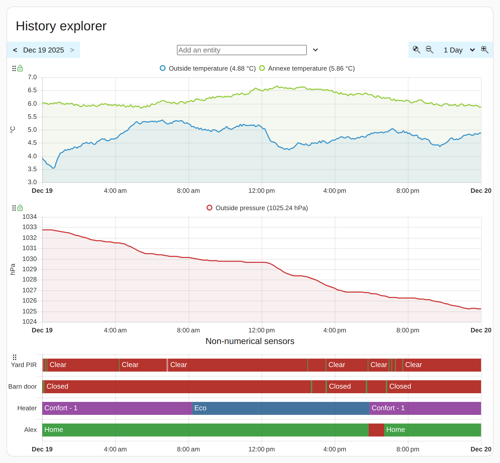

---

## Table of contents

- [Install](#install)
  - [Marketplace (HACS)](#marketplace-hacs)
  - [Manual install](#manual-install)
- [Quick configuration](#quick-configuration)
  - [YAML configuration for preconfigured graphs](#yaml-configuration-for-preconfigured-graphs)
    - [Attributes](#attributes)
  - [Exporting the configuration as YAML](#exporting-the-configuration-as-yaml)
  - [Multiple cards](#multiple-cards)
  - [Info panel — replacing the HA more info popup](#info-panel--replacing-the-ha-more-info-popup)
    - [Enabling the info panel](#enabling-the-info-panel)
    - [On every page of Home Assistant](#on-every-page-of-home-assistant)
    - [What the info panel supports](#what-the-info-panel-supports)
    - [Info panel limitations](#info-panel-limitations)
  - [Running as a panel in the sidebar](#running-as-a-panel-in-the-sidebar)
- [Usage](#usage)
  - [Adding entities](#adding-entities)
  - [Choosing an entity's display type](#choosing-an-entitys-display-type)
  - [Interactive navigation](#interactive-navigation)
  - [Tooltip](#tooltip)
  - [Interactive graph management](#interactive-graph-management)
    - [Grouping multiple entities into a single graph](#grouping-multiple-entities-into-a-single-graph)
    - [Ungrouping a curve](#ungrouping-a-curve)
    - [Linked graphs](#linked-graphs)
    - [Moving curves between graphs](#moving-curves-between-graphs)
    - [Reordering curves within a graph](#reordering-curves-within-a-graph)
    - [Reordering graphs](#reordering-graphs)
    - [The graph menu, cut and paste](#the-graph-menu-cut-and-paste)
    - [Timeline and arrowline entity management](#timeline-and-arrowline-entity-management)
  - [Legend / entity labels](#legend--entity-labels)
    - [Showing current sensor values](#showing-current-sensor-values)
    - [Rounding](#rounding)
  - [Y axis scaling](#y-axis-scaling)
    - [The automatic scale](#the-automatic-scale)
    - [Bounds](#bounds)
    - [Two Y axes](#two-y-axes)
  - [Menus](#menus)
    - [The options menu](#the-options-menu)
  - [Exporting data as CSV](#exporting-data-as-csv)
- [Detailed configuration](#detailed-configuration)
  - [Graph types](#graph-types)
    - [Bar graphs for total increasing entities](#bar-graphs-for-total-increasing-entities)
      - [Bars and curves on the same graph](#bars-and-curves-on-the-same-graph)
      - [Net metering](#net-metering)
    - [Timeline graphs](#timeline-graphs)
      - [Customizing state colors](#customizing-state-colors)
    - [Compass arrow graphs](#compass-arrow-graphs)
  - [Line appearance](#line-appearance)
    - [Line modes](#line-modes)
    - [Curve interpolation](#curve-interpolation)
    - [Smart mode: silences shown as flat dashed plateaus](#smart-mode-silences-shown-as-flat-dashed-plateaus)
    - [Circular values (angles)](#circular-values-angles)
    - [Line stroke style](#line-stroke-style)
    - [Displaying individual samples](#displaying-individual-samples)
    - [Showing the min/max statistical range](#showing-the-minmax-statistical-range)
    - [Text states as a curve](#text-states-as-a-curve)
    - [Line graphs and unavailable data](#line-graphs-and-unavailable-data)
  - [Colors of curves and bars](#colors-of-curves-and-bars)
  - [Values over a graph, a compact look](#values-over-a-graph-a-compact-look)
  - [mini-graph-card compatibility](#mini-graph-card-compatibility)
    - [Replacing mini-graph-card](#replacing-mini-graph-card)
  - [Default view and time ranges](#default-view-and-time-ranges)
  - [Long term statistics](#long-term-statistics)
  - [Data decimation and aggregation](#data-decimation-and-aggregation)
    - [Data decimation](#data-decimation)
    - [Aggregation](#aggregation)
  - [Scaling values: scale, unit and valueFactor](#scaling-values-scale-unit-and-valuefactor)
  - [Custom data processing functions](#custom-data-processing-functions)
  - [Auto refresh](#auto-refresh)
  - [Configuring the UI](#configuring-the-ui)
    - [Gesture settings](#gesture-settings)
    - [Header text](#header-text)
    - [Dark mode](#dark-mode)
    - [Customizing the color of UI elements](#customizing-the-color-of-ui-elements)
    - [The cursor line](#the-cursor-line)
    - [Changing the UI layout](#changing-the-ui-layout)
    - [Graph sizes](#graph-sizes)
    - [A narrow card](#a-narrow-card)
    - [The clock](#the-clock)
    - [Changing the horizontal time tick density](#changing-the-horizontal-time-tick-density)
  - [Persistence](#persistence)
    - [What is kept, and where](#what-is-kept-and-where)
    - [Enabling persistence (`enablePersistence` / `enableMultidevicePersistence`)](#enabling-persistence-enablepersistence--enablemultidevicepersistence)
    - [Persistence for specific entities](#persistence-for-specific-entities)
- [Options](#options)
  - [Entity options](#entity-options)
    - [Pattern-based entity options](#pattern-based-entity-options)
      - [Priority rules](#priority-rules)
  - [The same options at every level](#the-same-options-at-every-level)
  - [Complete list of options](#complete-list-of-options)
    - [Graph and entity options](#graph-and-entity-options)
    - [Curve and graph options](#curve-and-graph-options)
    - [Color options](#color-options)
    - [Value and header options](#value-and-header-options)
    - [Y axis options](#y-axis-options)
    - [Tooltip options](#tooltip-options)
    - [Data options](#data-options)
    - [Card options](#card-options)
    - [CSV export options](#csv-export-options)
    - [Gesture options](#gesture-options)
  - [Full configuration reference](#full-configuration-reference)

---

## Install

### Marketplace (HACS)

Home Assistant 2026.11 or later; on an older version, [HACS](https://hacs.xyz): *HACS › ⋮ › Custom repositories*, the same link, type *Dashboard*.

- **Marketplace** — *Settings › Marketplace*; the first time, accept its warning.
- **Add from link** (top right) — **GitHub link**: `https://github.com/Cook23/history-explorer-card`, then **Add**. The first time, Home Assistant asks to connect GitHub: enter the code it shows on GitHub, approve.
- **Install** — select *history-explorer-card* in the list (type *Dashboard*), then **Install**, and **Install** again.
- **Reload** — reload the page in the browser; in the Home Assistant app: *Settings › Companion app › Debugging › Reset frontend cache*.
- **Card** — edit a dashboard, **+ Add card**, search *History Explorer Card*.

The card's dashboard resource is added by itself (resources managed in YAML: the install dialog shows the one to add), and its new versions are shown as updates.

### Manual install

- **Copy** — `history-explorer-card.js` (from the [releases](https://github.com/Cook23/history-explorer-card/releases)) into the `config/www` folder.
- **Resource** — *Settings › Dashboards › ⋮ › Resources › Add resource*: **URL** `/local/history-explorer-card.js`, **Resource type** *JavaScript module*, then **Create** (see Home Assistant's [Registering resources](https://developers.home-assistant.io/docs/frontend/custom-ui/registering-resources)).
- **Reload** — reload the page in the browser; in the Home Assistant app: *Settings › Companion app › Debugging › Reset frontend cache*.
- **Card** — edit a dashboard, **+ Add card**, search *History Explorer Card*.

---

## Quick configuration

### YAML configuration for preconfigured graphs

YAML configuration is optional: it keeps a set of predefined entities, shown each time the dashboard opens:

```yaml
type: custom:history-explorer-card
graphs:
  - type: line
    entities:
      - entity: sensor.outside_temperature
        color: '#3e95cd'
        fill: rgba(151,187,205,0.15)
      - entity: sensor.annexe_temperature
        color: '#ee3452'
        fill: rgba(0,0,0,0)
  - type: line
    entities:
      - entity: sensor.outside_pressure
        color: '#3ecd95'
        fill: rgba(151,205,187,0.15)
  - type: timeline
    title: Non-numerical sensors
    entities:
      - entity: binary_sensor.pir_yard
        name: Yard PIR
      - entity: binary_sensor.door_barn
        name: Barn door
      - entity: input_select.qubino2_3
        name: Heater
      - entity: person.alex

```

The same entity (or attribute) written several times in the YAML is a curve each time — in several graphs, or in one (mini-graph-card's way of showing a sensor's highest, lowest and mean values, each with its `aggregateFunc`) —, each with its own options, saved on its own. From the card, a second curve of an entity already shown is created after a choice (see [Adding entities](#adding-entities)); a curve dropped or pasted onto a graph already showing it is refused, saying so.

**Wildcards** — an `entity:` with `*` adds every matching entity, in natural alphabetical order (`sensor.power_2` before `sensor.power_10`). Here, every sensor with `temperature` in its name, except those with `fridge` in theirs and `sensor.cpu_temperature`:

```yaml
type: custom:history-explorer-card
graphs:
  - type: line
    entities:
      - entity: sensor.*temperature*
        exclude:
          - entity: '*fridge*'
          - entity: sensor.cpu_temperature
        fill: rgba(0,0,0,0)
```

`exclude` also accepts plain strings, a single string, or a mix of both forms — these are all equivalent to the list above:

```yaml
        exclude: '*fridge*'          # single string
        exclude:                     # list of plain strings
          - '*fridge*'
          - sensor.cpu_temperature
        exclude:                     # mixed forms
          - '*fridge*'
          - entity: sensor.cpu_temperature
```

The same string/list/object forms are accepted by `filterEntities` and `excludeFilterEntities` (see [Adding entities](#adding-entities)). `exclude` can also be set once under a graph's `options:` to apply to every wildcard entity in that graph — see [Complete list of options](#complete-list-of-options).

A more complete example — the card's own options, `entityOptions` and several graphs:

```yaml
type: custom:history-explorer-card
cardName: advanced-history
uimode: dark
stateColors:
  person.home: blue
  person.not_home: yellow
header: 'My sample history'
entityOptions:
  - match: "sensor.*_power"
    lineMode: lines
    dashMode: [10, 4]
    lineWidth: 2
    showPoints: true
  - match: "sensor.temperature*"
    lineMode: curves
    color: '#3e95cd'
    showMinMax: statistics
graphs:
  - type: line
    options:
      ymin: -10
      ymax: 30
      showTimeLabels: true   # false: no time labels on this graph
    entities:
      - entity: sensor.outside_temperature
        color: '#3e95cd'
        fill: rgba(151,187,205,0.15)
        lineWidth: 4
        lineMode: stepped
      - entity: sensor.annexe_temperature
        color: '#ee3452'
        fill: rgba(0,0,0,0)
        lineMode: lines
        hidden: true         # hidden when the card opens
  - type: line
    entities:
      - entity: sensor.outside_pressure
        color: --my-special-green
        fill: rgba(151,205,187,0.15)
  - type: timeline
    title: Non-numerical sensors
    entities:
      - entity: binary_sensor.pir_yard
        name: Yard PIR
      - entity: binary_sensor.door_barn
        name: Barn door
      - entity: input_select.qubino2_3
        name: Heater
  - type: arrowline
    title: Wind bearing
    entities:
      - entity: sensor.wind_bearing
        color: black
        fill: rgba(0,0,0,0.2)
```

#### Attributes

`attribute:` shows one of an entity's attributes instead of its state — the same entity can be shown several times, its state and some of its attributes. Writing the attribute after the entity id is the same: `entity: climate.salon.current_temperature`.

- **Drawing** — a number is shown as a curve, anything else as a timeline; a number followed by a text that isn't one (`45.2 %`, `21.5 °C`, `3 days` — not a time, a date or a range) is that number, in that unit.
- **Name** — the entity, a colon and the attribute: `salon : Current temperature`, the colon telling an attribute from an entity (`name:` to change it).
- **Unit** — `unit:` always wins; otherwise the unit the value holds (`45.2 %`), else the one Home Assistant shows it in (the table below), else an attribute `X_unit`, as some integrations give them: the unit of every attribute with `X` in its name (`speed_unit: km/h` for `speed` and `max_speed`; the longest `X` when several match);
- **History** — Home Assistant gives an attribute no long-term statistics: an attribute's curve only covers what the history keeps. Its history is asked with every change of the entity's attributes (Home Assistant otherwise leaves out the changes of an attribute alone), only for the entities that have an attribute shown.
- **Sub-attributes** — in a dictionary or a list, written by their path, as mini-graph-card writes it: `attribute: forecast.0.temperature` (the attribute, then each level's key or index); named after each level (`Villeveyrac : Forecast › 0 › Temperature`), in the unit of its last name (`temperature`).
- **Entity selector** — an attribute holding sub-attributes is marked ▸: a click shows them in the same submenu, over the attributes (← or Escape: the level before; the entity's line again: its attributes). A list of plain values (`hvac_modes`) is not offered: a set of choices, nothing to follow.

**The units Home Assistant shows** (the tables of its frontend):

| Entity | Attributes | Unit |
|---|---|---|
| A weather entity | `temperature`, `apparent_temperature`, `dew_point`, `templow` | Its `temperature_unit` |
| A weather entity | `wind_speed`, `wind_gust_speed` | Its `wind_speed_unit` |
| A weather entity | `pressure`, `visibility`, `precipitation` | Its `pressure_unit`, `visibility_unit`, `precipitation_unit` |
| A weather entity | `humidity`, `cloud_coverage`, `precipitation_probability` | % |
| A weather entity | `wind_bearing` | ° (Home Assistant gives none) |
| Any other entity | `temperature`, `current_temperature`, `target_temperature`, `target_temp_high`, `target_temp_low`, `target_temp_step`, `min_temp`, `max_temp` | The system's temperature unit |
| A climate, a humidifier | `humidity`, `current_humidity`, `min_humidity`… | % |
| A cover, a valve | `current_position` (a cover's `current_tilt_position` too) | % |
| A fan | `percentage` | % |
| A sensor | `battery_level` | % |
| A light | `brightness` | %, converted from 0–255 |
| A media player | `volume_level` | %, converted from 0–1 |
| A light | `color_temp_kelvin`, its min and max | K |
| A light | `color_temp`, `min_mireds`, `max_mireds` | mired |
| The sun | `azimuth`, `elevation` | ° |

A value converted into % is in % everywhere: the curve, the entity selector, the tooltip.

```yaml
type: custom:history-explorer-card
graphs:
  - type: line
    title: Salon
    entities:
      - entity: climate.salon
        attribute: current_temperature
        unit: °C
      - entity: climate.salon
        attribute: temperature          # the setpoint
        unit: °C
  - type: timeline
    entities:
      - entity: climate.salon           # its state: heat, off…
      - entity: climate.salon
        attribute: hvac_action          # heating, idle…
```

### Exporting the configuration as YAML

*Export ▸ YAML ▸* copies to the clipboard, as YAML, the settings of what its menu acts on — what the YAML says and what was chosen in the menus: from the options menu, the whole card; from a graph's menu, that graph (an item of `graphs:`); from a curve's menu (the info panel's too), that curve (an item of a graph's `entities:`). Pasted into another card's YAML, it makes there a graph or a curve defined statically, shown as it is here. A message says it's copied — or that the clipboard refused it.

It's written in the card's own syntax: each option under its own name, never a synonym (`lineWidth`, not `width` or `line_width`), a bar interval by its name (`daily`, `raw`). What is kept on each device is left out: a curve hidden, its points, the tooltip's modes, the Y axes locked (see [What is kept, and where](#what-is-kept-and-where)). Each level — the card, a graph, a curve — writes what it holds that the level above it gives otherwise; the first level copied, what differs from the option's default:
- **Simplified** — what is necessary: those only. The card's `look:` and `entityOptions` are written as its YAML says them: the options they give are left to them. A curve's color is written when it was set (in the YAML, `entityOptions` or the menu), not when it's automatic.
- **Complete** — what is useful to change it, the options at their default value included: those, plus, at each level, the options the look sets, and the ones any of its neighbours writes — the others of its level in the export: the card exported, every graph and every curve of the card; a graph, its curves; a curve alone, none —, each with its own value. No `entityOptions`: each curve writes what they give it.

**In Home Assistant's card editor** — it helps write a card's YAML: set the card up in the editor's preview with its menus (the entities added, their display, their look), export it from the options menu (▾), and paste it in place of the YAML there — it holds `type:` and `cardName:` too. In the editor's window, the card keeps room under itself for its menus to open; on the dashboard being edited, none.

```yaml
# Export ▸ YAML ▸ Simplified, from a curve's menu: its style chosen in Appearance ▸
entity: sensor.power
dashMode: points
lineWidth: 3
```

### Multiple cards

Several history explorer cards can be on the same view, or on several views and dashboards, each with its own configuration. To keep their configurations apart, each card needs a name of its own (`cardName`): a card added from the UI gets a random one, which can be changed; a card written in YAML needs one written for it.

With a single history explorer card, the name is optional.

The name is the key of what the card keeps, on the device and in the user's Home Assistant account (see [Persistence](#persistence)): two cards of the same name share it; a card renamed starts again from its YAML.

```yaml
type: custom:history-explorer-card
cardName: history-card-5
```

### Info panel — replacing the HA more info popup

The card can replace the history graph in Home Assistant's more info popup — the one a click on an entity opens anywhere on a dashboard. Turned on, that popup shows the history explorer card instead of Home Assistant's history graph, with the same interactive experience (zoom, pan, Y axis control) inside the popup.

#### Enabling the info panel

The info panel is turned on or off with the switch *Global ▸ Enhanced native history* of the options menu (see [The options menu](#the-options-menu)), or from the YAML with `defaultInfoPanel` — the last one to speak wins: the YAML takes over only when its value changes (removed, the panel off). `infoPanel:` holds the panel's own options — the card's options, applied to its graphs:

```yaml
type: custom:history-explorer-card
defaultInfoPanel: true   # the info panel on
infoPanel:               # its own options
  lineMode: lines
```

Once on, a click on any entity anywhere on a dashboard opens the more info popup with the history explorer graph instead of Home Assistant's history chart.

Switching the info panel on or off applies the next time an entity's popup shows its history, without reloading the page. The choice is saved for the Home Assistant user: a browser or a device where no card was shown yet uses it too.

#### On every page of Home Assistant

The card's file is a dashboard resource: Home Assistant only loads it once a dashboard is shown. A page opened directly in a new tab — *Settings › Entities*, *History*, *Logbook*… — shows Home Assistant's own history in an entity's popup until a dashboard has been opened. To have the info panel on every page, load the card's file as soon as Home Assistant starts, in `configuration.yaml`:

```yaml
frontend:
  extra_module_url:
    - /hacsfiles/history-explorer-card/history-explorer-card.js?hacstag=...
```

Restart Home Assistant, then reload the page.

**About `?hacstag=…`** — it isn't required: `/hacsfiles/history-explorer-card/history-explorer-card.js` alone works. It's a tag HACS adds to the URL of the card's dashboard resource, and changes at each update, so that browsers fetch the new version. Using **exactly** that URL (*Settings → Dashboards → ⋮ → Resources*), tag included, is still the better choice:
- the browser runs a file only once per URL: with the same URL as the resource, the card's file is loaded once; with another one, it's loaded twice — harmless (the card is made for it), only heavier;
- with the tag, the browser fetches the new version after an update; without it, it may keep using a copy from its cache for the info panel until the page is fully reloaded.

After each card update through HACS, copy the resource's URL into `extra_module_url` again.

#### What the info panel supports

The info panel shows one interactive line, bar, timeline or arrowline graph of the entity, drawn as the card draws it, with the card's interactions:

- **Pan** — a drag moves the graph through time;
- **Zoom** — the range selector, Ctrl + the wheel, or, with a mouse, a drag mostly up or down: the elastic box, the time and the Y axis zoomed to it;
- **Y axis** — its padlock, and a drag on the left label area to pan it (the pointer turns to `↕`);
- **Touch screen** — two fingers: a vertical pinch zooms the Y axis, a horizontal one the time, both moving together pan;
- **Tooltip** — on a click or a tap, then following the pointer;
- **Curve menu** — its *Display*, *Appearance* and *Interpolation* submenus, through the *Curve ▾* link (when the entity's state is a number); what is chosen there isn't saved;
- **Long term statistics** — the graph goes on past the history's retention.

Opened from a curve of a card — a click on its value, or *Info* in its menu —, the panel shows that curve as it looks on the card: its display type, its interpolation, its color, its fill, its line's width and style, its points and its extremes. Opened from anywhere else, the graph type and display options for the entity are taken from the card's `entityOptions` configuration, so an entity configured as `arrowline` in the YAML appears as an arrowline in the info panel too.

#### Info panel limitations

- **One entity** — the panel shows one entity's graph: no ungrouping, no curve dragged, no graph reordered;
- **Time range** — the card's `defaultTimeRange`.

### Running as a panel in the sidebar

The history explorer can be run as a sidebar panel: the card on a page of its own, in Home Assistant's sidebar.

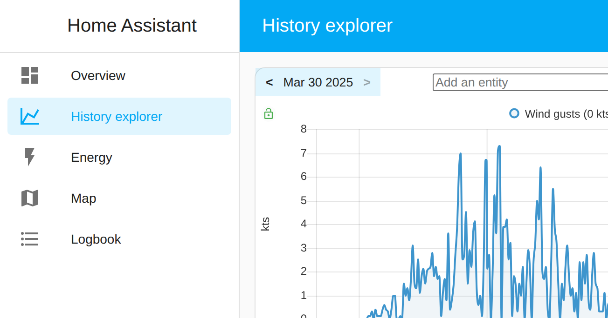

- **Dashboard** — *Settings › Dashboards › Add dashboard › New dashboard from scratch*: a title and an icon, **Add to sidebar** on, then **Create**.
- **View** — open it, **Edit dashboard**, then edit its view (✏ beside its name): **Layout**: *Panel (single card)*, then **Save**. A view already holding sections keeps its layout: add a view (**+**) with that one instead.
- **Card** — **+ Add card**: *History Explorer Card*; it takes the whole page.

---

## Usage

### Adding entities

The card's entities are written in the YAML, or added and removed from the card itself — both together: the YAML's first, shown each time the dashboard opens, then the ones added from the card. Those are kept in the Home Assistant user's account and restored on every device (the browser's storage as a fallback).

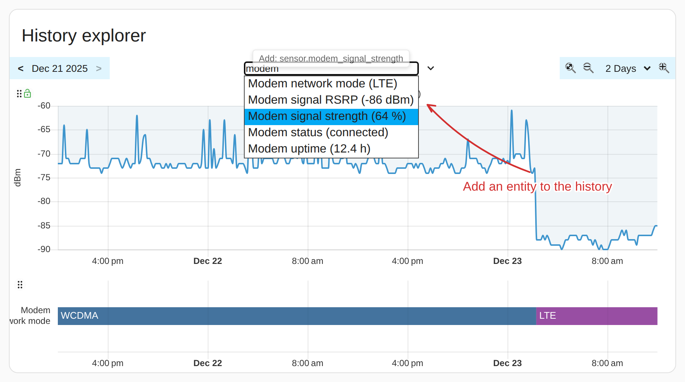

To manage every entity from the UI, the YAML has no graphs — it can still hold the card's other settings.

```yaml
type: custom:history-explorer-card
graphs:
```

By default the entity list offers every entity Home Assistant knows — many, on a large installation. The card can offer only the entities actually recorded in the database instead: that asks the database, a few seconds on a large installation, the card usable meanwhile; the list becomes available as soon as it's loaded. In the YAML:

```yaml
type: custom:history-explorer-card
recordedEntitiesOnly: true
```

The entity selector shows the friendly names, and filters on the names and the ids at once; the id is shown in a tooltip on selection. With the keyboard:

- **ArrowUp / ArrowDown** — moves through the list;
- **Enter** — chooses the highlighted entry (with a `*` pattern, the first Enter selects every match, a second one adds them);
- **Escape** — closes the list and clears the field.

Clicking an entry chooses it, as Enter does.

An entity can also be shown through one of its attributes (a thermostat's measured temperature, its setpoint, what it's doing…):
- **The submenu** — an entity with attributes that can be shown opens a submenu first, over the list, level with the entity (in bold while it's open): *Value* (its own state) first, pre-selected — Enter takes it at once —, then each attribute with its current value;
- **Keys** — the arrows move through it, Enter or a click chooses, ← or Escape goes back to the list;
- **Without attributes** — the entity goes straight to the curve menu; a wildcard pattern adds the entities' states only.

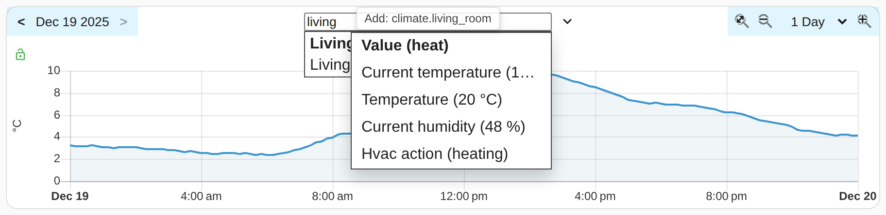

The attributes offered hold a number, a text or a yes/no — or a dictionary, or a list of dictionaries (a forecast), holding some: marked ▸, a click opens them in a submenu over the attributes (← or Escape closes it). Not offered, though any of them can still be written in the YAML (`attribute:`):
- a list of plain values (`hvac_modes`: a set of choices);
- Home Assistant's own (name, unit, icon, classes…);
- a unit: an attribute `X_unit` (`temperature_unit`, `pressure_unit`…) — the attributes are shown in it (see [Attributes](#attributes));
- a reference to something else: an entity (`source: sensor.x`) or a web address (`release_url: https://…`);
- a version or an update (`installed_version`, `latest_version`, `auto_update`);
- a setting, a limit or a description of the entity (`display_precision`, `min_temp` / `max_temp`, `min` / `max` / `step`, `manufacturer`, `model`, `serial_number`, `code_format`…);
- a date, with or without its time (`last_triggered`, `next_rising`, `last_seen`…).

Choosing an entity (a click, or Enter) doesn't add it right away: the curve menu opens first, the most fitting type pre-selected — line (*Smart*, *Curve*, *Straight* or *Stepped*), *Bar*, *Direction* or *Timeline*.
- **Nothing added before a type is picked** — the choice sets the type and adds the entity, in one step;
- **Always opened** — even for an entity whose state isn't a number (on/off, text…): it then only offers *Timeline*, to check before adding.

The full behavior — the long-press on existing labels, the wildcard's *Default* — in [Choosing an entity's display type](#choosing-an-entitys-display-type) below.

The entity selector accepts the `*` wildcard, to add every matching entity at once: the matches are shown in bold in the list, a first Enter selects them all, a second one opens the curve menu for the whole batch (see below):

```
person.*      — every entity of the person domain
*door*        — every entity with 'door' in its name, whatever its domain
sensor.*door* — every sensor with 'door' in its name
*             — every entity of the list
```

`filterEntities` narrows the list, with the same wildcards:

```yaml
type: custom:history-explorer-card
filterEntities: 'binary_sensor.*'   # only the binary sensors in the list
filterEntities:                     # or several patterns: an entity matching any of them is listed
  - '*power*'
  - 'sensor.*energy*'
```
`excludeFilterEntities` leaves out again some of `filterEntities`' matches, with the same syntax — one or two entities a broad pattern picks up:

```yaml
filterEntities: '*power*'
excludeFilterEntities:
  - 'sensor.power_supply_test'
```

The entities added from the card are removed one by one by clicking twice the `×` close button at the top right of their graph — a round button drawn over the graph, like the handle: a first click turns it into a red cross in a red circle for one second, a second click during that second removes the graph — or all together with *Card ▸ Default graphs* in the [options menu](#the-options-menu).

### Choosing an entity's display type

An entity whose current state can be read as a number can be shown as a line (*Smart*, *Curve*, *Straight* or *Stepped*), as bars (*Bar*), as direction arrows (*Direction*, the `arrowline` type) or as a timeline (*Timeline*); any other entity only as a timeline.

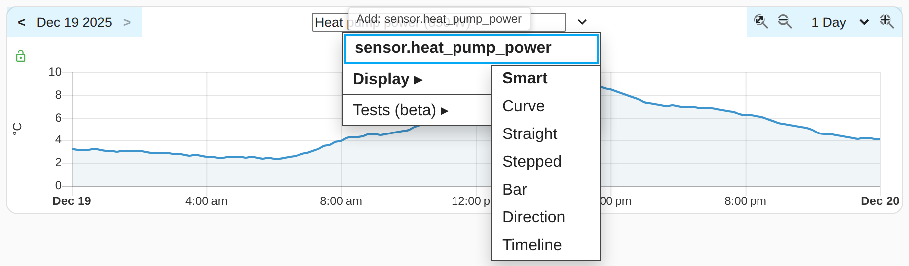

The curve menu's items each open their submenu over the menu, level with it — its right edge on the menu's right edge; the item whose submenu is open is in bold:
- **Display ▸** — open as soon as the menu opens: *Smart*, *Curve*, *Straight*, *Stepped*, *Bar*, *Direction*, *Timeline*;
- **Appearance ▸** — how an entity shown looks, for a curve or a bar; for an arrowline's row, *Color*, *Fill* and *Length* only; for a timeline's row, *Fill* only:
  - *Color ▸* — *Automatic*: the color it's given when it's added (its configuration's, else the one of what it measures — see [Colors of curves and bars](#colors-of-curves-and-bars)), in bold when it has it; *Choose…*: the browser's own color picker, the curve's color preselected, opened in the middle of the screen (Firefox on Windows opens the system's own, where Windows places it); the color chosen is the curve's own (`color`), a fill of its color following it — for a bar too. *Entity ▸*: the color from an entity (see below);
  - *Points ▸* — the curve's samples' dots (`showPoints`), a list: *None* (`false`), *Hovered* (`hover`), *All* (`true`) — see [Displaying individual samples](#displaying-individual-samples);
  - *Extremes ▸* — its min/max band (`showMinMax`) — an arrowline's: its sectors —, a list: *None*, *All*, *Maximum*, *Minimum*, *Statistics*, *History* (see [Showing the min/max statistical range](#showing-the-minmax-statistical-range), [Compass arrow graphs](#compass-arrow-graphs));
  - *Fill ▸* — *None* (`fill: false`), *Fade* (`fill: fade`), *Light* (its color, light: `fill: light`), *Solid* (its color: `fill: solid`), *Entity ▸* (see below);
  - *Width ▸* — 1 to 5 px (`lineWidth`);
  - *Line style ▸* — *Solid*, *Dots*, *Short dashes*, *Long dashes*, *Dash-dot* (`dashMode`);
  - *Length ▸* — an arrowline's arrows' length (`arrowLength`): *Entity ▸* (see below);

  - *Entity ▸* (under *Color*, *Fill* and *Length*) — the option read from an entity or one of its attributes, in three steps:
    1. the entity — its field searches as the entity selector does: the same list, filtered as it's typed, `filterEntities` and `excludeFilterEntities` applied; an entity with attributes opens them (▸);
    2. its value or an attribute;
    3. *Value* — the option is what it holds (a color, a fill, a length) — or *Thresholds ▸* — the option given by thresholds on its value (the curve's own entity: on the curve's value, saved without `entity`):
       - each threshold — `≥ 20` for a number, `= heat` for a state —, its submenu: its value, and what it gives (a color: *Choose…*; a fill: its list; a length: 0 to 100);
       - *Default ▸* — what applies when no threshold does;
       - *+ Add ▸* — a value typed (a number: a threshold; a text: a state), or one of the entity's known states;
       - *Blend* — a switch, for a color's number thresholds on the curve's own value (`colorTransition: smooth`);
       - a long press on a threshold deletes it;

    *Entity ▸* is in bold when the option is read from an entity, the entity's *Value* or *Thresholds ▸* too;

  each list in a submenu over *Appearance* (← or Escape closes it), the value in use in bold — none when the curve has one the list doesn't hold (a fill of another color, a width of 1.5 px, dashes of its own). A choice is applied at once and saved with the entity as the matching option, as the interpolation is — a YAML entity's, when its options are saved (see [Enabling persistence](#enabling-persistence-enablepersistence--enablemultidevicepersistence)); the last one to speak, the menu or the YAML, wins;
- **Interpolation ▸** — for a curve shown in *Smart* or *Curve*: how the curve is drawn between its values (see [Curve interpolation](#curve-interpolation)), the algorithm in use in bold; the choice is saved with the entity;
- **Behavior ▸**:
  - *Tooltip ▸* — *Selected*, *Nearest*, *Mixed*, *All* (see [Interactive navigation](#interactive-navigation));
  - *Y axis ▸* — *Left*, *Right* (see [Two Y axes](#two-y-axes)); *Locked*, a switch: its graph's padlock;
  - opened by a long-press on a label, also *Separate* (the entity taken out into its own graph, as a double-click on its label), *Merge back* (a linked graph put back into the one above, as a double-click on the chain icon), *Cut* (the entity moved to another graph, as a drag — see [The graph menu, cut and paste](#the-graph-menu-cut-and-paste)), *Delete* (the entity removed from the card);
- **Export ▸** — *History* and *Statistics ▸* (by the period chosen), as the [options menu's](#exporting-data-as-csv), for this entity alone, and *YAML ▸* (*Simplified*, *Complete*): its curve's entry (see [Exporting the configuration as YAML](#exporting-the-configuration-as-yaml)) — in the info panel's curve menu too.

The curve menu opens:

- **Right after a new entity is chosen** in the list (a click, or Enter) — always, even when *Timeline* is the only choice, to check before it's added. Nothing is added to the graph or to persisted configuration until a type is picked — the choice both defines the type and performs the creation in the same action. The most fitting type is pre-selected in bold in *Display* — Enter right away adds it, the arrow keys first highlight it and then move through the other choices:
  - a state that isn't a number (on/off, text…) — timeline, the only possible display (the menu offers nothing else);
  - the entity's own `entityOptions` `type` / `lineMode`, when set;
  - an angle (`circular`: unit exactly `°`, or state class `measurement_angle`) — direction arrows;
  - a quantity that only adds up (energy, gas, water, volume: state class `total_increasing`, or `total` with such a device class or unit) — bar;
  - no state class, no unit and a state that isn't a number — timeline (a state telling nothing now, `unavailable` or `unknown`: the last state of the entity the card has already loaded that tells something takes its place — a number, not a timeline; none loaded, no state class and no unit are enough) — the same rule for a YAML entity without a `type`. A `unit_of_measurement` of `unknown`, in any case, is no unit: none is named so;
  - any other measurement — line, in smart mode (or in the card's own `lineMode` when it's set: `lineMode: curves` at the card level pre-selects *Curve*).
- **On a long-press** (or a right click) of a legend label on a line/bar graph, or of an entity label on a timeline/arrowline graph — to change the type, the look or the layout of an entity that's already added.
- **After *Create a second curve*** — selecting an entity (or attribute) that's already shown says so, outlines its graphs, and offers a choice under the field: *Cancel*, pre-selected (Enter, Escape or a click elsewhere cancel), or *Create a second curve* — the curve menu then opens as for a new entity, and the curve is added in a graph of its own.

For a **wildcard match** (multiple new entities added at once), *Display* gets an extra **"Default"** entry at the top, pre-selected by default:
- **Default** — each matched entity created with its own type, detected as if it had been added on its own;
- **Any other type** — applied to every entity of the batch, except an entity whose state isn't a number, always a timeline. When no entity of the batch has a number as its state, the menu only offers *Timeline*.

**Keyboard** — in a submenu, ArrowUp / ArrowDown move a highlight between the options, from the pre-selected one; Enter confirms — at once, the pre-selected or default option.

The type chosen is kept as everything added from the card: in the Home Assistant user's account, on every device.

In the [info panel](#info-panel--replacing-the-ha-more-info-popup), the *Curve ▾* link, between the date and the range selectors, opens the same menu when the entity's state is a number.

### Interactive navigation

https://github.com/user-attachments/assets/ccc401af-be63-4838-b540-0079e92ca915

The card opens on the last 24 hours (see [Default view and time ranges](#default-view-and-time-ranges)).

- **Pan** — drag a graph left or right to slide it through time. The card loads what comes into view as the graph moves (see [Long term statistics](#long-term-statistics)): on a slow database (on an SD card, for example), parts of the window may stay empty for a moment, filled as the data comes in. Released, the Y axes readjust to the new data, and every graph of the card shows the same time.
- **Zoom** — the time range selector (top right: up to 10 years), the magnifiers − and + on each side of it (each a step: an hour, a day — 1 to 6 —, a week, a month, a year — 1 to 10), or the mouse wheel with Ctrl. Under the pointer — a mouse, a pen above the screen, a finger while it presses —, each magnifier is shown twice as large, to see which one is clicked.
- **Elastic box** — with a mouse, a drag mostly up or down on a graph draws a box (a drag mostly sideways pans; a finger's or a pen's vertical move scrolls the page); the magnifying glass turns green while it's drawn, Escape cancels it:
  - released, the time zooms to it — the round duration that covers it, centred on it — and every Y axis of the graph to its values, the padlock closed;
  - a box narrower or lower than the pointer's precision, or covering 90 % or more of the curves' area that way, leaves that axis as it is — a box the whole height zooms the time only.
- **The magnifying glass**:
  - *a click* — turns it on: any drag on a graph's curves then draws the same box, with a finger too (the page doesn't scroll from a graph meanwhile); it goes off at the end of the next gesture on a graph, a press outside the graphs, Escape, or a click on it again;
  - *a double click* — brings the range back to `defaultTimeRange`, in real time;
  - *a long press* (or a right click, a pen's button) — opens the menu of what the box zooms: the time (↔ — a band the curves' whole height), the Y axis (↕ — a band their whole width) or both (⤢); the glass shows its symbol, kept as the time range is; its default: `defaultMagnifierMode` (see [Default view and time ranges](#default-view-and-time-ranges)).
- **Date** — the `<` `>` buttons move the window back or forward by 80 % to 90 % of its length — some of what was on one edge still on the other —, its start on the roundest time that allows: a month's first, a Monday, midnight, an hour, ten minutes, a minute. `>` stops with the end — the present, or the end `realTimeStep` gives — on the right edge, also when it would leave it less than 20 % of the window ahead; the next one goes a graduation past it; from there, `<` comes back to the end on the right edge. The date shown is the window's first day: a click opens the browser's calendar, the day chosen starts the window, the range kept (a day whose window reaches the present: real time). A double click brings the window back to the present, the zoom kept.

**Real time** — the window shows where the new values come: the curves grow and slide as they come, and a three-quarter circle turns under the date's `>`. The window goes at most one graduation of the time axis past the end — dragged towards the future, zoomed, the day after —: there is nothing after, the `>` is greyed. That graduation is shown empty, the latest values clear of the right edge, and kept as new values come. Dragged back until the place of the new values leaves the screen, the window stays where it is while new values keep coming — the history. The end is the present, now, or the time `realTimeStep` gives (see [Default view and time ranges](#default-view-and-time-ranges)).

Where a zoom keeps the window:
- **In real time** — every change of the range keeps the end where it is (on the right, or before the time shown after it): the selector, the magnifiers − and +, the default range. The wheel does too when the pointer is in the right 10 % of the plot area, and a pinch when a finger is in its right 20 % at its start or its end; elsewhere they zoom around the pointer or the fingers, and the window stops following the end (the date brings it back).
- **Looking at the history** — the selector and the magnifiers − and + keep the middle of the window; the wheel and a pinch zoom around the pointer or the fingers.

The last one to speak wins, whatever is loading: a range chosen, a zoom, a drag, a day before or after, a curve added while the card is still loading is taken at once — drawn with what's already there, the rest asked; what was asked before keeps coming and is kept. A page left open past midnight goes on with the new day.

**With a pen** — the tip works as a finger (a swipe scrolls the page, tap then press again to drag, double tap, long-press). Its button isn't passed on to web pages by every browser: in Chrome and the Home Assistant app (Android), a tap with it held on a label opens its curve menu, as a right click does; elsewhere, a long-press does the same. To see what a browser or app reports of a pen: the options menu, *Tests (beta) ▸ Pen events*.

### Tooltip

A click or a tap near a curve puts it in the tooltip, at the value pointed at — near a value, in time and in height:
- **Real values only** — never a point of the line between two: a click on the line far from its values shows none;
- **Several curves** — a click near another curve adds it; a click beside the curves changes nothing;
- **Near the plot's edge** — under the legend, beside the Y labels, a click goes to what's nearest, a curve or a label: a value on the plot's edge opens its tooltip, a click on a label is the label's; leaving the plot area closes the tooltip;
- **Bars, timelines, arrowlines** — a bar, a state or an arrow is a value: a hover or a click opens the tooltip of the element pointed at (under the pointer or just beside it), a click puts its series (its row) in the tooltip.

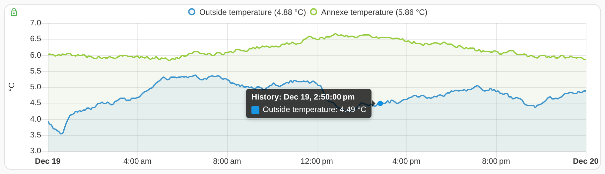

Once open, the tooltip:
- **Follows the pointer** — it moves to the value pointed at as the mouse (or a pen held above the screen, in the browsers that report it) moves over the curves; away from every value it stays, and fades out after its reading time;
- **Stands behind the move** — beside its point, on the side the pointer comes from when there is room (reaching a value moving rightward: on its left), decided when it shows a new value and kept while it stays on it; with a finger (no move to follow), on the side it comes from — from the value it showed before (tapping a value further right: on its left) —, for the first one on the side away from the graph's nearest edge; with no room on either side, above or below;
- **Never moved by a drag** — a drag moves the curves, and an open tooltip with them.

**Which values it shows** — each curve's tooltip mode, set by the screen or by the card's room:
- by the screen: `tooltip.largeScreen` in a window 640 px wide or more, `tooltip.smallScreen` in a narrower one — every card of the window alike, whatever its width;
- by the card's room: `tooltip.largeChart` in a card 600 px wide or more, `tooltip.smallChart` in a narrower one and in the info panel. When set, it wins over the screen's; unset (the default), the screen's applies.

Each is set on the card, a graph, an entity or in `entityOptions`, or from a menu: *Behavior ▸ Tooltip ▸* of a curve, of a graph (all its curves) or of the card's options menu (every curve), which sets the one giving each curve's mode where the card is: the card's room's when it's set (at any level), else the screen's — so, by default, a mode chosen from a menu follows the window's size. The last one to speak wins, kept on this device only:
- `selected` — the default on a small screen: the curves clicked; a hover alone shows the dot of the value nearest it, never the tooltip;
- `nearest` — the value pointed at, on any curve, at a hover too, without a click;
- `mixed` — the default on a large screen: that value and the curves clicked;
- `all` — that value and, for each other curve of the graph, its value at the same time — or the nearest one, a few pixels away at most (each other row's or series' element, on timelines and bars).

A click opens it in every mode — a finger has no hover. `tooltip.behavior` changes the default of `tooltip.largeScreen` and `tooltip.smallScreen` — `selected`, `nearest`, `mixed` or `all`, on both screens; `auto`, the default, leaves theirs. `tooltip.largeChart` and `tooltip.smallChart` have no default. They can be set at the same levels:

```yaml
tooltip:
  behavior: nearest      # every curve, on both screens, unless a screen's mode is set
  largeScreen: all       # on a large screen: all
  smallChart: selected   # in a narrow card and in the info panel: selected, whatever the screen
```

**Its size** — `tooltip.size`: every tooltip has the same layout, in one of three sizes:
- `full`:
  - its title — where its first value comes from (`History`, or `Statistics` and their period: `5 min`, `1 h`) and its time: a value's own, or the time a column of values, a bar or a state covers (`27 Oct, 05:10:43 – 19:37:05`, the end's date only when it's another day);
  - then a line per value shown — its color box, its series' name and its value: a curve's or a bar's in its unit (`min / mean / max` for a column of values, its mean alone when the three are the same as shown — see [Data decimation](#data-decimation)), a timeline's state, an arrowline's value;
- `compact` — its title is the time alone; then a line per value: its color box, its series' name at its shortest (as a narrow legend shortens it, see [Legend / entity labels](#legend--entity-labels)) and its value;
- `slim` — no title; one value only, the one pointed at, whatever the mode, on one line: its color box, its time and its value. The time leaves out its date when the window shown is a single day, or when the time axis shows each day; a span over several days keeps its dates;
- `auto` (the default) — `full` on a card 600 px wide or more, `compact` from 300 px (and in the info panel), `slim` below.

A timeline's graph is at least as high as its tooltip: 130 px in `full`, 115 in `compact`, 90 in `slim`.

```yaml
tooltip:
  size: compact               # full, compact, slim or auto
  showColorsLine: false       # no color boxes in the tooltips of every graph but timelines
  showColorsTimeline: false   # no color boxes in the tooltips of timelines
  showDuration: true          # a timeline's or arrowline's state: how long it lasted, after its time
  showLabel: false            # no series' name
  stateTextMode: raw          # a state's name as in the timelines (stateTextMode) unless set here
```

### Interactive graph management

#### Grouping multiple entities into a single graph

An entity of a line graph added from the UI gets a graph of its own by default. To group the entities of compatible units of measure in a single graph:

```yaml
type: custom:history-explorer-card
combineSameUnits: true
```

With `combineSameUnits`, entities of compatible SI units (W and kW, m and km) go into the same graph, converted so that the Y axis labels and the tooltip show each entity's values in its own unit.

A YAML graph whose entities have compatible but different units (W and kW) is converted the same way, into the common unit with the fewest digits; the legend and the tooltip show each entity's value in its own unit.

Timelines are always grouped when they can be; YAML graphs never are — their YAML sets their grouping.

A YAML graph always shows all its entities together, whatever their units (or lack of one) — the YAML author's explicit choice:
- **Units** — two groups of units get a Y axis each, more are shared between the two by the size of their values (see [Two Y axes](#two-y-axes));
- **Lines and bars** — share one graph too, the curves drawn over the bars (see [Bar graphs](#bar-graphs-for-total-increasing-entities));
- **Timelines and arrowlines** — the only ones that can't share a graph with anything else: shown as separate *linked* graphs (see below).

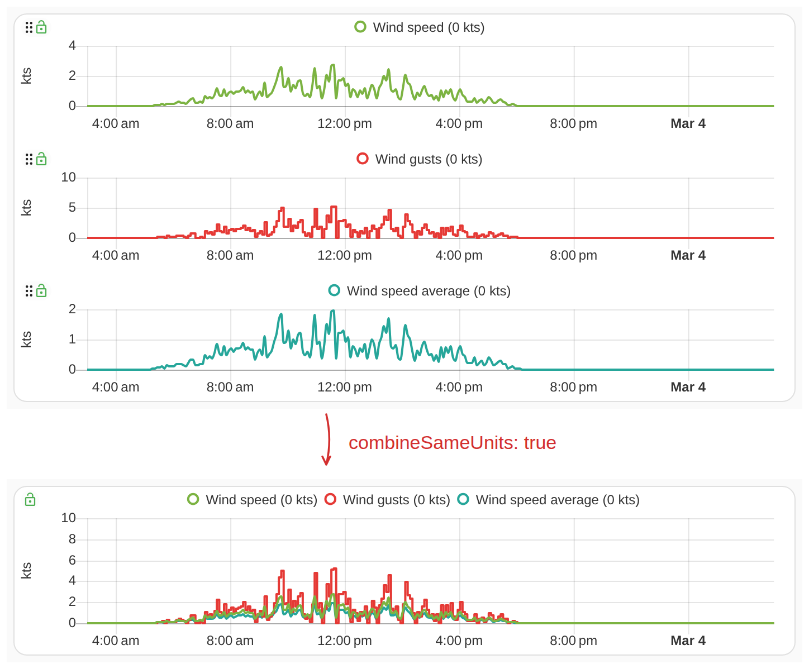

#### Ungrouping a curve

A double-click on a curve's label takes it out of its graph, into a graph of its own right below. This is kept in the Home Assistant user's storage (the browser's as a fallback) and survives a reload; another double-click takes out another curve.

On a graph defined in the YAML, double-clicking a label also shows that curve in its own graph right below, but the new graph stays *linked* to the YAML graph (see *Linked graphs* below) so it can be put back at any time, whatever its unit. Whether this split survives a page refresh follows the card's persistence options for YAML entities (`enablePersistence` / `enableMultidevicePersistence`, the `groupId` field) — by default the YAML layout is restored on reload.

A long-press (or a right click) on a legend label instead opens the [curve menu](#choosing-an-entitys-display-type) for that entity.

#### Linked graphs

Graphs sharing the same group are shown as a solid block with a chain icon 🔗 between them, on the left. A group gets split into several linked graphs either by a double-click on a YAML graph's label (see above) or by changing an entity's display type to one its graph can't show (a timeline or arrowline can't share a chart with lines or bars; lines and bars can).

Graphs added from the UI work the same way: changing a curve's display type to one its graph can't show (a line into a timeline) moves it to a new graph linked to its original one, and changing its type back to a compatible one returns it to that original graph. A double-click on a label of a graph added from the UI, on the other hand, takes that curve out of its group entirely (no link).

Within a group, curves can always be shown together again, as long as their display types match:
- **Drag** — a curve's (or a timeline entity's) label onto another graph of the group;
- **Double-click** — on the chain icon, merges the graph below it into the one above.

#### Moving curves between graphs

A curve's legend label dragged onto another graph moves the curve there (on a touch screen: tap the label, then press it again right away and drag):
- **Any line or bar graph** — accepts it, whatever its unit: lines and bars mixed, a YAML graph included, in or out of a group of linked graphs; a second group of units gets the right Y axis, more groups share one axis (see [Two Y axes](#two-y-axes)). Units only matter when an entity is added: `combineSameUnits` only joins compatible ones on its own;
- **Another display type** — an entity whose state is a number takes the graph's: a curve dropped onto a timeline becomes one of its rows; an arrowline's entity dropped onto a line graph becomes a curve — its own default display when it fits that graph (*Smart* or its line mode, *Bar* for a quantity that adds up), else the graph's;
- **A state that isn't a number** (on/off, text) — only a timeline: dropped onto any other graph, it's refused with a brief tooltip (`timeline ≠ line`);
- **Its color** — kept; an automatic color the target graph already uses: the next free one of its class, else of the palette.

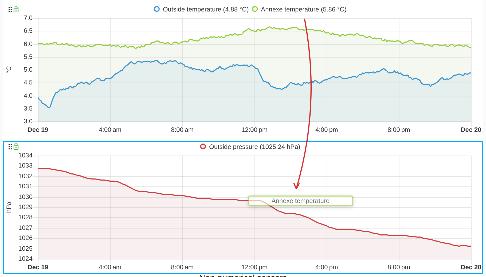

A drop is saved only when the placement of both graphs is (the `entities` persistence of their entities, see [Enabling persistence](#enabling-persistence-enablepersistence--enablemultidevicepersistence)). A graph defined in YAML saves nothing by default: a curve dropped onto it, or taken out of it, is saved where it was before the drop, so a reload brings both graphs back as they were — nothing duplicated, nothing lost. Dropped back into its own graph, the curve is saved there again.

#### Reordering curves within a graph

A curve's label dragged left or right reorders the curves of its graph; the order is kept in the Home Assistant user's account.

#### Reordering graphs

A graph is moved by dragging its ⠿ symbol, at its top left (its box, with the padlock): dropped onto another graph, above its midpoint it goes above it, below it below. On a touch screen, tap the ⠿ symbol, then press it again right away and drag. The order is kept in the Home Assistant user's account.
- **A click** — on the same zone, toggles the Y axis lock;
- **Its room** — the handle, the padlock and the chain icon of linked graphs keep only the room they need beside the legend's first line; on a narrow card none: each is drawn in a small box of the card's background over the legend's labels (or a timeline's rows) — on the box, a gesture is theirs; beside it, on a label, the label's.

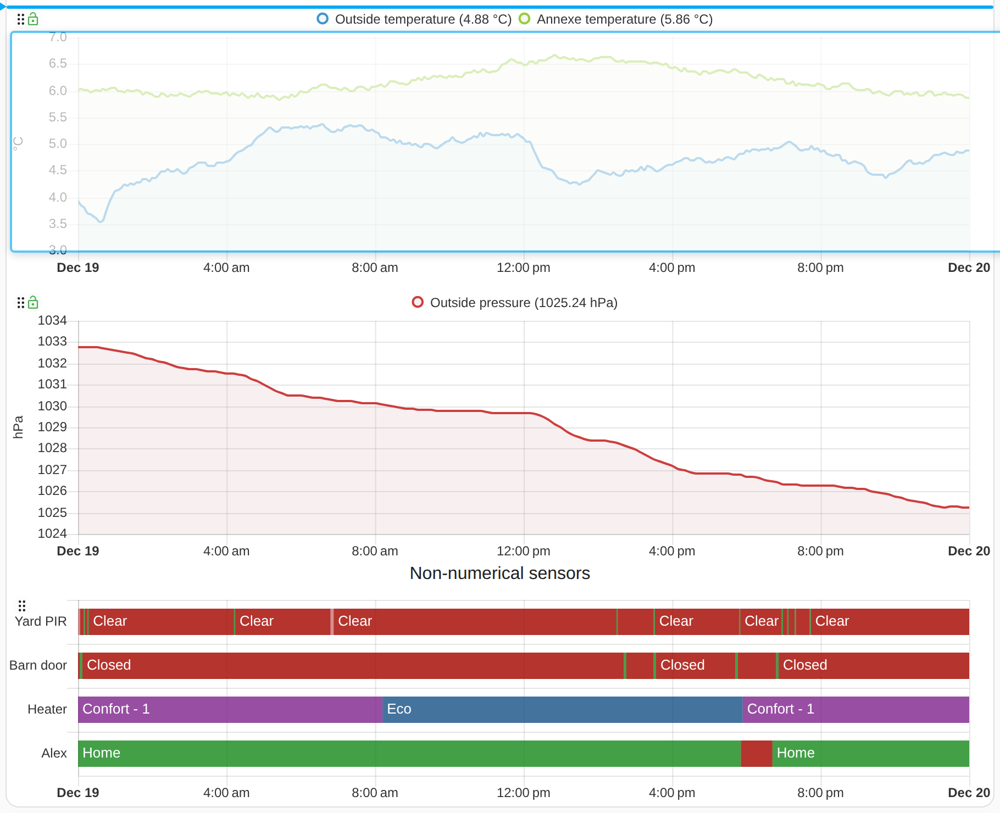

Linked graphs (same group, chain icon) always form one solid block: another graph can't be dropped between them, and moving one of them outside of its block moves the whole block along, keeping its internal order. Moving a graph within its own block just reorders it there.

Dragged near the top or bottom edge of the screen, a graph or a curve scrolls the page, to reach the graphs out of sight.

#### The graph menu, cut and paste

A long-press (or a right click) on the ⠿ zone of a graph opens its menu, titled with the graph's `title` — or, without one, with the first two words of each curve's name (a word: two letters or digits at least — the `:` of an attribute's curve, `salon : Current…`, is kept but not counted), each start once. It is one zone: a click there toggles the Y axis lock, a drag moves the graph, a long-press opens the menu — so that what a gesture does there is also in a menu:
- **Add ▸** — an entity added to this graph: the same field as the card's *Add an entity* (its attributes ▸, a `*` pattern and Enter for every entity it shows), then the display types this graph can show it as. The graph takes it as a curve dragged onto it: one the graph already shows, or a state that isn't a number on a graph other than a timeline, is refused (a message says why, the graph outlined); one shown in another graph offers *Cancel* or *Second curve*, as the card's field does;
- **Display ▸** — open with the menu (*Behavior* for a graph of timelines): the display types that fit every entity of the graph, the one they all share in bold: chosen, every entity of the graph is shown that way, saved with each, and the graph stays one graph, in its place (three curves made a timeline: one timeline of three rows). Not shown for a graph of entities that can only be a timeline;
- **Appearance ▸** — as in the curve menu, its color aside (but for a graph of arrows), for all the graph's curves at once: a switch on when all of them show it, a value in bold when all of them have it; and *Alignment ▸* (*Left*, *Justified*: see [Two Y axes](#two-y-axes)), for any graph — a timeline's or arrowline's too;
- **Interpolation ▸** — the algorithm for all the graph's curves in *Curve* or *Smart* mode (the only ones it applies to), in bold when they all share it; shown when the graph has such a curve;
- **Behavior ▸** — *Tooltip ▸* and *Y axis ▸* for all its curves — in it, *Locked* (a switch, as a click on the padlock — not on a timeline or arrowline graph, which have no lock) —, *Merge back* (a linked graph put back into the one above, as a double-click on the chain icon), *Cut* (the graph moved elsewhere, as a drag of its ⠿ zone), *Delete the graph* (a graph added from the card, as two clicks on its × button);
- **Export ▸** — *History* and *Statistics ▸* (by the period chosen), as the [options menu's](#exporting-data-as-csv), for the graph's own entities, and *YAML ▸* (*Simplified*, *Complete*): the graph's YAML (see [Exporting the configuration as YAML](#exporting-the-configuration-as-yaml)).

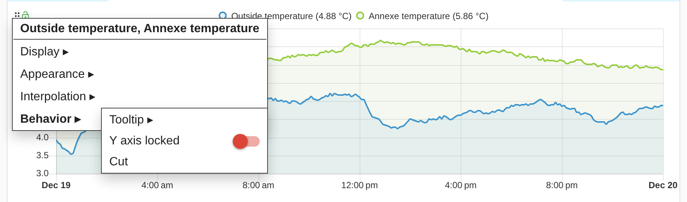

*Cut* is also in the *Behavior* submenu of the curve menu (a curve's, a timeline entity's). Once something is cut, the ⠿ zone of every graph shows where it can go, instead of the ⠿ symbol and the padlock:
- a curve or an entity: 📋 — click it to paste it into that graph, at the end of its legend, exactly as a drop there (same rules: any graph for an entity whose state is a number — shown the way that graph shows its entities —, a timeline only for one whose state isn't; saved only when both graphs are);
- a graph: ↓ 📋 ↑ — ↓ inserts it below that graph, ↑ above it, as a drop below or above its midpoint; a swipe down or up on them does the same (on a touch screen, that swipe doesn't scroll the page); a block of linked graphs moves as a whole, and nothing is inserted inside another block.

A choice that isn't possible is greyed and struck through in red; clicked, it says why, and the cut goes on. ✂ marks the graph it was cut from — clicked, the cut is cancelled. As for the labels, a click just beside a button counts as on it, and one about halfway between two does nothing (the cut goes on). A click clearly away from them, anywhere else on the card or the page, or Escape, cancels it too.

#### Timeline and arrowline entity management

The entities of timeline and arrowline graphs are handled the same way:
- **Double-click** — on an entity's label, takes it out into its own graph, right below;
- **Long-press** (or right click) — on its label, opens the [curve menu](#choosing-an-entitys-display-type);
- **Drag** — its label onto another graph moves it there, of another type too for an entity whose state is a number (see [Moving curves between graphs](#moving-curves-between-graphs)); up or down, reorders it in its graph (on a touch screen, tap it, then press it again right away and drag);
- **Click** — on a label cut short, shows its full name in a tooltip.

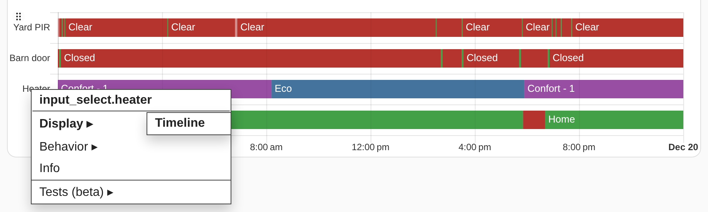

A drag shows a ghost of what is moved and a line where it goes; every change is kept in the Home Assistant user's account.

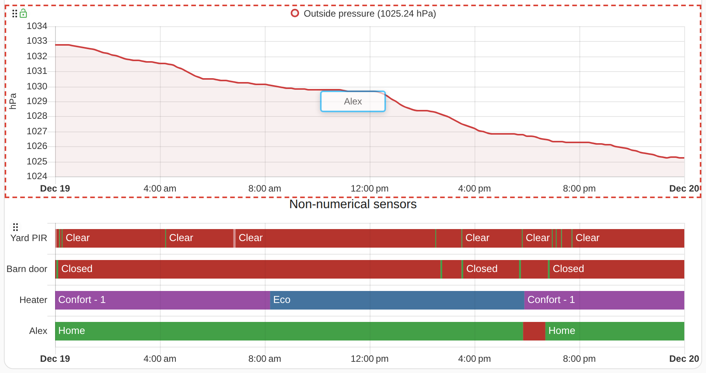

### Legend / entity labels

- **A click on the name** — hides the entity, its name struck through; a second click shows it again. Kept on this device only, as the card's persistence options say — never synced across devices, as its points shown (`showPoints`);
- **A click on the value** — `(400 W)` at the end of its label, or its value over the graph (`showState`): opens Home Assistant's dialog of the entity, with the [info panel](#info-panel--replacing-the-ha-more-info-popup) in it when it's on; so does *Info* in its menu;
- **Hidden when the card opens** — `hidden: true`, on the entity, its graph, in `entityOptions` or on the card (see the complete example of [YAML configuration for preconfigured graphs](#yaml-configuration-for-preconfigured-graphs)).

A text shortened or hidden — a legend's label shortened, a timeline's row name cut, a timeline's state too long for its bar — is shown in full where it is while hovered; a click or a tap on a row name or on a legend label shows it too, for a while.

- **Double-click** — on a label, takes its curve out into its own graph (see [Ungrouping a curve](#ungrouping-a-curve));
- **Drag** — a label left or right reorders the curves of the graph; onto another graph, moves its curve there (see [Moving curves between graphs](#moving-curves-between-graphs)).

`legendVisible: false` removes the labels:

```yaml
type: custom:history-explorer-card
legendVisible: false
```

`legendVisible: auto` (on the card; `look: mini`'s default) shows a graph's legend only when it has several labels in it, as mini-graph-card does: a graph of one curve has none — its name is in the graph's header (see [Values over a graph, a compact look](#values-over-a-graph-a-compact-look)).

On an entity, `legendVisible: false` leaves only that entity out of the legend: its curve is drawn, the other labels take its room.

#### Showing current sensor values

In line and bar graphs, each label shows the entity's current value; `showCurrentValues: false` leaves it out:

```yaml
type: custom:history-explorer-card
showCurrentValues: false
```

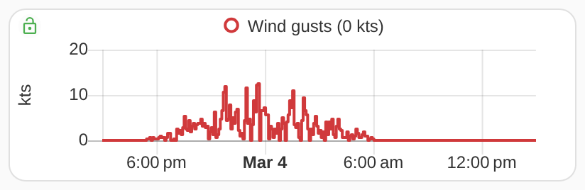

#### Rounding

`rounding` sets how many decimals the values are written with — in the legend, the tooltip, over the graph and in the entity selector: exactly that many (`rounding: 1` gives `20.0`, `rounding: 0` none). Not set, the values have at most 2 decimals (`20`, `20.5`, `20.25`). It can be set on the card, in `entityOptions`, on a graph or on an entity — the most specific one wins.

```yaml
type: custom:history-explorer-card
rounding: 1
```

### Y axis scaling

The Y axis fits the values shown: its padlock open, in green; locked, closed, in red (the theme's green and red).

A click on the padlock — or the *Behavior ▸ Y axis ▸ Locked* switch in the [graph menu](#the-graph-menu-cut-and-paste) — locks the Y axis on its current range; a drag or a zoom of a Y axis locks it too, on the range it's moved to. The lock and its range are kept on this device, as the card's persistence options say — as a hidden curve (see [What is kept, and where](#what-is-kept-and-where)). A second click brings back the graph's default scale:

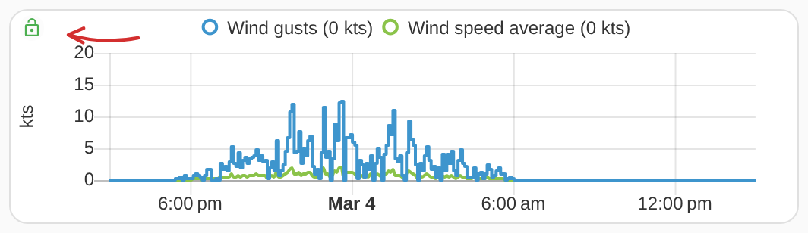

**With Shift** — a drag on a graph moves it both ways, the time and the Y axis together; the wheel zooms the Y axis. Moving the Y axis locks it; a click on the padlock brings back its default scale.

**On the labels** — with a mouse, a drag on the Y axis' label area (the left 65 px of the graph) pans the axis; the pointer turns to `↕` over it.

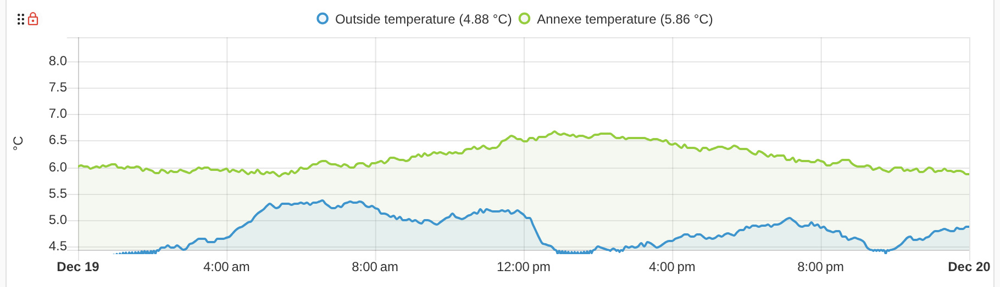

**Labels inside the plot** — with a card narrower than 300 px, `yLabels: inside` or `look: mini`, the Y axis zone is a column along the labels, as wide as their boxes and the pointer's precision more. There, as on the ⠿ zone, the gesture decides: a drag moves the axis (with a mouse at once; with a finger or a pen, after a tap then a second press right away), a click, a long press or a hover is for the curves (tooltip, points, the point hovered).

**Showing the labels** — `labelsLeft` for the left axis, `labelsRight` for the right one, on the card, in `entityOptions`, on a graph or on an entity (for its graph); `look: mini` gives `hover` to both:
- `true` — the default;
- `false` — no labels nor unit, the plot taking their room, no drag there to move the axis;
- `hover` — shown while the pointer is over the graph, fading in and out; on a touch screen, a tap on the graph shows them for 3 s; hidden, they keep their place, and a drag there still moves the axis.

**On a touch screen** — the same Y axis zone is a touch target: tap it, then press it again right away (within the long-press duration) and drag (a swipe on it scrolls the page). Two fingers on a graph zoom and pan: spread or pinch them vertically to zoom the Y axis around them — what is under the fingers stays there —, horizontally to zoom the time (by the same steps as the zoom buttons), and move them together to pan the time and the Y axis.

By default, the Y axis of a line graph fits its curves (see [The automatic scale](#the-automatic-scale)). A margin can be added below and above them, to give some headroom: where a curve comes within half a step of the axis' end, the axis takes one step more (bar graphs never get it):

```yaml
type: custom:history-explorer-card
axisAddMarginMin: true   # margin below the curves (default false)
axisAddMarginMax: true   # margin above the curves (default false)
```

`ymin`, `ymax` and `ystepSize` set the Y axis' range and its step, each on its own (the step alone, the range left automatic) — on a YAML graph, for the entities added from the card, or by device class:

```yaml
graphs:
  - type: line
    options:
      ymin: 0       # the Y axis' bottom when the card opens, and when the padlock is unlocked
      ymax: 40      # its top, the same way
      ystepSize: 5  # a label every 5
      ylock: true   # no pan nor zoom of the Y axis by hand
```

`ystepSize` sets the step between the Y axis' labels — unless, at the graph's height, they would overlap: the axis then takes its automatic step, and a warning in the browser's console says so (`ystepSize: 5 — ignored on graph '…'`). Without `ystepSize`, the axis takes the tightest round step (1, 2, 5, 10, 20…) its labels have room for.

`ymin` and `ymax` set the Y axis' range when the card opens, and the range the padlock brings back; the axis can still be moved by hand — unless `ylock: true`.

`ylock: true` stops every change of the graph's Y axis by hand — a drag of its labels, a pinch, Shift + drag — with any pointer; the padlock is unchanged. For a graph whose Y range means something, not to be moved by mistake.

More examples: [Entity options](#entity-options), and the complete example of [YAML configuration for preconfigured graphs](#yaml-configuration-for-preconfigured-graphs).

#### The automatic scale

The automatic Y axis of a line or bar graph works like an automatic gain in audio:
- **Every value** — it always shows every value of the window, and the nearest one on each side where a curve crosses the window's edges;
- **Ahead of a pan** — it looks at the values on each side of the window, each counting the more as it is near the edge — fully at the edge, not at all a window away (by default): a pan towards a spike makes the axis grow before the spike shows;
- **Growing, narrowing** — it grows at once whenever it must, so that a curve never goes out of it; it narrows only when what it holds fills less than half its height (by default) — during a drag or a pinch, one step at a time, at most one each quarter of a window the time moved (a small pan to and fro keeps it); once the gesture ends, at once as far as it has to;
- **Round values** — its ends and labels fall on the tightest step of 1, 2, 5 × 10ⁿ whose labels fit the graph's height: the axis moves from one tick to the next, never between. A logarithmic axis does the same, in decades.

The values around the window come from what the card has loaded: as it loads a window, its coarse statistics over a window on each side of it (a month at most), and more while the graphs are looked at (see [Long term statistics](#long-term-statistics)). A curve without statistics (no `state_class`), or with the statistics off, uses only what is loaded: the window alone at first, its sides once they're loaded.

`yScaleSteadiness` sets the balance between seeing what is shown well and a steady scale, in %, from 0 to 100 — on the card, in `entityOptions`, on a graph or on an entity (for its graph); `yScaleSteadinessRight`, the right axis' own (else `yScaleSteadiness`):
- **What it does** — what the axis holds fills at least 100 − `yScaleSteadiness` % of its height, and it looks as far as `yScaleSteadiness` / 50 windows on each side;
- **0** — the axis follows exactly what is shown, at every move, during a drag too;
- **50** — the default;
- **100** — it only grows, looking two windows ahead on each side:

```yaml
type: custom:history-explorer-card
yScaleSteadiness: 25        # every graph: what is shown first
graphs:
  - type: line
    options:
      yScaleSteadiness: 75  # this graph: a steadier scale
    entities:
      - entity: sensor.outside_temperature
```

A side fixed (`ymin`, `ymax`), set by hand (the padlock, a drag, a pinch) or locked (`ylock`) stays as it is; soft bounds and `yrange` are reached as usual (see [Bounds](#bounds)). A `state_map`'s axis keeps its states' places.

#### Bounds

A bound written with a `~` is soft: the axis reaches it, and goes past it where the values do — `ymin: ~0` shows 0 at least, and a negative value below it. `yrange` is the smallest range the axis shows: a nearly constant sensor isn't drawn as if it varied a lot; the range is widened on the sides that aren't fixed (on both, evenly, when neither is), never across 0 when the values don't cross it — a sensor at 0 shown from 0. A side set by hand — the padlock, a drag, a pinch — is kept as it is.

```yaml
type: custom:history-explorer-card
graphs:
  - type: line
    options:
      ymin: ~0          # 0 at least, lower when the values go lower
      yrange: 5         # at least 5 units from the bottom to the top
      logarithmic: true # a logarithmic axis
    entities:
      - entity: sensor.outside_temperature
```

`logarithmic: true` draws a line graph's Y axis on a logarithmic scale (values above 0); a drag, a pinch or Shift + wheel move and zoom it evenly, as it's seen.

#### Two Y axes

Line and bar graphs have up to two Y axes, one per group of compatible units:
- **Two groups** (a power in W and kW, and a temperature) — the first on the left, the second on the right, each with its own scale; in the legend, each curve's color mark is a triangle pointing to its axis, ◀ or ▶ (a dot with one axis);
- **More groups** — shared between the two axes by the size of their values: the small ones on one axis, the large ones on the other (split where two neighbouring groups' sizes differ the most), the axis with more curves on the left — as many: the first curve's. Decided when the graph is shown, from the values it draws then (on the left meanwhile), then kept: a zoom, a move of the time or the cache filling never change it. Each axis' title lists its units, separated by " / " (`% / °C`);
- **Chosen by hand** — *Behavior ▸ Y axis ▸* in a curve's menu (or a graph's: all its curves) puts it on the left or the right axis, saved with it;
- **`yAxis`** — `left` or `right` on an entity (or in `entityOptions`) puts it on that side whatever its unit; on a graph or the card, every curve that doesn't set its own — `yAxis: left` on a graph keeps it on one axis, `yAxis: auto` on an entity brings back the choice by unit;
- **Shared settings** — `ymin`, `ymax` and `ystepSize` apply to both axes. Linked graphs keep the same room on the right when one of them has a right axis, their time aligned.
- **Graphs aligned** — `alignment: justified` (on the card, in `entityOptions`, on a graph or on an entity, for its graph — or *Appearance ▸ Alignment ▸ Justified* in a graph's menu or the card's): a graph without a right axis keeps the room of one on its right when another graph of the card has one — a timeline's or arrowline's too —, so that every graph's time lines up; when none has a right axis, none keeps any. `left`, the default: a graph takes the room its own axes leave it.

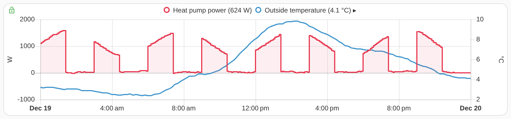

The right axis takes `yminRight`, `ymaxRight` and `yrangeRight` when they're set, else `ymin`, `ymax` and `yrange` like the left one; `labelsRight` shows its labels, as `labelsLeft` the left one's (see [Y axis scaling](#y-axis-scaling)).

Dragging the label area of one axis — left or right — pans that axis only. Shift + drag, Shift + wheel and the two-finger pinch move and zoom both axes together — Shift + wheel each around its own middle, the pinch around the fingers —, so the curves keep their positions relative to each other; the padlock locks and releases both.

### Menus

A long-press — or a right click — opens a menu: on a curve's or a row's label (its [curve menu](#choosing-an-entitys-display-type)), on a graph's ⠿ zone ([the graph menu](#the-graph-menu-cut-and-paste)); the ▾ button beside the entity selector opens the options menu. Every action of a gesture is also in a menu.

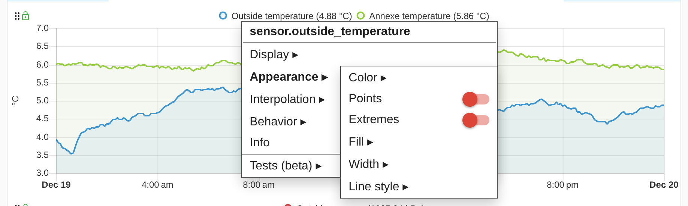

- **Choosing** — click an item, or Enter or → on it; ← or Escape goes back to the menu. A click on a line closes the submenu another line opened (a line with a submenu then opens its own).
- **Applied at once** — a choice that changes what the menu shows (a display type, an interpolation, a look, a switch) is applied, and the menu stays open half a second showing it, then closes; another choice meanwhile is applied too, and the half second starts again. An action whose result is elsewhere — *Separate*, *Merge back*, *Cut*, *Delete*, *Info*, a test, *Color* (the picker takes over), a type for an entity being added — closes the menu at once.
- **Switches** — a line with its name and Home Assistant's switch on its right: green and on the right when on, red and on the left when off; toggled by a click on the switch, or Enter on its line — not by a click on its name.
- **Reopened** — less than 10 s after it was closed, a menu opens the submenu it had open (a new entity's always opens on *Display*).
- **Scrolling**:
  - a menu follows what it was opened from (a curve's label, a graph's ⠿ zone, the entity field, the ▾ button), its submenus with it, when the page, the dialog or the panel scrolls, even under a sticky toolbar; a submenu follows its line when its menu scrolls;
  - each shows in its zone — a menu, the screen minus what covers it (a sticky toolbar, the page's header); a submenu, its menu at the top and that zone at the bottom: what goes past is masked;
  - the menu closes once its first line is wholly out (a submenu opened from a first or last line isn't closed by the least scroll).
- **Widths** — a menu is wider than each of its submenus, so its lines stay readable beside the one open — the last line's too. On a card or a screen too narrow, the menu opens without any submenu. The menu stays where it opened; each submenu takes its own width, and when the last one opened lacks room, it's taken from the submenus over it — the menu's lines shown beside them reduced first to the width of two wide characters (two to three characters), then the first submenu's, and so on down —; only once all of them show no more than that are its own lines cut ('…'). Every menu does so, the entity selector's lists too; a submenu closed, they take back their width.

#### The options menu

The ▾ button beside the entity selector opens the options menu, in submenus:
- **Display ▸**, **Appearance ▸** (its color aside), **Interpolation ▸**, **Behavior ▸** (*Tooltip ▸*, *Y axis ▸*) — as in a graph's menu, for every curve of the card at once: the value all of them share in bold, a switch on when all of them show it; a choice in the card's menu, a graph's or a curve's applies to every curve it concerns, the last one made winning;
- **Export ▸**:
  - *History* — the history of the entities shown, over the time window shown, as a CSV file (a floppy disk icon before it);
  - *Statistics ▸* — their statistics, with long-term statistics on, for the period chosen in its submenu: *5 min*, *Hour*, *Day*, *Week*, *Month* (see [Exporting data as CSV](#exporting-data-as-csv)), as a CSV file (a floppy disk icon before each);
  - *YAML ▸* — *Simplified*, *Complete*: the card's YAML, copied to the clipboard (a clipboard icon before it — see [Exporting the configuration as YAML](#exporting-the-configuration-as-yaml));
- **Card ▸**:
  - *Default graphs ▸* — the graphs added from the card removed, the YAML's kept as they were changed;
  - *Default display ▸* — back to the YAML: the graphs added from the card removed, every change made from the card to the YAML's forgotten (their order, display, interpolation, colors, splits, hidden curves, points), and the YAML's time range;
  - each confirmed in a submenu over *Card ▸*, right-aligned on it (*Confirm* / *Cancel*, Cancel marked: Enter changes nothing; Cancel, ← or Escape close it); saved as any change: it reaches the user's other devices for what they share (a hidden curve and its points stay each device's own);
- **Global ▸** — what applies to every card of every dashboard, on every device: *Enhanced native history*, a switch turning the info panel on (green) or off (red) — see `defaultInfoPanel` —, and the [gesture settings](#gesture-settings), entered right in the submenu.
- **Tests (beta) ▸** — diagnostics run where the card is shown (browser, Home Assistant app), to report what that system gives the card; a report can be copied or sent as a GitHub issue, with the device, the system and the browser or app used:
  - *Pen events* — what the browser reports of a pen (hover, its button, a long press), on two test zones;
  - *Performance* — what the card costs on this device, with its entities and its Home Assistant:
    - what they run on — Home Assistant's version, installation, hardware, memory, disk and database (an administrator's account tells it); this device's model, system, processor, memory, graphics and screen; the browser or the Home Assistant app;
    - each statistics probe's verdict, with what it found — when, the values of the entity's last hour, its intervals under 4 minutes, the shortest;
    - the card as it is — its graphs (those on the screen told), its points, which statistics are valid;
    - its graphs drawn again — the card's work (the rows read from the cache, the points worked out) and Chart.js's, graph by graph;
    - the window loaded again from nothing — each request: its phase, its source, the time it asks, its entities (how many on the screen) and values, how long it waited and Home Assistant took;
    - the window moved — *<* and *>* three times each, a drag;
    - the real time — each time the graphs are drawn again, what had them drawn (answers from Home Assistant, the window moved, the window or its settings changed, a graph come on the screen, a graph off the screen drawn after those on it); when the page froze;
    - on its own button, a return to the page after another app — what the card and Home Assistant's connection did until the graphs were drawn again: the card taken back, its graphs moved and shown, resized, each drawing and its cause.

Arrows move through it, Enter or → opens a submenu, ← or Escape goes back.

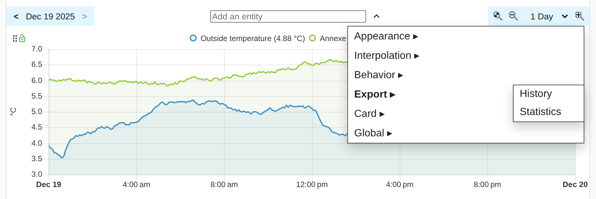

### Exporting data as CSV

*Export ▸ History* — or *Export ▸ Statistics ▸* and a period — of the options menu (▾ beside the entity selector) exports the values of the entities shown, over the window shown, as a CSV file; a graph's own entities from the same *Export ▸* in its menu (a long-press on its ⠿ zone), a curve's own entity from its menu (a long-press on its label) or the info panel's.

Home Assistant's recorder keeps two kinds of statistics, for the entities with a state class: every 5 minutes (short-term, kept as long as the history — the recorder's `purge_keep_days`) and every hour (long-term, kept for ever).
- **The periods** — *5 min* exports the first, *Hour* the second; *Day*, *Week* and *Month* are computed by Home Assistant from the hourly ones;
- **In italic** — the period chosen last, kept on this device whatever the persistence options (see [What is kept, and where](#what-is-kept-and-where)), else `csv.statisticsPeriod`; a change of `csv.statisticsPeriod` in the YAML wins (the last one to speak wins);
- **In bold** — a period already loaded by the card over the whole window: exported at once.

**The counts in brackets** — each line says how many of the entities exported have values within the window, at least in part (*History (3)*, *Statistics (2) ▸*, *Hour (2)*), a line greyed when none has:
- **What tells it** — what the card has loaded, and Home Assistant's recorder: its hourly, daily, weekly and monthly statistics come from the same long-term statistics; its 5-minute ones are kept as long as the history; attributes, timelines and entities without a state class have none. What can't be told yet is asked quietly once the window is loaded;
- **5-minute statistics** — not valid for an entity (see [Only valid statistics](#long-term-statistics)), they don't count it, and it's left out of their file: they would make up values. The hourly, daily, weekly and monthly ones are exported wherever Home Assistant has them;
- **What is exported** — the values the curves show: an attribute's curve exports the attribute's values, not its entity's state; a series without a value within the window is left out; a series' history begins with its state in force at the window's start;
- **What is asked** — the card takes what it has loaded and asks Home Assistant only for the days it lacks — the history with its attributes (`exportAttributes`), all of it.

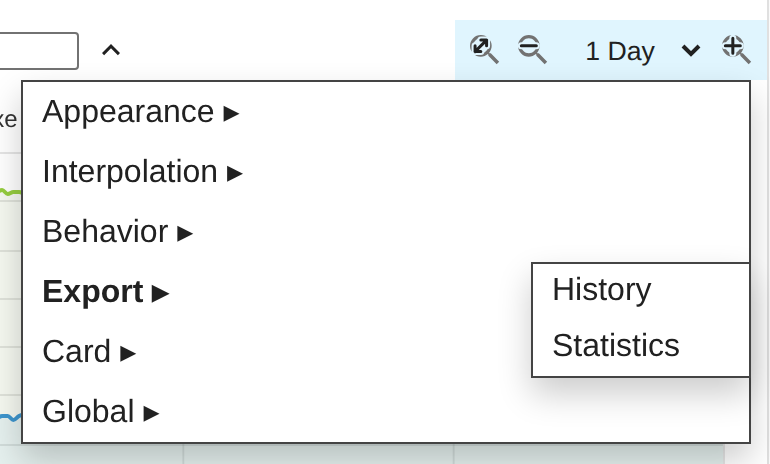

The CSV is set with these options, all optional:

```yaml
type: custom:history-explorer-card
csv:
  separator: ';'            # the column separator — default ','
  timeFormat: 'DD/MM/YYYY'  # the time format — default 'YYYY-MM-DD HH:mm:ss'
  statisticsPeriod: hour    # Export ▸ Statistics ▸'s default period: 5minute, hour, day, week or month — default hour
  exportAttributes: true    # the entities' attributes too, in columns of their own — default false
  numberLocale: 'en-US'     # the numbers in this locale's format — default: as the database holds them
```

A value missing leaves its cell empty (a value of 0 is written 0); a cell holding the separator, a quote or a line break is quoted, its quotes doubled.

---

## Detailed configuration

### Graph types

#### Bar graphs for total increasing entities

An entity that is a total (increasing, or net metering) — the energy, the water or the gas consumed, the rainfall, the data used on a network — is shown as bars, each the total of an interval: 10 minutes, an hour, a day, a week (from Monday) or a month, chosen on each graph at any time.

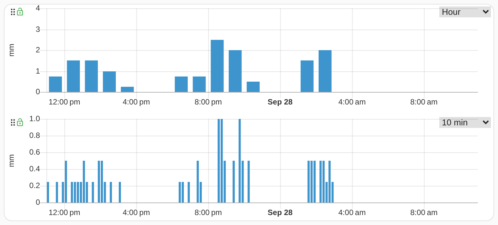

A bar graph is the `bar` type, for the entities added from the card and the YAML's alike. When an entity is added from the card, the curve menu pre-selects *Bar* for energy, gas, water or volume that adds up (state class `total_increasing`, or `total` with such a device class or unit); any other entity can be shown as bars by picking *Bar* in the menu, or with `type: bar`.

The interval selector, at the top right of the graph, chooses the interval of the bars — on the legend's first line, before the `×`; when the legend's first label doesn't fit beside it, centred between the handle (or the padlock) and the `×`, the legend starting on the next line.
- **Several intervals** — the same entity can be added several times, in separate graphs with different intervals;
- **Raw** — shows the bar entities' raw data as curves; an interval chosen again turns them back into bars;
- **`interval`** — the default interval, `hourly` unless set: `10m`, `hourly`, `daily`, `weekly`, `monthly` or `raw` (*Raw*).

`sensor.rain_amount` added from the card, shown as bars of 10 minutes without picking *Bar* in the curve menu:

```yaml
entityOptions:
  sensor.rain_amount:
    type: bar
    color: '#3e95cd'
    interval: 10m     # 10m, hourly, daily, weekly, monthly or raw
```

A bar graph written in the YAML can hold several entities, their bars side by side:

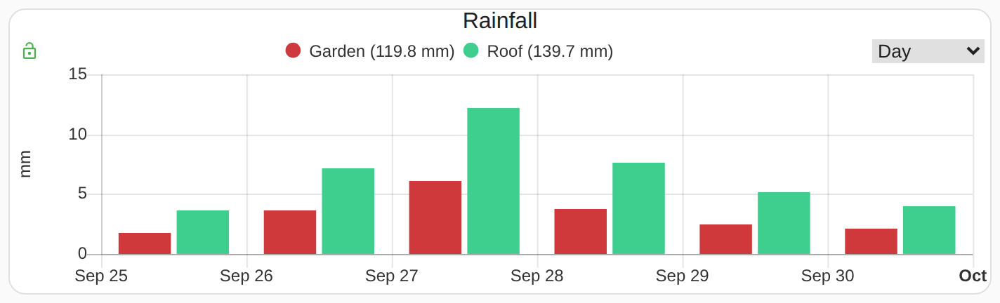

```yaml
graphs:
  - type: bar
    title: Rainfall
    options:
      interval: daily
      stacked: false
    entities:
      - entity: sensor.rain_amount
        scale: 0.5
      - entity: sensor.rain_amount
```

`barSpacing` — on the card, a graph, an entity or in `entityOptions` (for its graph) — is the room between two bars, in pixels; without it, each bar leaves a small gap on both sides, in proportion to its interval.

##### Bars and curves on the same graph

A bar graph can also hold line entities: their curves are drawn over the bars, with their own line mode (`curves`, `smart`...). The interval and *Raw* only apply to the bars, and `stacked` only stacks the bars — curves are never stacked. This happens with a YAML graph mixing both (no `type:`), when a curve's display type is changed to bars (it stays in its graph), or when a curve is dropped onto it. An entity added from the UI never joins a graph of the other type on its own.

```yaml
graphs:
  - options:
      interval: hourly
    entities:
      - entity: sensor.energy_consumed      # total_increasing (kWh) → bars
      - entity: sensor.power                # measurement (W) → curve
        lineMode: smart
        scale: 0.001                        # W → kW, comparable with the kWh bars
        unit: kW                            # the unit shown in the legend and tooltip
```

Bars and curves follow the same rule: energy bars and a power curve, two groups of units, get an axis each — the bars on the left, the curve on the right. Compatible units (W and kW...) share an axis, converted automatically.

Set the `stacked` option to `true` to display the bars on top of each other rather than side by side (with two Y axes, the bars of each axis are stacked in a column of their own):

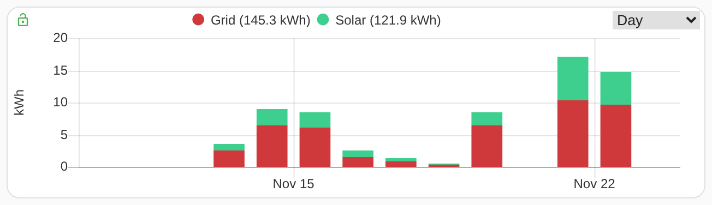

##### Net metering

A bar graph follows Home Assistant's `total_increasing` state class: a decrease of the value is a reset of the meter. A net metering sensor's total can decrease as it works. Totals that can decrease (net metering) are drawn with `netBars` (in `entityOptions` and in the YAML's graphs); net metered and total increasing sensors can be mixed in the same graph.

```yaml
graphs:
  - type: bar
    entities:
      - entity: sensor.net_meter
        netBars: true
        color:
          '-1000': red   # the negative bars red
          '0.0': green   # the positive ones green
```

**The `total` state class** — Home Assistant's `total` works much the same way: net metered `total` sensors are drawn with this option too. The card doesn't read `last_reset`: the bar right after a reset of the meter is wrong.

#### Timeline graphs

A timeline shows an entity whose state isn't a number, as a row of colored states. When an entity is added from the card, the curve menu pre-selects *Timeline* for an entity whose state isn't a number (the only choice then), and for one without unit of measure that isn't a measurement.

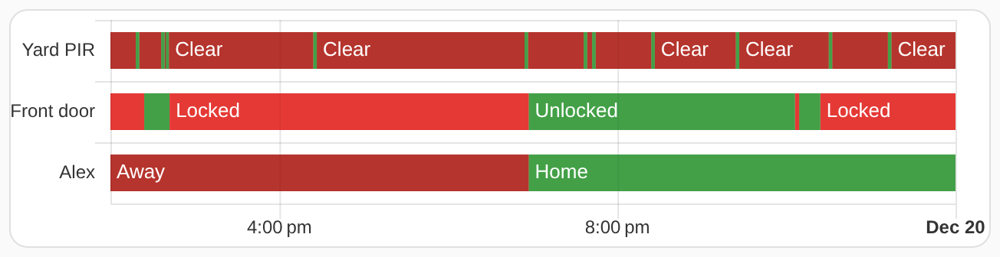

`showTimeLabels: false` hides a timeline's or an arrowline's time labels, graph by graph — the plot taking their room, below and on its sides:

```yaml
graphs:
  - type: timeline
    options:
      showTimeLabels: false   # hide the time axis labels on this graph
```

By default a timeline shows the states as Home Assistant names them for their device class (`Open`/`Closed` for a door, `Detected`/`Clear` for a motion sensor). A state that is a number is shown in its unit (`19.5 °C`), in its row and in its tooltip. The raw states (`on`/`off`) or no text at all can be chosen instead:

```yaml
type: custom:history-explorer-card
stateTextMode: raw    # the raw states
                      # or: auto — the names of their device class (the default)
                      # or: hide — no state text
```

##### Customizing state colors

`stateColors`, in the card's YAML, sets the states' colors on the timelines — by entity, device class, domain or state alone: the *on* and *off* states of motion sensors and of door sensors can differ, though both are binary sensors. Colors are any HTML color, or a CSS variable as is (`--primary-color`, without `var()`).

**By device class** — the device class, a dot and the state: here, the *on* state of every door sensor blue, of every motion sensor yellow. The other device classes keep their colors, from a rule of the entity, of its device class or domain, or a global one, in that order (see below):

```yaml
type: custom:history-explorer-card
stateColors:
  door.on: blue
  motion.on: yellow
```

**By domain** — here, the *off* state of every binary sensor without a color for its device class purple, and the *home* state of the person domain green:

```yaml
type: custom:history-explorer-card
stateColors:
  binary_sensor.off: purple
  person.home: 'rgb(0,255,0)'
```

**By state alone** — for every device class and domain, as a last fallback: here, the *off* state of every sensor red, unless a rule of its device class or domain says otherwise:

```yaml
type: custom:history-explorer-card
stateColors:
  off: '#ff0000'
```

**Any state** — not only `on` and `off`: any raw state, a template's or an MQTT sensor's:

```yaml
type: custom:history-explorer-card
stateColors:
  sensor.Dry: tan
  sensor.Wet: green
```

**A default color** — of a domain, a device class or an entity, for its states without their own: here, the *bad* state of `input_text.air_quality` red, the *good* one green, and every other one yellow:

```yaml
type: custom:history-explorer-card
stateColors:
  input_text.air_quality.bad: red
  input_text.air_quality.good: green
  input_text.air_quality: yellow        # every other state of the entity
```

**The *multiple* state** — a virtual state of every entity: the states merged on a timeline, each too thin to be seen (see [Data decimation](#data-decimation)). Its color is set as any state's: by entity, device class, domain or globally.

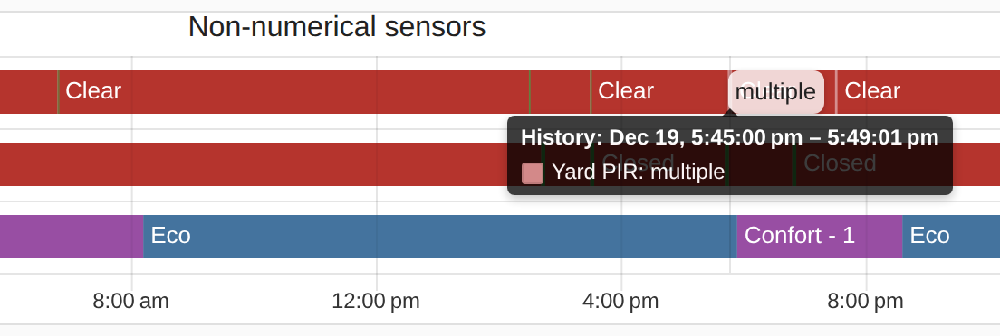

The random colors assigned to states not covered by `stateColors` are generated from a fixed seed. Another seed gives another set of automatic colors:

```yaml
type: custom:history-explorer-card
stateColorSeed: 42   # any integer — default 137
```

#### Compass arrow graphs

An angle — a bearing, a direction, the wind's — is shown as a row of compass arrows:

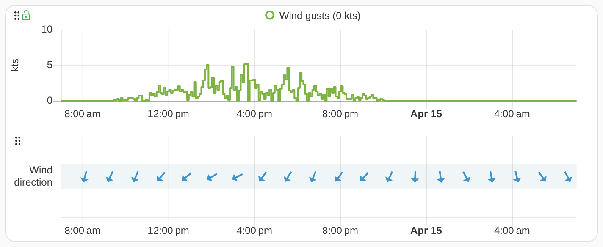

A compass arrow graph is the `arrowline` type, for the entities added from the card and the YAML's alike — examples in [Entity options](#entity-options) and in the complete example of [YAML configuration for preconfigured graphs](#yaml-configuration-for-preconfigured-graphs).

**Each arrow** shows its zone — the time under it, as wide as the space between two arrows: the mean of the values there, from the most precise data the card has for each column of pixels (the history where it's kept, else the statistics), each weighted by how long it lasts:
- a circular entity's direction (see [Circular values (angles)](#circular-values-angles)) has a circular mean, for its own period (350° and 10° give 0°, not 180°), by the same rule as every mean of an angle; an entity that isn't circular (`circular: false`), the mean of a number;
- with a length from an entity (`arrowLength`, below), the direction is also weighted by the length — a strong wind counts more than a weak one —: `arrowWeighting: length`, the default; `arrowWeighting: none`, by how long only. A value without a length there doesn't count in it; none with one: by how long only;
- the length is the mean of the length's values there.

The tooltip shows a column of pixels, as a curve's: the direction, then the length, each `min / mean / max` of the column (the value alone when, rounded, the three are the same).

**The extremes** — `showMinMax`, as a curve's band (see [Showing the min/max statistical range](#showing-the-minmax-statistical-range)): from the arrow's base, a light sector of a disc on each side, to the lowest and the highest direction of its zone around its own, its radius the longest length there, in the arrow's color; a whole disc about the arrow's middle where the direction turned a whole turn or more in its zone (the sun's azimuth over several days). Where the arrow's length isn't given, its sectors and its whole disc are 80 % of their size, as the arrow. What goes past the arrows' band, an arrow or its extremes, is cut. `max` is the clockwise side, `min` the anticlockwise one; `all` (or `true`) both; `statistics` / `history` both, only where the arrow comes from them.

**The arrows' length** — `arrowLength`, on the card, in `entityOptions`, on a graph or on an entity:
- not set: every arrow 80 % of its whole length;
- a number from 0 to 100: every arrow that part of its whole length, in % (0: a point); out of 0 to 100, it's kept within, with a warning in the browser's console;
- thresholds on an entity's or attribute's value, as for `color` (see [Colors of curves and bars](#colors-of-curves-and-bars)), each giving a length from 0 to 100;
- an entity, or one of its attributes (`weather.home.wind_speed`): each arrow the mean of its values in the arrow's zone — the wind's speed with its direction:
  - its scale is chosen as the [automatic Y axis](#the-automatic-scale) chooses its top, with `yScaleSteadiness` at 50, from the entity's means over the time of an arrow's zone: the longest arrow in the window and around it at its whole length — about 80 % of the row's height —, 0 a point; a negative value is drawn by its absolute value;
  - where the entity has no value, the arrow is drawn 80 % of its whole length, its shaft dashed;
  - the tooltip shows its values, signed, in its unit, after the direction.

`arrowMax` sets the value giving the whole length, as `ymax` sets a Y axis' top: a number — fixed, no automatic scale, a larger value drawn its whole length —, or `~` and a number — soft: the whole length at least that value, more where the values go past it. The bottom is always 0.

```yaml
type: custom:history-explorer-card
graphs:
  - type: arrowline
    title: Wind
    arrowMax: ~50                          # the whole length: 50 km/h at least
    showMinMax: true                       # the directions' spread: a light sector each side
    entities:
      - entity: sensor.wind_bearing
        arrowLength: sensor.wind_speed     # each arrow as long as the wind is fast
        arrowWeighting: length             # (the default) the direction weighted by the speed
```

### Line appearance

#### Line modes

Four modes are available for line graphs:
- **`curves`** — cubic splines, smooth and natural-looking, for signals already filtered; by default a monotone cubic interpolation (Fritsch–Carlson), never overshooting — other algorithms with `interpolation` (see [Curve interpolation](#curve-interpolation));
- **`lines`** — straight segments between the values (a zero-tension monotone interpolation): the most faithful drawing of the raw data;
- **`stepped`** — the raw quantized data as a staircase;
- **`smart`** — described below.

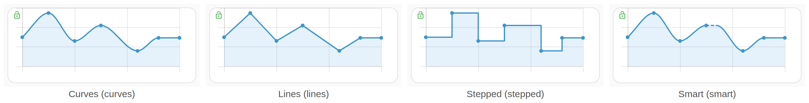

`lineMode` — `curves`, `lines`, `stepped` or `smart` — is set in the YAML, on the card:
- **Not set** — the curves of YAML graphs are drawn as `curves`, and an entity added from the card gets `smart` (the curve menu pre-selects it);
- **Set** — it applies to both: with `lineMode: curves`, the entities added from the card are pre-selected as *Curve* too;
- **For the YAML's graphs only** — set it under each graph's `options:` (or on each entity) instead.

```yaml
type: custom:history-explorer-card
lineMode: lines
```

The line mode can also be set on a YAML entity, and for the entities added from the card or device classes (see [Entity options](#entity-options)).

`showLine: false` draws a curve's points only, without the line between them (its points shown, unless `showPoints` says otherwise).

`fixedValue: true` (on an entity or wherever an option is set) draws a curve's last value in the window shown — in real time, its value now — flat over the whole window, instead of its history.

#### Curve interpolation

In `curves` and `smart` modes, the curve between two recorded values is rebuilt by an interpolation. Its algorithm is set with `interpolation` — on the card, in `entityOptions`, on a graph or on an entity — or from the curve menu (**Interpolation ▸**):

| `interpolation` | How the curve looks |
|---|---|
| `monotone` (default) | Chart.js' own monotone cubic (Fritsch–Carlson). Never overshoots, but the slope is set to zero at every value where the curve changes direction or repeats a value, and doesn't take the spacing of the values into account: small breaks in the slope, especially with rounded or noisy sensors |
| `steffen` | Monotone too (M. Steffen, 1990): never overshoots, flat only at the real peaks and troughs, slopes weighted by the irregular spacing of the values |
| `makima` | Modified Akima: follows the local trend, stays flat over flat stretches, no break at each small peak; hardly any overshoot |
| `catmullrom` | The slope of the chord through both neighbours: the smoothest, but may overshoot a little around sharp changes |
| `bspline` | [mini-graph-card](https://github.com/kalkih/mini-graph-card)'s smoothing (a quadratic B-spline): from the middle of each segment to the middle of the next, each value its control point. Never overshoots, the smoothest of all, but passes through the middles, not through the values — a peak is drawn lower than it was; its dot and its tooltip keep the value measured. `look: mini`'s default |

```yaml
type: custom:history-explorer-card
interpolation: makima
```

#### Smart mode: silences shown as flat dashed plateaus

Many sensors report irregularly: every few seconds while something happens, then nothing for minutes or hours. `curves` and `lines` then bridge each silence with a long spline or diagonal from the last value before it to the first one after it — suggesting a slow, gradual change that never happened. `stepped` avoids that, but loses the smooth shape of the curve while the sensor reports.

`smart` combines both: a curve (as `curves`) while the sensor reports at its usual rhythm, and during a silence a flat dashed line at the last known value, until one usual interval before the next value, where the curve resumes.
- **An ongoing silence** — from the last value to now, drawn the same way;
- **Statistics** — never a silence: where the curve is drawn from them (a long time range), the history's values next to them (another day, the last minutes they don't cover yet) neither start nor end one; but a run of statistics Home Assistant made up while the sensor was silent (see [Long term statistics](#long-term-statistics)) is one, drawn the same way;
- **No min/max band** (`showMinMax`) on a plateau — nothing varies in a silence.

```yaml
type: custom:history-explorer-card
graphs:
  - type: line
    entities:
      - entity: sensor.heater_power
        lineMode: smart
```

It's also available in the [curve menu](#choosing-an-entitys-display-type) as *Smart*, and like the other modes in `entityOptions` or as the card-wide `lineMode`.

How a silence is detected — the rules of the [lowpass_dt](https://github.com/Cook23/lowpass_dt) integration, computed in the browser on each curve's recorded values:
- the sensor's usual interval between values is a running average (EMA) of the intervals — of every value of the sensor's history the card knows (all it has loaded, not only the days the window shows: the same limits whatever the window, refined as it loads more), never across a time it hasn't loaded. The card has those values at once, so it starts from the median of their intervals; lowpass_dt, which receives the values one by one, starts from the first interval;
- an interval longer than that average plus 3 standard deviations (and at least 1 second) is a silence;
- the curve resumes one average interval before the value that ends the silence.

The threshold adapts along the curve, so a sensor that reports fast during the day and slowly at night gets plateaus only for what's unusual at each moment. The tooltip only ever shows recorded values.

Limitation: Home Assistant only records a new value when it changes, so the card can't tell a silent sensor from one repeating the same value. Both appear as a plateau — which is right either way, since the last value still holds — but the dashes then mean "no new value recorded" rather than strictly "sensor silent".

#### Circular values (angles)

A wind direction oscillating around the north goes 3, 2, 1, 0, 359, 358…: drawn as is, the curve jumps across the whole graph at each crossing of 0/360. For angles, the card draws a continuous curve instead — 3, 2, 1, 0, -1, -2 — while the tooltip and the Y axis labels keep showing the real values, in [0, 360) (a point at -1 shows 359).

```yaml
type: custom:history-explorer-card
graphs:
  - type: line
    entities:
      - entity: sensor.wind_direction      # unit °: detected automatically
      - entity: sensor.heading_rad
        circular: 2pi                      # angle in radians
      - entity: sensor.some_angle
        circular: false                    # drawn as is
```

`circular` is set per entity (in `graphs:` or `entityOptions`):
- absent, `null` or `none`: automatic —
  - an entity whose unit is exactly `°` (not `°C`/`°F`) or whose state class is `measurement_angle`: circular, with a period of 360;
  - an attribute in `°` only when its name says it's a direction (`bearing`, `direction`, `azimuth`, `heading`, `yaw`, `wind_dir`): a weather entity's `wind_bearing` or the sun's `azimuth` is, the sun's `elevation` (from -90 to 90) isn't;
- `false`: never circular;
- a number or numeric string (`360`, `"360"`, `6.28`): circular with this period; `2pi` (any case, spaces ignored): 2π. Any other value, or a period ≤ 0, turns it off with a warning in the browser console.

The same values as the `circular` option of the [lowpass_dt](https://github.com/Cook23/lowpass_dt) integration.

How it's drawn:
- each value is first brought into [0, period); a step of more than half a period from the previous value is a crossing of 0, and the curve goes on below 0 (or above the period) instead of jumping;
- the whole curve is then placed around its average direction, so a wind around the north is drawn around 0 whatever the start of the time range;
- should the curve go round more than a whole turn over the time range (very unlikely for a wind):
  - it's drawn within a one-turn band centered on its average direction instead, and the jump where it crosses the band's edge is drawn dashed — the same dashes as the [smart mode](#smart-mode-silences-shown-as-flat-dashed-plateaus);
  - a curve swinging back and forth over that edge doesn't jump each time: it goes on past the edge, up to a twentieth of a turn, and jumps only when it goes further — the Y axis then shows a turn and a tenth at most;
- the average direction, the span and the turn are those of the time window shown, what is loaded around it put in the same turn: zoomed or moved in time, the curve is placed again for what is seen;
- the Y axis moved by hand (a drag of its labels, a pinch, the padlock), the turn shown is the one of its range: the curve, continuous, moved by whole turns to sit around the range's middle — or, going round more than a turn in the window, each value put in the turn around that middle, its jumps dashed; released, back as above;
- the Y axis labels show the real values only when every curve of the graph is circular with the same period;
- `ymin` / `ymax` apply as set: with `ymin: 0` and `ymax: 360`, what goes below 0 is cut off at the edge of the graph. The top label of the Y axis shows a whole turn as 360 rather than 0 (0 … 360, or 300 … 350, 0, 10 … 360); anywhere else it's 0.

On an arrowline, `circular` sets what a full turn of the arrows is: with `circular: 2pi`, a value of 1.5708 points east, as 90 does by default; without a period (no `circular`, or `false`) a full turn is 360. An entity with state class `measurement_angle` and no unit is shown as a line, like a `measurement`.

**Limitations** — Home Assistant's long-term statistics average an angle as a plain number (the mean of 359 and 1 is 180), unless its state class is `measurement_angle` — their mean then circular, without min and max, drawn as any other statistics. The other angles:
- **Within the history's retention** — an angle is loaded as any other curve (see [Long term statistics](#long-term-statistics)); when the window is drawn from the statistics, its history over the window is asked first of what is loaded in the background (one request at a time, with the same pause after each one), from the right, and drawn as it comes — the history's values in a column of pixels giving its mean, min and max;
- **Past it** — the angle is drawn from the statistics.

The mean of an angle — a column of pixels, the average over a graph (`showStats`) — is the same as Home Assistant's statistics of an angle (state class `measurement_angle`) and the [lowpass_dt](https://github.com/Cook23/lowpass_dt) integration's: each value a unit vector at its angle, counting for as long as it lasted, the mean the direction of their sum (the mean of 350° and 10° is 0°); a column's min and max are the mean plus the largest differences to it each way, the shortest way round.

#### Line stroke style

`dashMode` sets a line's stroke style — on an entity, in `entityOptions`, on a graph or the card.

```yaml
entities:
  - entity: sensor.temperature
    dashMode: shortlines     # a named style
  - entity: sensor.humidity
    dashMode: [10, 4, 2, 4]  # a pattern of its own
```

Named modes:

| Value | Description |
|---|---|
| *(absent)*, `solid` | Solid line (default) |
| `points` | Fine dots |
| `shortlines` | Short dashes |
| `longlines` | Long dashes |
| `pointline` | Long dash — dot alternation |

Custom pattern: an array of pixel lengths `[on, off, on, off, ...]` following the Canvas `setLineDash` convention, repeated cyclically. For example `[10, 4]` draws 10 px dashes with 4 px gaps, and `[15, 3, 3, 3]` alternates a long dash and a short dot.

`lineWidth` on the card sets every line's width — 2 px by default:

```yaml
type: custom:history-explorer-card
lineWidth: 2
```

#### Displaying individual samples

- **`Alt`** (`Option` on a Mac) — held while moving over a graph, shows every value of its curves; moving without it, or leaving the graph, hides them again;
- **A long-press** (or a right click) near a curve — shows all its own (`showPoints: true`); when it shows them all, back to the hovered one only (`hover`);
- **The menu** — *Points ▸* in the *Appearance* submenu of its menu, or of its graph's: *None* (`false`), *Hovered*, *All*;
- **Their size** — `sizePoints` across, by default the line width plus 2 px; the one the tooltip shows, 2 px more:

The long-press's choice and the YAML's `showPoints`: the last one to speak wins, kept on this device only, never synced across devices. When a curve's points aren't shown, hovering it (a mouse, or a pen above the screen) — or clicking, tapping it, for a pointer without hover — shows the point of its value nearest the pointer along the curve alone, a discreet guide to where the real values are (not on the tooltip's own point, drawn larger).

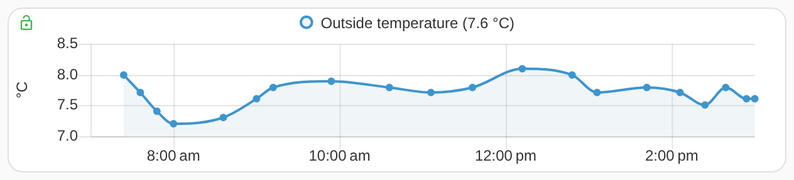

To show them permanently, use `showPoints` — on the card, in `entityOptions`, on a graph or on an entity: `true` all; `hover`, the default, shows only the one hovered; `false` none, not even that one. A number is accepted too: all shown, that radius (`showPoints: 4` is `showPoints: true` with `sizePoints: 8`).

Their diameter is `sizePoints`, in pixels, at the same levels — every point of the curve: shown, revealed with `Alt`, the hovered one's guide; the one the tooltip shows 2 px more. By default it's the line width + 2 px, following the width. A width chosen in the *Width ▸* menu keeps the points visible: a `sizePoints` the YAML sets becomes the larger of it and the width + 2 px:

```yaml
type: custom:history-explorer-card
entityOptions:
  humidity:
    showPoints: true     # always show sample dots for humidity graphs
    sizePoints: 6        # 6 px across
graphs:
  - type: line
    options:
      showPoints: true   # show samples for this entire manually defined graph
    entities:
      - entity: sensor.outside_temperature
        showPoints: true  # show dots on this entity only
        sizePoints: 6     # 6 px across
```

#### Showing the min/max statistical range

`showMinMax` draws a lighter band, in the curve's color, between the minimum and the maximum of each column of pixels, around the curve of their mean — like the band of Home Assistant's own history panel.
- **Only where there are values** — a point's band covers only the time its values cover: from one point to the next only where their times meet, never across a time without values; a point alone is a bar over its time;
- **Its edges** — drawn as the curve is (straight, in steps, or curves of the same interpolation — see [Line modes](#line-modes), [Curve interpolation](#curve-interpolation)), without a line of their own.

| Value | Band |
|---|---|
| `false` / absent | No band (default) — *None* in the menu |
| `all` / `true` / `both` | Everywhere: on the statistics (each hour's min and max) and on the history (the min and max of the values in each column) — *All* |
| `max` | Everywhere, its half above the curve only: from the curve to the max — *Maximum* |
| `min` | Everywhere, its half below the curve only: from the min to the curve — *Minimum* |
| `statistics` | Only where the curve comes from the long-term statistics — *Statistics* |
| `history` / `states` | Only where the curve comes from the history — *History* |

No extra request is made: the band comes from the data drawn. Where a column of pixels holds a single value of the history, it's drawn as is, without band — zoomed in, every value is there, point by point.

```yaml
type: custom:history-explorer-card
graphs:
  - type: line
    entities:
      - entity: sensor.outside_temperature
        color: '#3e95cd'
        showMinMax: all          # band everywhere
      - entity: sensor.outside_pressure
        color: '#3ecd95'
        showMinMax: statistics   # band where the curve comes from the statistics only
```

#### Text states as a curve

An entity whose state is a text (a mode, a set of choices) is drawn as a curve with `stateMap`: each state at its place in the list — 0, 1, 2… —, its label in the legend, the tooltip, the values over the graph and on the Y axis; a state that isn't listed has no value: the curve goes over it, or shows a gap there with `showMissingState: true` (see [Line graphs and unavailable data](#line-graphs-and-unavailable-data)). A state is written as it is (`off`), or with a label (`{ value: off, label: Off }`).

```yaml
type: custom:history-explorer-card
graphs:
  - type: line
    entities:
      - entity: climate.salon
        stateMap:
          - { value: 'off', label: 'Off' }
          - heat
          - cool
```

#### Line graphs and unavailable data

Where the history holds an unavailable state — a sensor offline for a while —, a line graph goes over the missing data by default, without a gap. To see when and how often a sensor was disconnected or unavailable, `showUnavailable: true`: the curve shows a gap wherever the entity was unavailable or unknown. A timeline always shows the unavailable and unknown states, whatever this option says.

A text state drawn as a curve (`stateMap`, see [Text states as a curve](#text-states-as-a-curve)) has no value when the list doesn't hold it: the curve goes over it the same way by default, and shows a gap there with `showMissingState: true`.

```yaml
type: custom:history-explorer-card
showUnavailable: true    # a gap where the entity was unavailable or unknown (default false: the curve goes over it)
showMissingState: true   # a gap where its state isn't in its stateMap (default false: the curve goes over it)
```

### Colors of curves and bars

**Without a color set** — a curve or bars take the color of what they measure: their entity's device class (`temperature`, `humidity`, `power`, `energy`, `battery`…), else their unit's (`°C`, `W`, `kWh`, `hPa`…; an attribute: its unit's). Several curves of one class in a graph each take the next color of their class, clearly told apart from the others; a curve of no class, or once its class's colors are all taken in the graph, takes a color of the palette. *Color ▸ Automatic*, in a curve's menu, gives a curve its color back as it's given when it's added: its configuration's (its YAML, `lineColor`, its graph's, `entityOptions`', the card's), else this automatic one.

The `color` of a curve or of bars is a value, or an entity holding that value. The same values are accepted everywhere — in a graph's entity, in `entityOptions`, and in the state of an entity:

- **A color** — any CSS color (`red`, `#3e95cd`, `#3e95cd80`, `rgb(62, 149, 205)`, `rgba(...)`, `hsl(...)`), a CSS variable (`--my-special-green`), or an RGB triplet: `[62, 149, 205]`, also written `62, 149, 205` or `(62, 149, 205)`;
- **Thresholds** — on the value shown: key / color pairs, as many as needed. A number key is a threshold: a value takes the color of the highest threshold at or below it — below every threshold, the lowest one's. Any other key is a state, compared exactly as it is written (case included): `heat: red`. `default` is the color of every value they don't cover. A curve is colored point by point, bars bar by bar (by the value of each bar). The keys can be quoted or not (`0: blue`, `'1.0': green`);
- **Thresholds on another entity's value** — the same, with an `entity` key — they compare that entity's value (a number or a state) instead of the value shown, at each point: for a heat pump's power, its mode (`heat: red`, `cool: blue`). With an `attribute` key too, they compare that attribute of the entity (a thermostat's `hvac_action`);
- **an entity** (its entity_id) — or one of its attributes, written after it (`climate.salon.led_color`): its state (its value) holds one of the above, as text — a color, a triplet, or thresholds written as JSON (`{"0": "blue", "20": "red"}`) or as a Home Assistant template writes a dictionary (`{0: 'blue', 20: 'red'}`).

With an entity — thresholds on its value, or holding the color — the curve takes, at each point, the color that applied at that time: the entity's history is loaded with the card's, and the curve follows when it changes.

```yaml
entityOptions:
  energy:           # apply this color coding to all sensors of the energy device class (also works for domains or individual entities)
    type: bar
    color:
      '0.0': blue   # blue below 1.0 kWh
      '1.0': green  # green from 1.0 to 1.5 kWh
      '1.5': red    # red from 1.5 kWh
graphs:
  - type: line
    entities:
      - entity: sensor.heat_pump_power
        color:                         # the heat pump's mode at each point
          entity: sensor.heat_pump_mode
          heat: red
          cool: blue
          default: grey                # any other mode (off, fan...)
      - entity: sensor.living_room_temperature
        color: sensor.heating_color    # an entity holding the color itself
      - entity: climate.salon          # an attribute: thresholds on it,
        attribute: current_temperature
        color:
          entity: climate.salon
          attribute: hvac_action
          heating: red
          idle: blue
      - entity: sensor.salon_humidity
        color: climate.salon.led_color # or an attribute holding the color itself
```

The color held by an entity can be set by a template sensor, for instance from the heating's mode:

```yaml
template:
  - sensor:
      - name: heating color
        state: "{{ {'heat': 'red', 'off': 'grey'}.get(states('climate.living_room'), 'blue') }}"
```

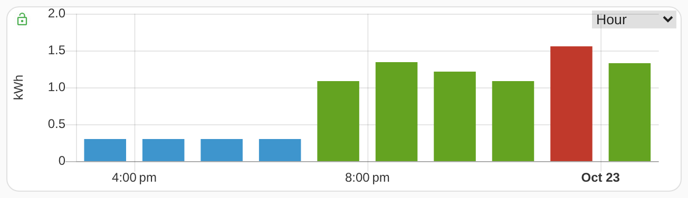

- **At each point** — the color is evaluated at each point (each bar, each arrow of an arrowline — its fill, the band under it): a curve changes color on a point, never between two. Its fill takes the same color, with the transparency of its `fill`.
- **In the legend** — the color now, as the value shown in the label is the value now.
- **No valid color** — when none applies (a value thresholds don't cover and no `default`, the entity holding the color unavailable, its state not a color, or no history of it — an entity holding text has no long-term statistics), the curve takes a color of the automatic palette.
- **The same color** — two curves of one graph whose `color` is set to the same value both keep it; only a color the card chose itself is changed to tell a curve from the others.

**Blended thresholds** — `colorTransition`:
- `smooth` (`look: mini`'s default) — number thresholds blended from one to the next, as mini-graph-card draws them: at a threshold its color, between two a mix of both by where the value is between them, below the lowest and above the highest their own color; the line is a gradient along the Y axis, each point its own blended color, the legend the color of the value now. Thresholds with states, or compared on another entity, aren't blended;
- `hard` — each value the color of its threshold.

```yaml
type: custom:history-explorer-card
colorTransition: smooth
graphs:
  - type: line
    entities:
      - entity: sensor.outside_temperature
        color: { '0': blue, '20': green, '30': red }
```

**A color for each entity of a graph** — `lineColor` on a graph or on the card: a color, or a list of colors — each entity of a graph without its own `color` takes the one at its place in the graph, the others the palette's. A graph's `lineColor` comes above its `color`; the card's, as every option of the card, below a graph's `color` and `entityOptions`', above the card's `color`.

**The fill** — `fill` takes the same forms as `color`, its values being a fill's — `false` (none), `fade` (the curve's color fading out downwards), `light` or `true` (the curve's color, light), `solid` (the curve's color) or a color: thresholds on the value shown, thresholds on the value of another entity or attribute, or an entity holding a fill. It's evaluated at each point, as the color.

**Its default** — calculated by the type, and by whether the color is defined (by the YAML, `lineColor`, `entityOptions`, or chosen in the menu):

| Type | Color not defined | Color defined |
|---|---|---|
| Curve, arrowline | `light` | `false` |
| Bar, timeline | `solid` | `solid` |

On an arrowline, `solid` — which would hide the arrows — is ignored: its default applies.

**A timeline's blocks** — each in its state's color, outlined in it: `solid` filled, `light` light, `fade` fading out downwards, `false` its outline only; a color of its own (`fill` a color, or read indirectly) is ignored there. Read indirectly, each block takes the fill of its middle's time.

```yaml
      - entity: sensor.heat_pump_power
        fill:
          entity: climate.salon            # its fill from the thermostat's action
          attribute: hvac_action
          heating: fade
          default: false
```

### Values over a graph, a compact look

A graph can show, over its plot:
- **`showState: true`** — each curve's value now, in large, in its color and unit (the first one on the left, the last one on the right), updated with the entity; the times shown over a graph are written as the time axis writes them (`hour24`, else Home Assistant's own setting);
- **(hover)** — a hover on a curve shows, in place of its value now, the value it's on with its time, as mini-graph-card does; a value or a name cut (a narrow card) is shown in full while hovered, and on a click; a click on a value opens its entity's dialog (with the info panel when it's on);
- **`showStats`** — each curve's statistics over the time window shown: `min`, `average`, `max` (a name or a list; `true`: all three), on a row — the minimum and the maximum with their time (the hour on a window of a day or less, else the date and the hour). For curves (lines) only:
  - **Taken from the values loaded** — the history, or the statistics where the curve is drawn from them (each hour's own minimum and maximum), never from the points drawn, between the start of the window and its end (or now); the average weighted by time;
  - **Kept up to date** — recomputed as the window moves or zooms, and when new values arrive;
  - **Several curves** — each row named after its curve.

A curve hidden from its legend shows neither. Both are set at every level — card, `entityOptions`, graph, entity (`showStats: false` on one curve of a graph that shows them turns them off for it).

- **`showStateFor`, `showStatsFor`** — on a graph or the card: which curves a graph's or the card's `showState` and `showStats` are for:
  - `all` — the default;
  - `first` — its first curve only, as mini-graph-card shows its first entity's; the others show theirs only when it's set on them (on the entity, or in `entityOptions`: mini-graph-card's `show_state` on an entity).
- **`stateAdaptiveColor: false`** — mini-graph-card's `state_adaptive_color`, on the card, a graph, an entity or in `entityOptions`: a curve's values written in the text's color instead of its own (the default); its `showIndicator` dot keeps the curve's color.

The values' place along their row: `alignState` — `left` (the default), `center`, `right`; their size: `fontSize`, a percentage (`80`); `showIndicator` on an entity: a dot in its color before its value.

Above them, a graph's **header** — its name and its icon, as mini-graph-card shows them —, set on a graph or on the card:
- **the name** — the graph's `title`; `showName: true` without one, its first curve's name; `showName: false`, none;
- **`showIcon: true`** — an icon: `iconImage` (an image's address), else `icon` (`mdi:home`), else the entity's own, else one by its device class (a thermometer for a temperature…);
- **`alignHeader`** — `center` (the default), `default` (the name on the left, the icon on the right), `left`, `right`; **`alignIcon`** — `right` (the default), `left`, or `state`: with the values, at the end of their row;
- **`fontSizeHeader`** — its size in pixels; **`nameAdaptiveColor`**, **`iconAdaptiveColor`** — the name, the icon in the color of the first curve now.

`showCurrentValues: false` — on the card, a graph, an entity or in `entityOptions` — leaves a curve's value now out of its legend label.

`showGraph: false` on an entity leaves its curve undrawn and out of the legend; its value is still shown over the graph. On a graph or the card, none of its curves is drawn: no plot, only the header and the values.

Three more options shape the graph itself:
- **`showGrid: false`** — no grid lines;
- **`yLabels: inside`** — the Y labels drawn inside the plot, over the curves, each in a box of the card's background, just above their grid line, at mini-graph-card's size, the plot then taking the whole width (an axis is moved by a drag along its labels, see [Y axis scaling](#y-axis-scaling)). A card narrower than 300 px draws them so by itself, its other text a little smaller; `yLabels: outside` keeps them beside the plot whatever the width;
- **`fill: fade`** — the area under a curve filled with its own color, fading out downwards.

**`look: mini`** — mini-graph-card's look, for the whole card:
- **What it sets**:
  - the card — `header: hide`, `uiLayout: { toolbar: hide, selector: hide, interval: hide }`;
  - the header — `showName: true`, `showIcon: true`, `alignHeader: default`, `fontSizeHeader: 14`;
  - the values over the graph — `showState: true`, `showStateFor: first`, `showStatsFor: first`, `stateAdaptiveColor: false`, `showCurrentValues: false`, `legendVisible: auto`;
  - the graph — `height: 150`, `showTimeLabels: false`, `showGrid: false`, `yLabels: inside`, `labelsLeft: hover`, `labelsRight: hover`;
  - the curves — `lineWidth: 5`, `lineMode: curves`, `interpolation: bspline`, `fill: fade`, `colorTransition: smooth`;
- **Only defaults** — every option set on the card wins over the look's, under any of its names (`look: mini` with `showGrid: true` keeps the grid). Its options in mini-graph-card's syntax: see [Replacing mini-graph-card](#replacing-mini-graph-card);
- **Unlike mini-graph-card** — the time can still be panned and zoomed (a drag, the wheel with Ctrl, a pinch), and the statistics follow the window shown.

```yaml
type: custom:history-explorer-card
look: mini
defaultTimeRange: 24h
graphs:
  - title: Rain
    entities:
      - entity: sensor.rain_rate
        name: Rate
        color: orange
      - entity: sensor.rain_total
        name: Total
        showState: true         # its value now too, beside the first one's
```

<picture>
  <source media="(prefers-color-scheme: dark)" srcset="https://github.com/Cook23/history-explorer-card/raw/v1.2-dev/images/screenshots/narrow-and-mini-dark.png">
  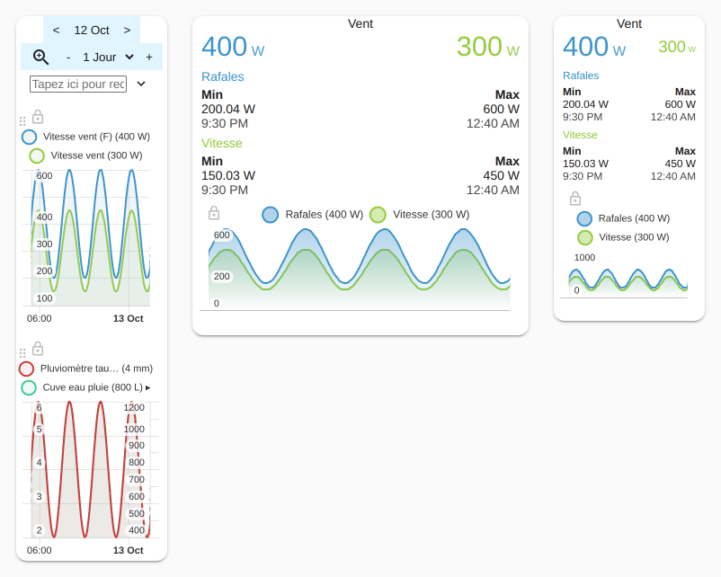
</picture>

*Left: a card 168 px wide (two cards side by side on a phone). Middle and right: `look: mini`, 374 and 168 px wide.*

> Thanks to [mini-graph-card](https://github.com/kalkih/mini-graph-card) (kalkih) for its good ideas on showing a graph in little room — the labels in boxes inside the plot and their size, the first value large and the others small, names cut rather than wrapped — which this card follows.

### mini-graph-card compatibility

#### Replacing mini-graph-card

A mini-graph-card is replaced in place: `type: custom:history-explorer-card` and `look: mini` — its other lines unchanged.

```yaml
type: custom:history-explorer-card    # was custom:mini-graph-card
look: mini                            # mini-graph-card's look
name: Power
hours_to_show: 12
show:
  fill: false
entities:
  - sensor.power
  - entity: sensor.rain
    y_axis: secondary
```

Its options are aliases of the card's — names and values, each in the [complete list of options](#complete-list-of-options) — mixed freely with the card's own names; `look: mini` only gives defaults: any option set, under either name, wins. Its forms are read as they are:
- **`show:`** — `show: { fill: false }` is `show_fill: false`;
- **The card's `entities`** — one graph, `name` its title, `show: graph: bar` its type; an entity written as its entity_id alone; `unit`, `color` and `fill` on the card: every entity's;
- **`height`** — the graph's, the header's lines not counted;
- **`update_interval`** — the card's automatic refresh (on by default: each change, at most every 2 s);
- **An entity's `attribute:`** — the card's own: an attribute shown instead of the state (see [YAML configuration for preconfigured graphs](#yaml-configuration-for-preconfigured-graphs)); `tap_action` is `tapAction`;
- **A hover on a curve** — shows the value it's on over the graph, as mini-graph-card does (`showState`);
- **`smoothing: true`** — curves (`lineMode: curves`), with mini-graph-card's interpolation under `look: mini` (`interpolation: bspline`).

Written differently in the card's syntax:

| mini-graph-card | history-explorer-card |
|---|---|
| `show.extrema`, `show.average` | `showStats: [min, max]`, `showStats: [average]` (both: `[min, average, max]`) — under `look: mini`, the first curve's (`showStatsFor: first`) |

Also read as the card's own:
- **Aggregation** — `points_per_hour`, `aggregate_func`, `group_by`: `pointsPerHour`, `aggregateFunc`, `groupBy` (see [Aggregation](#aggregation)); a sub-attribute (`attribute: forecast.0.temperature`), as mini-graph-card reads it;
- **The Y axis** — soft bounds (`lower_bound: ~0`), `min_bound_range`, the `_secondary` ones, `logarithmic`, `show.labels` and `show.labels_secondary` with their `hover` (see [Y axis scaling](#y-axis-scaling), [Bounds](#bounds), [Two Y axes](#two-y-axes));
- **The curves**:
  - `show.legend` — shown only for several curves under `look: mini` (see [Legend / entity labels](#legend--entity-labels));
  - `value_factor`, `state_map` — see [Text states as a curve](#text-states-as-a-curve);
  - `line_color`, `color_thresholds_transition` — see [Colors of curves and bars](#colors-of-curves-and-bars);
  - an entity's `show_line`, `show_legend`, `fixed_value` — see [Line stroke style](#line-stroke-style);
  - `bar_spacing` — see [Bar graphs for total increasing entities](#bar-graphs-for-total-increasing-entities);
  - `hour24` — see [The clock](#the-clock);
- **The header and the values over the graph** (see [Values over a graph, a compact look](#values-over-a-graph-a-compact-look)):
  - the header — `show.name`, `show.icon`, `icon`, `icon_image`, `align_header`, `align_icon`, `font_size_header`, `show.name_adaptive_color`, `show.icon_adaptive_color`;
  - the values — `align_state`, `font_size`; an entity's `show_state`, `state_adaptive_color`, `show_indicator`, `show_legend_state`, `show_graph`; `show.graph: false`;
- **Accepted, without effect** — `animate`, `cache`, `compress`, `group`, `loading_indicator`: the card draws at once, loads what the screen shows (see [Long term statistics](#long-term-statistics)) and keeps nothing in the browser's cache.

### Default view and time ranges

When the dashboard is opened, the card shows the last 24 hours by default; `defaultTimeRange` sets another one. m, h, d, and w to denote minutes, hours, days and weeks respectively. For longer time scale, o and y denote months and years. The maximum range is ten years. If no postfix is given, hours are assumed. A range that isn't one of the time range selector's is rounded up to the next one (`36h`: 2 days).

When the time range is persisted (see [Persistence](#persistence)), the card reopens at the range last chosen, and a change of `defaultTimeRange` in the YAML takes over — the last one to speak wins. Otherwise it always opens at `defaultTimeRange`.

```yaml
type: custom:history-explorer-card
defaultTimeRange: 4h     # show the last 4 hours when opening the card
                         # or: 15m (15 minutes), 2d (2 days), 3w (3 weeks), 6o (6 months), 1y (1 year), 5y (5 years)
```

The magnifying glass's mode — what its box zooms — has its default the same way, kept or not as the time range is:

```yaml
type: custom:history-explorer-card
defaultMagnifierMode: x   # the time (↔); y: the Y axis (↕); xy: both (⤢, the default)
```

The card opens with the present on the graphs' right. `realTimeStep` (also `defaultTimeOffset`) sets the end — where the window ends when the card opens or the date is double-clicked, and how it follows the new values in real time:
- not set (or 0): the end is the present, now; the window slides with each new value;
- a time after now, in lowercase units (`m`, `h`, `d`, `w`, `o`, `y`) — `1h`: the window ends an hour after now; it stays still while the new values fill that hour, then moves on by a step when they reach its end;
- snapped to the current hour, day, month or year, in uppercase (`H`, `D`, `O`, `Y`) — `1D`: the window ends at midnight tonight; it stays still while the day fills, then moves on to the next one;
- negative — `-1d`: the end is a day before now, followed as new values come: the window slides a day behind, the last day never shown.

Real time lasts as long as the place of the new values is on screen: from now to the end (with a step), now (without), the end (negative). The window goes at most one graduation of the time axis past the end.

```yaml
type: custom:history-explorer-card
realTimeStep: 1h            # an hour of empty space after now, filled, then a step on
                            # or: -1d — the previous day's data, sliding a day behind
                            # or: 1D — the current day from midnight to midnight
                            # or: 1O — the entire current month, starting at the 1st
```

### Long term statistics

The card loads what the screen can show, and no more. A graph can't draw anything narrower than a column of pixels: what it loads depends on how long a column lasts — the window's duration divided by the width of the plot area, in CSS pixels (the widest graph's). Both sources are combined on the fly: scrolling and zooming go on as usual.

| A column of pixels lasts | The window drawn from |
|---|---|
| a month (30 days) or more | the monthly statistics |
| a week or more | the weekly statistics |
| a day or more | the daily statistics |
| an hour or more | the hourly statistics (`statistics.period`) |
| 5 minutes or more | the 5-minute statistics |
| less than 5 minutes | the history |

For example, on a graph 900 pixels wide: a day is drawn from the history (1.6 min a column), a week or a month from the 5-minute statistics (11 or 48 min), three months from the hourly statistics (2.4 h), five or ten years from the daily statistics (2 or 4 days) — ten years on 500 pixels from the weekly ones. The history is used up to some 29 hours on 350 pixels, 3 days on 900, 5 days on 1500.

- **What the window needs, in phases** — what the card has loaded is drawn at once; what it lacks is asked to Home Assistant in phases, each answer drawn as it comes:
  - **Phase 0** — once a session, each entity's statistics checked (see *Only valid statistics* below);
  - **Phase 1** — the coarse source — the most precise valid statistics among the hourly, daily, weekly and monthly ones giving the window a hundred values at least (never finer than a column of pixels shows), over the window and a window on each side (a month at most; in real time, the left side only); the automatic Y axis is worked out from it:
    - one request per entity; a short part (a day, a side, the hours not compiled yet) the same for several entities, one request for them all; a larger one, once the window has moved, in 4 groups of entities, a request each;
    - a window too short for a hundred hourly values (some 4 days) has no phase 1;
  - **Phase 2** — only when a column of pixels lasts less than an hour: the fine source over the window — the 5-minute statistics where a column lasts 5 minutes or more and they're valid, else the history:
    - in blocks from the right, all the same size for a width: up to a day, one block of the window (whole hours); up to 10 days, a day; beyond, a tenth of the window in whole days, a month at most;
    - an entity without statistics always has phase 2, from its history;
    - without phase 1, where the fine source comes back empty or starting late (past the recorder's retention): the hourly statistics there;
    - without phase 2, where the statistics begin after the window's start (a state class given later, a change of unit): the history before them.
- **Only valid statistics** — statistics of a period shorter than an entity's own would make up values between its values: a value held, drawn as twelve the same, then a step.
  - **The probe** — once a session, at the start (kept in the cache), all the entities in one request, judged from Home Assistant's answer itself:
    - their last hour — the 5-minute statistics valid, and the hourly ones, where 5 intervals between values are each under 4 minutes (how often the sensor speaks when it speaks, whatever its silences); the hourly ones where the mean time between values (an hour divided by their count; none: infinite) is under 15 minutes;
    - for the others, their last 24 hours, in one request — the hourly ones valid where 5 intervals are each under 50 minutes.
  - **What counts** — only the intervals between two numbers: an unavailable state and the value after it (a restart) tell nothing of the sensor. A sensor flooding its history costs one hour of it only; a sensor silent at night, or between its changes, is judged on how often it speaks.
  - **Daily, weekly, monthly** — always valid.
  - **Not valid** — 5-minute statistics are never used, neither drawn nor exported (the history is kept as long). Hourly ones are drawn only where the history isn't kept (past the recorder's retention, their periods made up held — see below), the history first wherever it is: better than daily statistics coarser than a column of pixels; they're always exported.
- **The coarsest source a column holds, first** — where the card has several sources loaded, it draws the coarsest valid one whose period a column of pixels holds — the hourly statistics for six months, even where the history is loaded too: the same mean, minimum and maximum, from far fewer values —, a finer one only where it lacks (the last minutes, not compiled yet), a coarser one where nothing finer is kept. An angle is drawn from its history wherever it's loaded: its statistics are wrong (see below) — not one of state class `measurement_angle`.
- **Statistics made up, a value held** — Home Assistant compiles statistics for a period even when the sensor sent nothing: its last value, carried — its minimum, mean and maximum the same. A run of 5-minute or hourly statistics like that, at the same value, is drawn as that value held: one value lasting until the run's end — a silence in smart mode, a plateau (see [Smart mode](#smart-mode-silences-shown-as-flat-dashed-plateaus)) —, never a point each period.
- **In the background, while the graphs are looked at** — once the window has come, the card fills its cache around it:
  - **What** — first, the history of the angles drawn from statistics over the window (Home Assistant averages them as plain numbers — not those of state class `measurement_angle`); then what each source can give the entities for the export menu; then each side, the block nearest the window first, every entity alike — the fine source a window on each side, in its blocks, the coarse one up to four windows on each side, in blocks ten times as large;
  - **How** — one request at a time, the entities of a source together, without showing the window as loading; only when nothing else is under way, a second after the last change of the window, then a pause after each one of twice what it took (a second to 30 seconds: Home Assistant busy for it a third of the time at most); only while the cache stays under some 300 000 values.
- **Requests to Home Assistant** — its database answers a few requests at a time (its recorder's workers: 4 with MariaDB), in the order they come, and reads every hourly row for the daily, weekly and monthly statistics, whatever their period: ten years of an entity are 87 600 rows.
  - **One queue** — the card sends its requests by phase, then phase 2's block, then the graphs' order, at once, 4 in flight at most, never asked again (an answer always comes). Every card on the page shares it.
  - **Grouped** — each request costs Home Assistant a fixed time, so: the probes in one request; phase 1, the heavy one, an entity at a time, each drawn as it comes — its short parts the entities together, its larger ones, once the window has moved, in 4 groups; phase 2, block by block, the entities of a source in 4 groups, a request each, every worker busy; the background, the entities of a source together.
  - **Priorities** — phase 1's parts wholly outside the window shown (its sides, once the window has moved) go after phase 2; a request bringing nothing to the window shown goes after those that do — one asked for the window before but bringing some of this one keeps its place (the window moved by the arrows, a drag, a zoom). The window shows as loading as long as a request bringing some of it is under way.
  - **Drawing** — an answer draws again only the graphs of the entities it brought something to, and answers coming close together are drawn once; the graphs on the screen (their plot area, at least in part, in what the page shows) first, the others right after, one at a time when the page is free — after a gesture that moves the window, never during it.
  - **A history's start remembered** — where an entity's history comes back beginning well after the time asked, or empty for a time ended an hour before it was asked (past the recorder's retention, or before the entity existed — nearer, its first rows may not be written yet), the card never asks its history (its attributes' too) before that time again.
- **A reasonable cache** — past some 500 000 values (about 50 MB), the card drops the least useful ones until it's back under 300 000:
  - first the history of the days farthest from the window, then their 5-minute statistics, the hourly, daily, weekly and monthly ones last;
  - never the window nor its sides, as the coarse source asks them (each side a width, a month at most): a window of years may keep the cache past 500 000 values;
  - a day dropped is drawn again at once from the statistics kept, and asked again when it's shown.
- **Kept when the card is drawn again** — Home Assistant drawing the dashboard again (coming back to it, the app back from the background) makes the card again:
  - **Taken back** — put on the page, the new card takes back the one it replaces as it was — its graphs, already drawn, shown at once, nothing built or drawn again — and asks only what came since; a card that wasn't drawn yet takes back what its cache held on the page;
  - **Let go** — a card off the page and its cache, 10 minutes later, unless taken back; two cards are never given each other's, whatever their name;
  - **The page loaded again** (the app's page dropped meanwhile) — its cache starts again, but this device keeps the probes' verdicts (see *Only valid statistics*), for a day, and the automatic Y axes (see [Y axis scaling](#y-axis-scaling)): no probe asked again, the axes as they were.
- **The last minutes from the history** — Home Assistant compiles a period's statistics once it has ended:
  - **Not compiled yet** — those periods come from the finer statistics, down to the hourly ones, and the minutes after the finest from the history — from the hour before their period and 10 minutes ago (room for Home Assistant being slow), or from where they stop when they stop earlier (Home Assistant late with them) —, the entities from the same time in one request;
  - **The automatic refresh** — asks again what came since each source was asked: today's statistics, and of the history only the hours since — never the day's history again. The card keeps every source the same way, by the time it covers.
- **The same values from both** — a point computed from the history has the same mean, minimum and maximum as Home Assistant's statistics over the same time (see [Data decimation](#data-decimation)): nothing shows where the history meets the statistics.
- **`statistics.period`** (below) is the hourly threshold of the table — an hour by default; with `period: day`, `week` or `month`, those statistics replace the hourly ones; with `period: 5minute`, the 5-minute ones do — used only where they're valid, as everywhere (see *Only valid statistics* above); with `statistics.force`, the card never goes down to the history (the 5-minute statistics at most), but for the last minutes.
- **How long they're kept** — Home Assistant keeps the 5-minute statistics as long as the history (the recorder's `purge_keep_days`), the hourly ones for ever (the daily, weekly and monthly ones are computed from them): the card takes what it returns, however far back.
- **Entities without statistics** — attributes, entities without a state class — always come from the history: past the history retention limit, their graph is blank. How an entity is shown — a curve, bars, a timeline, an arrowline, or the color of another curve — changes nothing to where its data comes from.
- **Angles** (`circular`) are loaded as the rest, in the same phases; Home Assistant averaging them as plain numbers (not those of state class `measurement_angle`: their mean circular), their history is asked besides wherever the window is drawn from the statistics: over the window, first of the background, from the right (see [Circular values](#circular-values-angles)).

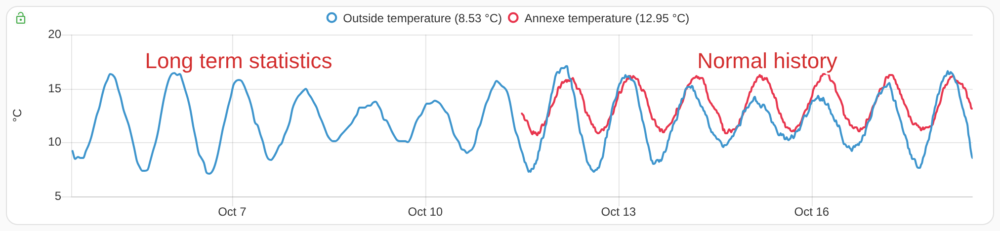

In the screenshot above, the blue graph is the outdoor temperature, the red graph is the temperature of a barn. The outdoor temperature has statistics available, the barn temperature does not. So the red line stops where the history database retention period ends (Oct 11th). The outdoor temperature continues way past this point, from its long term statistics.

The long term statistics are on by default, hourly. `statistics` turns them off, or to statistics only — the short term history then left aside:

```yaml
type: custom:history-explorer-card
statistics:
  enabled: true    # true is the default, use false to turn LTS support off (history only)
  period: hour     # reporting period. 5minute, hour, day, week or month. Default is hour.
  force: false     # true: long term statistics only (still the history for the last minutes, and for entities without statistics)
```

`mode` and `retention` are accepted, without effect: a curve is drawn through the mean, the minimum and maximum shown by the band (`showMinMax`) and in the tooltip; the statistics cover the whole window, whatever the history's retention. A `total_increasing` sensor (energy…) is drawn from its state.

### Data decimation and aggregation

#### Data decimation

A long time window holds far more values than the graph has pixels: a week of a sensor reporting every few seconds is hundreds of thousands of values over some 900 pixels. Drawing them all froze the page for nothing — they land on the same pixels. So:

- **Curves — one point per column of pixels** — the graph's width is cut into columns of one pixel each.
  - **Several values in a column** — of the history, or an hour of statistics: drawn as one point, their **mean**, each value weighted by how long it lasted. Computed as Home Assistant compiles its statistics: the value in force when the column starts counts too, from its start, in the mean, the minimum and the maximum — an hour of the history gives exactly that hour's statistics, and nothing shows where the history meets the statistics.
  - **Minimum and maximum** — kept with it: `showMinMax` draws them as a lighter band around the curve, and the tooltip shows `min / mean / max` (the mean alone when, rounded, the three are the same), with the interval of time the point covers.
  - **A single value** — of the history, drawn as is: zoomed in, every value is there, point by point — only the values recorded: the state in force that Home Assistant repeats at the start of a request (at midnight, for the requests of a day) is not one.
  - **The source** — whether the values come from the statistics or the history: see [Long term statistics](#long-term-statistics).
- **Aggregated — groups chosen** — see [Aggregation](#aggregation): a point a day, an hour, or `pointsPerHour` points an hour, each the function chosen.
- **Timelines — merged under 2 pixels** — states following each other that are each narrower than 2 pixels (too thin to tell apart, or to point at) are merged into one *multiple* block; zoom in and they appear:
  - a state 2 pixels wide or more is always drawn, and a short state alone, between two longer ones, keeps its own color;
  - a timeline with a `process` function is never merged;
  - a timeline of directions (`arrowline`) keeps a state per column of pixels at most: the one in force at the column's middle, the one its arrow shows.

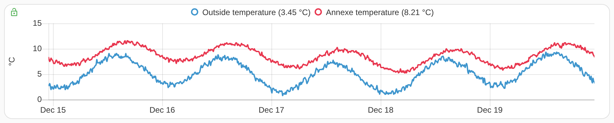

`decimation` is accepted — on the card, a graph, an entity or in `entityOptions` — without effect: the card draws what the screen can show, and only that, for a faithful drawing with the best display performance.

#### Aggregation

Instead of a point per column of pixels, a curve can have a point per group of time chosen, each given by the function chosen. On the card, a graph, an entity or in `entityOptions` — the curve's own options: moved to another graph, a curve keeps them:

| Option | Values | |
|---|---|---|
| `pointsPerHour` (`points_per_hour`) | a number > 0 | groups of 1 / `pointsPerHour` hours, on the day's grid (`0.5`: 0:00, 2:00, 4:00…) |
| `groupBy` (`group_by`) | `interval` (default), `hour`, `date` | `hour`: an hour each; `date`: a day each, from midnight to midnight — and a bar graph's interval hourly or daily, unless set |
| `aggregateFunc` (`aggregate_func`) | `avg` (default), `median`, `min`, `max`, `first`, `last`, `sum`, `delta`, `diff` | each group's value: its mean (each value weighted by how long it lasted), median, lowest, highest, first, last, the sum of its values, its highest less its lowest, its last less its first |

- **The same entity several times** — in the YAML, in one graph, each with its own `aggregateFunc` (its highest, its lowest and its mean, as mini-graph-card shows them); the card's gestures never put a curve twice in a graph;
- **Groups** — never narrower than a column of pixels; a group without any value carries the value before (`delta` and `diff`: 0);
- **The min/max band** (`showMinMax`) — each group's lowest and highest, whatever the function;
- **On a bar graph** — `aggregateFunc` gives each bar the function over its interval (`max`: the day's total of a sensor reset every day);
- **From the long-term statistics** (long windows) — an hour of them counts as one value, its mean: `median`, `first`, `last`, `sum` and `diff` are then approximate — exact where the history is loaded.

```yaml
type: custom:history-explorer-card
defaultTimeRange: 1w
groupBy: date                 # a point a day
graphs:
  - type: line
    entities:
      - entity: sensor.outside_temperature
        aggregateFunc: max
      - entity: sensor.inside_temperature
        aggregateFunc: min
```

### Scaling values: scale, unit and valueFactor

Three options of an entity (`valueFactor`: also of a graph, the card or `entityOptions`) multiply its values. They overlap; what differs is how the factor is written and what is shown:

| | `scale` | `valueFactor` (`value_factor`) |
|---|---|---|
| Written as | the factor itself (`0.001`, `-1`) | a power of 10 (`-3`: × 10⁻³) |
| Without `unit` | only the curve drawn is multiplied: the legend, the tooltip and the values over the graph show the entity's real value — to make a small curve visible next to larger ones, or to flip it with a negative factor | the values drawn **and** shown are multiplied (400 W shows 0.4 W) |
| With `unit` | a conversion: the values drawn and shown are multiplied, in that unit (`scale: 0.001` and `unit: kW` for a power in W) | the same, in that unit |

`valueFactor: -3` thus gives the same as `scale: 0.001` with `unit` set to the entity's own unit. Both can be set together: the values are drawn multiplied by `scale` × 10^`valueFactor`, and shown multiplied by the same with `unit`, by 10^`valueFactor` alone without it.

```yaml
type: custom:history-explorer-card
graphs:
  - type: line
    entities:
      - entity: sensor.power            # in W
        scale: 0.001
        unit: kW                        # shown and drawn in kW
      - entity: sensor.energy_meter     # in Wh
        valueFactor: -3                 # shown and drawn divided by 1000, its unit kept
      - entity: sensor.small_signal
        scale: 100                      # only drawn larger: its real value shown
```

### Custom data processing functions

`process` is a JavaScript expression changing each value right before it's drawn — to filter or shape the data, scale it non-linearly, or turn it into another graph type's. It receives the value as `state` (a string or a number, by the graph and the source) and gives the new one. A complex expression slows the drawing down. 

It works for the entities added from the card, the YAML's graphs and the info panel's.

A humidity shown as a timeline: below 30 %, `dry`; above 70 %, `wet`; in between, `normal`:

```yaml
type: custom:history-explorer-card
graphs:
  - type: timeline
    entities:
      - entity: sensor.room_humidity
        process: '( state < 30 ) ? "dry" : ( state > 70 ) ? "wet" : "normal"'
```

A spike filter for temperature entities: a positive or negative spike is made invalid, and the graph goes over it:

```yaml
type: custom:history-explorer-card
entityOptions:
  temperature:  
    process: '( Math.abs(state) < 100 ) ? state : "unavailable"'
```

### Auto refresh

The graphs follow the values as they change in two ways, which can be combined.

Automatic refresh watches the entities shown and reloads their recent data — the last minutes of history and today's statistics, today's history where the graph is drawn from the history:
- **How often** — at most once every 2 seconds, however often they change, and never sooner than five times what drawing the graphs again last took: many graphs over a long window are refreshed less often, the page never kept busy;
- **Current values** — next to their names (`showCurrentValues`) and over the graph (`showState`), they follow each change at once;
- **A state given by Home Assistant** — each change it pushes, or the state found when asking the history, is a value of the history at its time, drawn at once: the recorder writes the history only every `commit_interval` (its `recorder:` option), and an answer of the history that doesn't have it yet doesn't take it away;
- **Late statistics** — a period Home Assistant compiles later than expected is asked again at each refresh until it comes.

It's on by default; `automatic: false` turns it off (the card then refreshes only when the page is reloaded, or at the interval below):

```yaml
type: custom:history-explorer-card
refresh:
  automatic: false
```

With many fast changing entities, the automatic refresh can strain the database with its requests: a refresh at a fixed rate, whatever the sensors do, is then better — here, every 30 seconds (the page reloaded after the interval is changed):

```yaml
type: custom:history-explorer-card
refresh:
  interval: 30
```

### Configuring the UI

#### Gesture settings

Every gesture is told apart by two thresholds, one pair for a mouse or a pen, one for a finger:
- **the long-press duration** — a press held this long is a long-press; a second press this soon after a release, at the same place, is a double-click (or a tap-then-drag); after a tap on a label, a graph's ⠿ zone or the Y axis, the page doesn't scroll from there for that long, so that a drag can follow;
- **the precision** — a pointer that moved further than this is dragging; a second press within it of the first is at the same place; a label, a button or a curve within it of the pointer can be picked.

And, for every pointer, **the reading time of a word**: a tooltip or a message stays up 0.5 s, plus this per word it holds.

Raise them for a less steady or slower hand, or a slower reading. In the YAML (any card), or in *Global ▸* of the options menu:

```yaml
type: custom:history-explorer-card
gestures:
  longPress: 500        # ms, mouse and pen (200 to 2000; default 500)
  longPressTouch: 500   # ms, finger
  precision: 8          # px, mouse and pen (4 to 20; default 8)
  precisionTouch: 12    # px, finger (4 to 20; default 12)
  readingTimePerWord: 400   # ms per word of a tooltip or a message (100 to 1000; default 400)
```

A value out of bounds is brought within them. They apply to every card and info panel of the page: whether set in a card's YAML or in the menu, the last one to speak wins, and they are kept on every device, whatever the card's persistence options — as the info panel's switch.

#### Header text

`header` changes or removes the default header (*History explorer* and the card's version):

```yaml
type: custom:history-explorer-card
header: 'My sample history'
              # or: ' ' — a single space removes the header and leaves some padding space
              # or: hide — removes the header entirely
```

#### Dark mode

The card's colors follow the theme, dark or light, as Home Assistant says it is. With the default theme, or another modern theme that sets the dark mode flag, the default settings are right. With an older theme that uses the legacy format and doesn't properly set the dark mode flag, the card may end up in the wrong mode. The mode is then forced, dark or light:

```yaml
type: custom:history-explorer-card
uimode: dark
```
Replace dark with light to force light mode instead.

#### Customizing the color of UI elements

`uiColors` sets the colors of the card's elements:

```yaml
type: custom:history-explorer-card
uiColors:
  gridLines: '#ff000040'
  labels: green
  buttons: '#80f00050'
  selector: 'rgba(255,255,255,255)'
  closeButton: '#0000001f'  # the bar interval selector's background
  cursorLine: '#ff000080'   # the cursor line's color (see The cursor line below)
```

#### The cursor line

While the pointer is over a graph's plot area (a mouse, or a pen held above the screen), a thin vertical line follows it: an easy way to read the time of a change, and to compare it across graphs. By default it's drawn on timelines only. `cursor` sets where:

```yaml
type: custom:history-explorer-card
cursor:
  mode: auto          # auto (the default): on the graph under the pointer only
                      # all: on every graph of the card at once, at the same time — to line events up
                      # hide: never
  types: [timeline]   # the graphs that show it, by type: timeline (the default), line, bar,
                      # arrowline — or all
uiColors:
  cursorLine: '#ff000080'   # its color (the grid lines' color by default)
```

With `mode: all`, the line follows the pointer on every graph of the card as soon as the pointer is over a graph whose type is listed in `types`. For example, to line up a heating timeline with the temperature curves:

```yaml
type: custom:history-explorer-card
cursor:
  mode: all
  types: [line, timeline]
```

#### Changing the UI layout

`uiLayout` sets where the toolbar and the entity selector go:

```yaml
type: custom:history-explorer-card
uiLayout:
  toolbar: top
  selector: bottom
```
Each takes `top`, `bottom`, `both` or `hide`: `both` shows the element at the top and at the bottom — on a long card, much scrolled —, `hide` not at all. The interval selector of total increasing entities is hidden with `interval: hide`.

**Sticky toolbars** — `top`, `bottom` or `both` kept floating over the graphs, the controls in reach while scrolling through a long list of graphs. On a phone, a sticky bottom toolbar holding the entity selector makes its list hard to reach:

```yaml
type: custom:history-explorer-card
uiLayout:
  sticky: top   # the top toolbar kept on the screen
```

The magnifiers + and − of the time range control work the other way round with:

```yaml
type: custom:history-explorer-card
uiLayout:
  invertZoom: true
```

`labelAreaWidth` sets the width of the label area left of the graphs, `labelsVisible: false` hides the names left of the timelines' rows (the Y axes' labels: `labelsLeft` and `labelsRight`, see [Y axis scaling](#y-axis-scaling)):

```yaml
type: custom:history-explorer-card
labelsVisible: false   # no entity names left of the timelines' rows
labelAreaWidth: 10     # the width of the label area in pixels, default is 65
```

#### Graph sizes

The graphs' heights:

```yaml
type: custom:history-explorer-card
lineGraphHeight: 100     # default line graph height is 250
barGraphHeight: 100      # default bar graph height is 150
timelineBarHeight: 18    # timeline bar height (default is 24)
timelineBarSpacing: 30   # spacing from the top of one timeline bar to the next (default is 40)
```

A line or bar graph — added from the card or written in the YAML — can have a height of its own, which wins over the card's:

```yaml
type: custom:history-explorer-card
entityOptions:
  humidity:
    height: 150        # set the height of all humidity graphs to 150
graphs:
  - type: line
    options:
      height: 200      # explicitly set the height of this manually defined graph
    entities:
      - entity: sensor.outside_temperature
```

#### A narrow card

A card narrower than 300 px (two cards side by side on a phone, a grid of small cards) keeps its graphs readable, as mini-graph-card does:
- the toolbar's date, range and search each on a line of their own;
- the Y labels inside the plot (as `yLabels: inside`; `yLabels: outside` keeps them beside it), which keeps its width;
- the text a little smaller; the legend's names shortened, each value kept;
- the values over a graph, the first one large, the others small on its right;
- a menu takes the room there is, a tooltip stays within the screen.

In detail:
- the toolbar: when even the short date and the range don't fit side by side, the date (‹ ›), the range (🔍 − + and its name) and the entity search each on a line, centered;
- the Y labels inside the plot, each in a box of the card's background 80 % opaque (opaque while the pointer is near them), at mini-graph-card's size (10.5 px), a label whose box would touch another one skipped; dragged along them, an axis moves (a finger or a pen: a tap, then a second press right away) — a click, a long press or a hover there are the curves' (see [Y axis scaling](#y-axis-scaling));
- the handle, the padlock, the chain icon and the close button each in a box like the Y labels', over the legend's labels or a timeline's rows, taking no room — on the box a gesture is theirs, beside it the label's;
- the legend, the time labels and a timeline's text in 11 px (12 px, and 13 px for a timeline's states, otherwise); the legend's lines below the first taking the whole width; the time labels' step grown until they fit side by side;
- the legend's names shortened, every curve of the graph at the same step: a qualifier many entities carry as its initials (`(Filtered)` → `(F)`), the start of the name — the device's name, or the words shared with another curve — abbreviated (`M-F V…`), the articles removed, that start removed where two curves don't then read the same, then '…' before the value;
- the values over a graph (`showState`): the first curve's large, the others small in a column on its right, each cut ('…') rather than wrapped; the statistics a little smaller;
- a menu takes the room there is, opening without a submenu (a submenu then leaves the start of its lines); a tooltip wider than the card stays within the screen.

The card follows its width as it changes (a screen turned, a window resized).

#### The clock

The times are shown with Home Assistant's own clock setting (12 or 24 hours). `hour24: true` shows the 24-hour clock, `hour24: false` the 12-hour one, whatever that setting.

```yaml
type: custom:history-explorer-card
hour24: true
```

#### Changing the horizontal time tick density

By default, the time ticks' density is automatic, by the screen's width. Whatever the density, the time labels always fit side by side: when they wouldn't, the step between two grows (two hours instead of one, a week instead of a day, two months instead of one…) until they do. It's a compromise between looking good (no clipping), being readable on every screen, from a phone to a wall-sized 8k TV, and taste: the default suits most cases; `timeTicks` sets another density.

The year of the window's left end is shown in bold, in the margin left of the plot, on the line of the time labels — on every graph that shows its time labels and has room for it there (none when its Y labels are inside the plot, as on a narrow card). When the axis already shows that year at its left end (a window ticked by month starting on 1 January), the margin shows none.

```yaml
timeTicks:

  # the highest density, lowered by the card's width — default 'high'
  density: 'high'             # low, medium, high, higher, highest

  # the density, whatever the card's width
  densityOverride: 'highest'  # low, medium, high, higher, highest

  # shorter dates on the time ticks, more room for a high density
  dateFormat: 'short'         # normal (default) or short
```

Example with no `timeTicks` and everything set to automatic defaults:

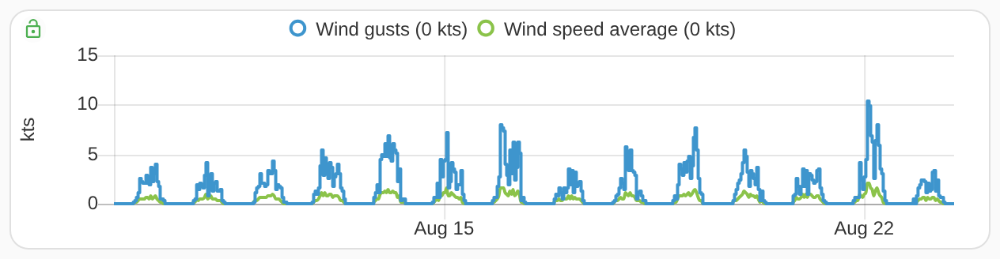

Using `densityOverride` at `higher`, leaving the date format at normal:

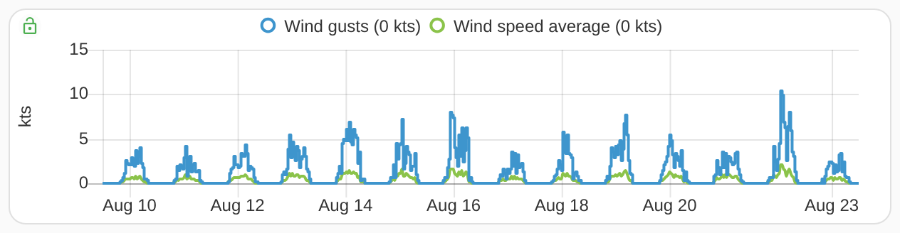

And same as above but setting the dateFormat to short:

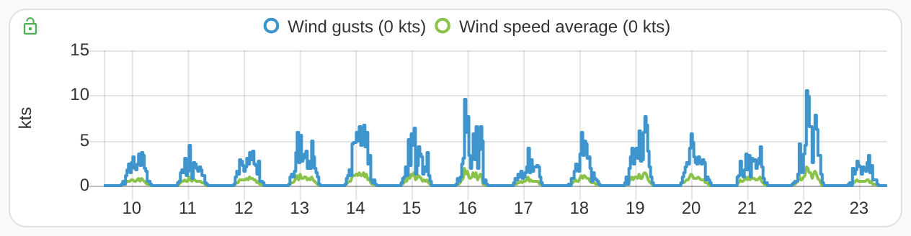

With `densityOverride`, the density no longer follows the card's or the screen's width: the labels can overlap.

### Persistence

#### What is kept, and where

The default values of the two options, when the YAML doesn't set them (see [Enabling persistence](#enabling-persistence-enablepersistence--enablemultidevicepersistence)):

| Option | Default on a card with YAML graphs (`graphs:`) | Default on a card with only entities added from it |
|---|---|---|
| `enablePersistence` | `none` — but `entities` for the entities added from the card | `all` |
| `enableMultidevicePersistence` | `none` — but `entities` for the entities added from the card | `all` |

What each variable obeys, for its persistence on this device and on every device:

| Variable | Kept on this device by | Kept on every device by |
|---|---|---|
| The time range | `range` (either option) | `enableMultidevicePersistence: range` |
| The magnifier's mode | `range` (either option) | `enableMultidevicePersistence: range` |
| The graphs' order, the linked graphs' too | `order` (either option) | `enableMultidevicePersistence: order` |
| An entity's `type`, `color`, `fill`, `arrowLength`, `colorTransition`, `interval`, `name`, `scale`, `siConversionFactor`, `dashMode`, `lineMode`, `interpolation`, `width`, `sizePoints`, `yAxis` (its side, the *Behavior* menu's), `showMinMax`, `unit`, `process`, `netBars`, `circular`, `groupId` (its splits) | `entities` (either option) — a YAML entity: its own option first | `enableMultidevicePersistence: entities` — a YAML entity: its own `enableMultidevicePersistence` first |
| A curve hidden (`hidden`), its points (`showPoints`), its tooltip modes, its graph's Y axes locked with their ranges (`yAxisLock`: the padlock, or a gesture on a Y axis) | `enablePersistence: entities` — a YAML entity: its own `enablePersistence` first | Never |
| The info panel's switch, the gesture thresholds | Always | Always |
| The statistics export's period | Always | Never |
| What the card worked out, to spare working it out again: the statistics probes' verdicts (a day), the automatic Y axes, the entity selector's widths and shorter lines | Always, until a new version of the card — let go then: the card's title reads "(new)" after its version, that first time only | Never |

`enableMultidevicePersistence` is the sync across devices: what it syncs is kept on this device too ("either option"). Not kept: what the YAML says, at each load. Kept: a change of the YAML still wins — the last one to speak wins.

#### Enabling persistence (`enablePersistence` / `enableMultidevicePersistence`)

By default, nothing about this card's state persists across reloads: the time range always reopens at `defaultTimeRange`, graphs always display in their YAML order, and every static (YAML-defined) entity always shows exactly what YAML says, regardless of any zoom, pan, reorder, or edit made through the UI on any device.

There are two exceptions to that default, because they'd otherwise behave in a way nobody wants:

- **The entities added from the card** (not in `graphs:`) — no YAML value to fall back to: if nothing remembered them, they'd vanish at every reload; so they default to full persistence (on this device and across devices, see below).
- **The time range and the graphs' order on a card without YAML entities** — such a card has nothing fixed to anchor either of those to, so they default to full persistence too, for the same reason.

Everything else (the time range and graph order on a card that *does* have static entities, and every field of every static entity) defaults to `none`, i.e. always YAML.

Three options change any of these defaults explicitly, at the card level (`enablePersistence`/`enableMultidevicePersistence` cover `range`, `entities`, and `order`) or per entity (individual fields only — see below):

```yaml
type: custom:history-explorer-card
defaultTimeRange: 24h
enablePersistence: entities              # this device remembers on its own — no cross-device sync
enableMultidevicePersistence: range     # this device's time range syncs across the user's devices via Home Assistant
```

- **`enablePersistence`** — turns on persistence in local browser storage only. This device remembers its own changes; nothing syncs to or from the user's other devices.
- **"Last one to speak wins"** — each source that can speak keeps its own image of what it said last: the YAML (what it said the previous time on this device), the Home Assistant account (what this device last received from it — never what it wrote there itself, which may not have landed yet), and this device's own UI.
  - **On each load** — every source is compared with its own image only; a difference means that source spoke: its image is updated, and its change applies.
  - **Option by option** — the YAML wherever it sets one for the entity (its own line, its graph, `entityOptions` or the card): an option a source changed replaces what the others said of that option only (the entity's other options, and the other entities, are untouched); an option both the YAML and another source changed: the YAML's. Reordering graphs in the YAML counts as a change for every entity of the moved graphs.
  - **Options the YAML doesn't set** — one it has never set (no `defaultTimeRange`) never speaks; one it stops setting speaks, on the card as on a curve: its default comes back, what was chosen on the card is lost.
  - **A new device** (or its browser storage cleared) — no image of its own yet: with `enableMultidevicePersistence`, it compares the YAML with the image saved in the Home Assistant account, so it gets what the user's other devices saved — unless the YAML changed since, which then wins there too; with `enablePersistence` alone, it gets the YAML.
- **`enableMultidevicePersistence`** — syncs across devices: turns on persistence in both local storage *and* the Home Assistant user account, so this device's changes sync across the user's other devices too. Where both options cover the same field, `enableMultidevicePersistence` always wins — that field syncs across devices, `enablePersistence` on the same field only matters for what `enableMultidevicePersistence` doesn't already cover.
- **`none`** — explicitly turns persistence off for a scope that would otherwise default to `all` (a card with only entities added from it, not to be remembered), without needing the other option to also be `none`.

Both accept `range`, `entities`, `order` (the display order of the graphs — card-level only, since a position only means something relative to every other graph, not a property of one entity), or `all` at the card level (top-level YAML key, alongside `defaultTimeRange`):

```yaml
type: custom:history-explorer-card
enableMultidevicePersistence: all   # persist everything, synced across devices
```

A card with only entities added from it, to behave like a fixed dashboard (nothing remembered) turns the default persistence off explicitly:

```yaml
type: custom:history-explorer-card
enableMultidevicePersistence: none   # this device never syncs the entities added from the card, the range, or the order
enablePersistence: none               # ...and doesn't remember them locally either
```

Or kept on this device, not synced across devices, on such a card:

```yaml
type: custom:history-explorer-card
enableMultidevicePersistence: none   # no Home Assistant sync
# enablePersistence unset — 'all' on such a card: kept on this device
```

See [Persistence for specific entities](#persistence-for-specific-entities) for the entity-level syntax (a precise list of fields, or `entities`/`all`/`none`, falling back to the card-level default above when unset — `order` isn't available at this level, see above).

#### Persistence for specific entities

Any YAML entity in `graphs:` can set its own `enablePersistence` and/or `enableMultidevicePersistence` (what each does at the card level: see [Enabling persistence](#enabling-persistence-enablepersistence--enablemultidevicepersistence)):
- **A list of fields** — the ones it covers;
- **`entities` / `all`** — every field;
- **`none`** — nothing, explicitly;
- **Not set** — the card-level default for that option, which for a YAML entity is `none` (always YAML) unless the card says otherwise:

```yaml
graphs:
  - type: line
    entities:
      - entity: sensor.living_room_target_temp
        color: '#3e95cd'
        enableMultidevicePersistence: [color, groupId]   # sync this device's color and grouping choices
                                                             # across the user's other devices too
      - entity: sensor.boiler_state
        enablePersistence: all                             # this device remembers everything about this
                                                             # entity on its own — no cross-device sync
```

Protectable/coverable fields (`order` isn't one of them — it's card-level only, see [Enabling persistence](#enabling-persistence-enablepersistence--enablemultidevicepersistence)):
- **Display** — `type`, `interval`, `name`, `unit`, `scale`, `siConversionFactor`, `process`, `netBars`, `circular`;
- **Look** — `color`, `fill`, `dashMode`, `lineMode`, `interpolation`, `width` (the line width), `showPoints`, `sizePoints`, `showMinMax`, `hidden`;
- **Axes and tooltip** — `yAxis`, `yAxisLock` (its graph's Y axes locked, with their ranges), `largeScreenTooltip`, `smallScreenTooltip`, `largeChartTooltip`, `smallChartTooltip` (the tooltip modes);
- **Layout** — `groupId`.
- **Never synced** — `hidden`, `showPoints`, the tooltip modes and `yAxisLock`: only `enablePersistence` keeps them, on this device;
- **`groupId`** — also covers how a YAML graph was split into linked graphs (double-click); their order within their block follows `order`, like the order of everything else.

This entity-level option only applies to static entities defined here in `graphs:`. The entities added from the card have no YAML entry to attach it to — they're governed entirely by the card-level `enablePersistence`/`enableMultidevicePersistence` (which default to `all` for a card without YAML graphs, see above).

---

## Options

### Entity options

A line graph added from the entity list takes the default settings and its automatic color. `entityOptions` overrides them for specific entities, device classes or whole domains: a fixed Y axis range for every humidity sensor, a color or a line mode for the power graphs.

```yaml
type: custom:history-explorer-card
entityOptions:
  humidity:                 # every humidity sensor
    color: blue
    fill: rgba(0,0,255,0.2)
    ymin: 20
    ymax: 100
    lineMode: lines
  sensor.outside_pressure:  # this entity
    color: green
    fill: rgba(0,255,0,0.2)
    lineWidth: 2
  sensor:                   # every other entity of the sensor domain
    color: red
    fill: rgba(0,0,0,0)
```

It also changes the graph type of entities, device classes or domains: a number shown as a timeline instead of a line graph, or the wind direction sensors shown as compass arrows by default:

```yaml
type: custom:history-explorer-card
entityOptions:
  sensor.wind_bearing:      # compass arrows instead of a line graph
    type: arrowline
    color: black            # the arrows' color — without it, the theme's
    fill: rgba(0,0,0,0.2)   # the arrows' background
```

#### Pattern-based entity options

`entityOptions` accepts two forms: the **dict form** (keyed by entity id, device class or domain) and a **list form** that supports glob pattern matching. The list form is the recommended one to style families of sensors alike.

```yaml
type: custom:history-explorer-card
entityOptions:
  - match: "sensor.temperature*"
    lineMode: curves
    showPoints: true
    color: '#3e95cd'

  - match: "sensor.*_power"
    lineMode: lines
    dashMode: [10, 4]
    lineWidth: 2

  - match: "sensor.*_energy*"
    type: bar

  - match: ["sensor.pressure*", "sensor.humidity*"]
    lineMode: lines
    ymin: 0

  - entity: sensor.sun_azimuth
    type: arrowline
    color: red
```

`match` takes a glob pattern or a list of them — `*` any sequence of characters, `?` a single one —, tested against the full entity id (`sensor.outside_temperature`); `entity` instead of `match`: an exact entity id.

##### Priority rules

`entityOptions` is either a dict or a list, not both:
- **dict form** — the entry of the entity id if there is one, else the entry of its device class, else the entry of its domain (one entry only, never merged);
- **list form** — every entry whose `match` (or `entity`) matches the entity id applies: the first one wins for each option, the later ones fill in the options it doesn't set. Device classes and domains aren't matched in this form — use a pattern (`sensor.*temperature*`).

Either way, an option set on a graph or on the entity itself wins over `entityOptions` (see [The same options at every level](#the-same-options-at-every-level)).

### The same options at every level

Every option below can be set at four levels: on the card (for every graph), in `entityOptions`, on a graph (for its entities) and on an entity — the most specific one wins: **entity → graph → `entityOptions` → card**. Except:
- **`type` and `name`** — an entity's only: on the card, `type` is the card's own and `name` mini-graph-card's title; on a graph, `type` is the graph's own and its `title` names it;
- **`lineColor`** — a graph's or the card's: a color by place in a graph.

What a curve keeps:
- **Its own options** — how it's drawn, its values, its tooltip, its color: taken from the levels when it's added, and kept, also when it's moved to another graph (its color changed only when another curve there already has it);
- **The graph's options** — its Y axes (`yAxis`), its values over it (`showState`, `showStats`, `showStateFor`, `showStatsFor`)…: a curve moved takes those of the graph it lands in;
- **The YAML's changes** — a curve of the YAML follows every later change of the YAML, at whatever level, option by option (see "Last one to speak wins" in [Persistence](#persistence)); a curve added from the card isn't the YAML's: a change of the YAML doesn't reach it.

**The graph's own options**, set on an entity or in `entityOptions`, apply to the graph the entity is shown in; the graph's own value wins:
- **Y axes** — `ymin`, `ymax`, `yminRight`, `ymaxRight`, `yrange`, `yrangeRight`, `yScaleSteadiness`, `yScaleSteadinessRight`, `ystepSize`, `ylock`, `logarithmic`, `labelsLeft`, `labelsRight`, `alignment`, `yLabels`;
- **The graph** — `stacked`, `barSpacing`, `height`, `showTimeLabels`, `showGrid`;
- **`height` on the card** — the height of every line and bar graph; `lineGraphHeight` / `barGraphHeight` set their own and win over it.

How options are read:
- **Names** — an option is spelled the same at every level; its aliases (the names and values in the list below, mini-graph-card's among them) are accepted everywhere, mixed freely with the card's own names — an option set under two names: the card's own name wins;
- **Values from a list** (`lineMode`, `interpolation`, `yAxis`, `tooltip.size`, `uiLayout.toolbar`…) — read whatever their case and spaces (`Curves`, `B-Spline`); an unknown one is left out, the option keeping its default, with a warning in the browser's console;
- **A configuration that makes no sense** — kept as written, with a warning in the console (a `sizePoints` smaller than the line's width: its points hidden by it);
- **A graph's options** — under its `options:`, or directly on the graph, next to `type:` and `entities:` (`options:` wins if both are set):

```yaml
type: custom:history-explorer-card
interpolation: makima          # every curve of the card
ylock: true                    # every graph of the card
graphs:
  - type: line
    lineMode: smart            # same as under options:
    options:
      ylock: false             # this graph only
    entities:
      - entity: sensor.outside_temperature
      - entity: sensor.inside_temperature
        interpolation: steffen # this curve only
```

`fill`, `showMinMax`, `showState`, `showStats`, `dashMode`, `lineMode`, `interpolation`, `lineWidth`, `showPoints`, `netBars` and `exclude` set on a graph are the default of every entity of that graph; an entity's own value always wins.
- **`options.exclude`** — the one exception to "most specific wins": it combines with each wildcard entity's own `exclude:`, both applying together;
- **Several wildcard patterns** — sharing one graph: the common styling set once instead of on each pattern:

```yaml
type: custom:history-explorer-card
graphs:
  - type: line
    options:
      fill: rgba(0,0,0,0)
      showMinMax: statistics
      exclude: '*fridge*'   # applies to every wildcard entity below
    entities:
      - entity: sensor.*puissance*
      - entity: sensor.*power*
```

On the card, they act as the fallback default when neither the entity, its graph nor `entityOptions` set a value:

```yaml
type: custom:history-explorer-card
lineWidth: 2
dashMode: shortlines
showMinMax: statistics
```

### Complete list of options

The options by theme, at the four levels unless their description says otherwise, in italics (see [The same options at every level](#the-same-options-at-every-level)).

Each option in **bold**, its aliases — other names it is read under — in *italics* under it.

#### Graph and entity options

| Option | Description |
|---|---|
| **`graphs`** | **Default** not set: every entity added from the card<br>The graphs written in the YAML, shown each time the dashboard opens, before the entities added from the card. Each graph has its `type`, an optional `title`, its `entities` and its `options` — see [YAML configuration for preconfigured graphs](#yaml-configuration-for-preconfigured-graphs) — *the card's only* |
| **`title`** | **Default** none<br>The graph's title, shown in its header. Without it, `showName: true` shows the first curve's name — see [Values over a graph, a compact look](#values-over-a-graph-a-compact-look) — *a graph's only* |
| **`entities`** | **Default** none<br>The graph's entities, in the order they are drawn. Each is an `entity:` with its own options; a wildcard (`sensor.*_power`) adds every matching entity — see [YAML configuration for preconfigured graphs](#yaml-configuration-for-preconfigured-graphs) — *a graph's only* |
| **`options`** | **Default** not set<br>The options of every curve of the graph; an entity's own value wins. They can also be written on the graph itself, beside `type:` — `options:` wins when both are set — see [The same options at every level](#the-same-options-at-every-level) — *a graph's only* |
| **`entity`** | **Default** none: required<br>The entity's id. `*` is a wildcard (`sensor.*`), `exclude` leaves matches out. An attribute can follow the id: `climate.salon.current_temperature` — see [YAML configuration for preconfigured graphs](#yaml-configuration-for-preconfigured-graphs) — *an entity's only* |
| **`attribute`** | **Default** not set: the entity's state<br>One of the entity's attributes, drawn instead of its state, from the history only (Home Assistant keeps no statistics of attributes). A number is drawn as a curve, anything else as a timeline. `forecast.0.temperature` reads a sub-attribute, level by level — see [Attributes](#attributes) — *an entity's only* |
| **`name`** | **Default** the entity's name<br>The curve's name, in the legend and the tooltip, instead of the entity's friendly name — *an entity's only* |
| **`exclude`** | **Default** not set<br>Entities left out of a wildcard `entity:` (`sensor.*`, but not `*fridge*`): a string, a list, or `{entity: '...'}`. A graph's `exclude` and an entity's combine — see [YAML configuration for preconfigured graphs](#yaml-configuration-for-preconfigured-graphs) — *a graph and an entity only* |
| **`entityOptions`** | **Default** not set<br>Options given once for the entities they target — by entity id, device class or domain (as a key), or by pattern (a list of entries with `match:`) —, for the YAML entities and the ones added from the card — see [Pattern-based entity options](#pattern-based-entity-options) — *the card's only* |
| **`filterEntities`** | **Default** every entity listed<br>The entities the entity selector lists: a pattern (`sensor.*energy*`, `*` as a wildcard) or a list of them — see [Adding entities](#adding-entities) — *the card's only* |
| **`excludeFilterEntities`** | **Default** none<br>The entities left out of `filterEntities`' result: a pattern or a list of them — see [Adding entities](#adding-entities) — *the card's only* |
| **`recordedEntitiesOnly`** | **Default** `false`<br>`true`: the entity selector lists only the entities recorded in Home Assistant's database — the others have no history to show — see [Adding entities](#adding-entities) — *the card's only* |
| **`combineSameUnits`** | **Default** `false`<br>`true`: an entity added from the card goes into an existing graph of compatible units (W and kW), instead of a new graph — see [Grouping multiple entities into a single graph](#grouping-multiple-entities-into-a-single-graph) — *the card's only* |

#### Curve and graph options

| Option | Description |
|---|---|
| **`type`**<br>*`graph`* | **Default** the one that fits the entity — a timeline for a state that isn't a number, bars for a quantity that adds up, arrows for an angle, else a line<br>The graph type the entity is drawn as: `line` (a curve), `bar` (bars by interval, for a total that adds up), `timeline` (a row of colored states) or `arrowline` (compass arrows, for an angle). Without it, the type that fits the entity's state class and unit — see [Choosing an entity's display type](#choosing-an-entitys-display-type) — *an entity's only* |
| **`lineMode`**<br>*`smoothing`* | **Default** `curves` in the YAML, `smart` added from the card<br>How the line joins the values: `curves`, a smooth curve (see `interpolation`); `lines`, straight segments; `stepped`, a step at each new value; `smart`, a curve, with a flat dashed line over a sensor's silences. `true` is `curves`, `false` is `lines` — see [Line modes](#line-modes) |
| **`interpolation`** | **Default** `monotone`<br>The algorithm drawing a smooth curve, in the `curves` and `smart` modes: `monotone` (never overshoots), `steffen` (flat only at real peaks), `makima` (follows the local trend), `catmullrom` (the smoothest) or `bspline` (mini-graph-card's). `akima` is `makima` — see [Curve interpolation](#curve-interpolation) |
| **`lineWidth`**<br>*`width`, `line_width`* | **Default** `2`<br>The width of the line, in px. Also set from the curve menu, *Appearance ▸ Width* — see [Line appearance](#line-appearance) |
| **`dashMode`**<br>*`line_style`* | **Default** `solid`<br>The line's style: `solid`, `points`, `shortlines`, `longlines`, `pointline`, or a pattern of dashes and gaps in px — a list (`[10, 4]`) or a string as CSS writes it (`'10,4'`) — see [Line stroke style](#line-stroke-style) |
| **`showPoints`**<br>*`showSamples`, `show_points`* | **Default** `hover`<br>Dots on the measured values: `hover`, only the one under the pointer; `true`, all of them; `false`, none; a number, all of them with that radius in px. A long press near the curve shows or hides them — see [Displaying individual samples](#displaying-individual-samples) |
| **`sizePoints`** | **Default** the line width + 2 px<br>The diameter of the dots on the values, in px; without it, the line's width + 2 — see [Displaying individual samples](#displaying-individual-samples) |
| **`showLine`**<br>*`show_line`* | **Default** `true`<br>`false`: the curve's points only, without the line between them — with `showPoints: true` to see them — see [Displaying individual samples](#displaying-individual-samples) |
| **`showMinMax`** | **Default** `false`<br>A band between the minimum and the maximum around the curve, where several values fall in one point: `all` (or `true`), everywhere; `max` / `min`, only its half above / below the curve; `statistics` / `history`, only where the curve comes from them; `false`, none — see [Showing the min/max statistical range](#showing-the-minmax-statistical-range). An arrowline's: a light sector of a disc each side of its arrows (`max` clockwise, `min` anticlockwise) — see [Compass arrow graphs](#compass-arrow-graphs) |
| **`hidden`** | **Default** `false`<br>`true`: the curve hidden when the card opens; its legend label is struck through, and a click on it shows the curve — see [Legend / entity labels](#legend--entity-labels) |
| **`legendVisible`**<br>*`show_legend`* | **Default** `true`<br>`false`: no legend label for the curves it's set for — set on every one, the graph has no legend. `auto`, on a graph or the card: a graph's legend only when it has several labels — see [Legend / entity labels](#legend--entity-labels) |
| **`showCurrentValues`**<br>*`show_legend_state`* | **Default** `true`<br>`false`: the legend label shows the curve's name only, without its current value — see [Showing current sensor values](#showing-current-sensor-values) |
| **`showGraph`**<br>*`show_graph`* | **Default** `true`<br>`false`: the curve is neither drawn nor in the legend, but its value is still shown over the graph. A graph none of whose curves is drawn shows only its header and its values — see [Values over a graph, a compact look](#values-over-a-graph-a-compact-look) |
| **`fixedValue`**<br>*`fixed_value`* | **Default** `false`<br>`true`: the curve drawn as a flat line over the whole window, at its last value in the window — see [Values over a graph, a compact look](#values-over-a-graph-a-compact-look) |
| **`tapAction`**<br>*`tap_action`* | **Default** `more-info`<br>What a click on the curve's value does (in the legend, over the graph), with Home Assistant's actions: `more-info` (its dialog, with the info panel when it's on), `navigate` (`navigation_path`), `url` (`url_path`), `perform-action` (`perform_action`, `data`, `target`), `call-service` (`service`, `service_data`), or `none` |
| **`stateMap`**<br>*`state_map`* | **Default** not set<br>A text state drawn as a curve: a list of states (`off`, or `{ value: off, label: Off }`), each at its place in the list — 0, 1, 2… —, its label shown in the legend, the tooltip and on the Y axis — see [Text states as a curve](#text-states-as-a-curve) |
| **`showUnavailable`** | **Default** `false`<br>`true`: gaps in the curves where the entity was unavailable — else the curve goes over them — see [Line graphs and unavailable data](#line-graphs-and-unavailable-data) — *the card's only* |
| **`showMissingState`** | **Default** `false`<br>`true`: gaps where a text state isn't in its `stateMap` — else the curve goes over them — see [Line graphs and unavailable data](#line-graphs-and-unavailable-data) — *the card's only* |
| **`circular`** | **Default** automatic: circular for an angle (unit `°`, state class `measurement_angle`), else not<br>Angles drawn without a jump at 0/360. Not set: automatic, for a unit of `°` or a state class `measurement_angle` (an attribute only when its name is a direction); `false`, never; a number, the period (`360`); `2pi`, 2π. On an arrowline: what a full turn of the arrows is — see [Circular values (angles)](#circular-values-angles) |
| **`interval`** | **Default** `hourly`<br>The interval a bar graph sums its values over: `10m`, `hourly`, `daily`, `weekly` or `monthly`; `raw` draws the bar entities as curves. Also chosen with the interval selector on the graph — see [Bar graphs for total increasing entities](#bar-graphs-for-total-increasing-entities) |
| **`netBars`** | **Default** `false`<br>`true`: a bar entity whose total can go down as well as up (net metering) — a decrease isn't taken as a reset of the counter — see [Net metering](#net-metering) |
| **`stacked`** | **Default** `false`<br>`true`: a bar graph's bars stacked one on another, instead of side by side — see [Bar graphs for total increasing entities](#bar-graphs-for-total-increasing-entities) |
| **`barSpacing`**<br>*`bar_spacing`* | **Default** automatic: a small gap on both sides of each bar, by its interval<br>The room between two bars, in px; without it, a gap in proportion to each bar's interval — see [Bar graphs for total increasing entities](#bar-graphs-for-total-increasing-entities) |
| **`arrowLength`** | **Default** not set: every arrow 80 % of its whole length<br>The length of an arrowline's arrows: a number from 0 to 100, that part of their whole length; thresholds on a value giving one; or an entity or attribute whose value gives each arrow its length, scaled automatically on its largest value around the window (see `arrowMax`) — see [Compass arrow graphs](#compass-arrow-graphs) |
| **`arrowMax`** | **Default** automatic: the largest value in the window and around it<br>The value of `arrowLength`'s entity that gives an arrow its whole length; no automatic scale then. `~` and a value: at least that value, more when the values go past it — see [Compass arrow graphs](#compass-arrow-graphs) |
| **`arrowWeighting`** | **Default** `length`<br>An arrowline's arrows' direction over their zone: `length`, weighted by how long and by the length `arrowLength`'s entity gives (by how long only without one); `none`, by how long only — see [Compass arrow graphs](#compass-arrow-graphs) |
| **`height`** | **Default** `lineGraphHeight` (250), `barGraphHeight` (150)<br>The graph's height, in px. On the card: the height of every line and bar graph — `lineGraphHeight` and `barGraphHeight` win over it — see [Graph sizes](#graph-sizes) |
| **`showGrid`** | **Default** `true`<br>`false`: no grid lines in the graph's plot |
| **`showTimeLabels`** | **Default** `true`<br>`false`: no time labels under the graph — the plot takes their room, below and on its sides |
| **`labelsVisible`** | **Default** `true`<br>`false`: no entity names left of the timelines' rows — the rows take the whole width — see [Timeline graphs](#timeline-graphs) — *the card's only* |

#### Color options

| Option | Description |
|---|---|
| **`color`**<br>*`color_thresholds`* | **Default** automatic: the color of what it measures (its device class, else its unit), else the palette's<br>The color of the curve or the bars. A color; thresholds on the value (`{ 0: blue, 20: red }`, or a list); thresholds on another entity's or attribute's value (with `entity:`, `attribute:`); or an entity or attribute whose state is the color. Without it, a color of the automatic palette — see [Colors of curves and bars](#colors-of-curves-and-bars) |
| **`fill`**<br>*`show_fill`* | **Default** `light` — `false` when the color is defined; a bar, a timeline: `solid`<br>The area under the curve, a bar's area, a timeline's blocks: a color (not a timeline's); `false`, none; `fade`, the color fading out downwards; `light` (alias `true`), the color, light; `solid`, the color. It also takes thresholds or an entity, as `color` does — see [Colors of curves and bars](#colors-of-curves-and-bars) |
| **`colorTransition`**<br>*`color_thresholds_transition`* | **Default** `hard`<br>How the color changes between number thresholds: `hard`, each value takes its threshold's color; `smooth`, the color is blended from one threshold to the next — see [Colors of curves and bars](#colors-of-curves-and-bars) |
| **`lineColor`**<br>*`line_color`* | **Default** not set: each curve its own color<br>A color, or a list of colors given by place: the first curve of a graph takes the first color, and so on. A curve with its own `color` keeps it. A graph's `lineColor` wins over its `color`; the card's is below `entityOptions` — see [Colors of curves and bars](#colors-of-curves-and-bars) — *the card and a graph only* |
| **`stateColors`** | **Default** automatic colors<br>The timelines' colors: an entity, a device class or a domain followed by the state (`door.on`, `binary_sensor.off`), or a state alone (`off`) — see [Customizing state colors](#customizing-state-colors) — *the card's only* |
| **`stateColorSeed`** | **Default** `137`<br>The seed of the timelines' automatic colors: another number gives other colors to the states without their own — see [Customizing state colors](#customizing-state-colors) — *the card's only* |

#### Value and header options

| Option | Description |
|---|---|
| **`showState`**<br>*`show_state`* | **Default** `false`<br>`true`: the curve's current value written large over the graph, in its color and unit. `showStateFor` chooses which curves show it — see [Values over a graph, a compact look](#values-over-a-graph-a-compact-look) |
| **`showStats`**<br>*`show.extrema`, `show.average`* | **Default** `false`<br>The curve's `min`, `average` and `max` over the window shown, written over the graph: one name, a list of names, or `true` for all three. They follow the window as it is panned and zoomed — see [Values over a graph, a compact look](#values-over-a-graph-a-compact-look) |
| **`showStateFor` / `showStatsFor`** | **Default** `all`<br>Which curves the graph's or the card's `showState` (`showStateFor`) and `showStats` (`showStatsFor`) are for: `all`, every curve; `first`, its first curve only, as mini-graph-card shows its first entity's. A curve's own setting always wins — see [Values over a graph, a compact look](#values-over-a-graph-a-compact-look) — *the card and a graph only* |
| **`showIndicator`**<br>*`show_indicator`* | **Default** `false`<br>`true`: a dot in the curve's color before its value over the graph, to tell several values apart — see [Values over a graph, a compact look](#values-over-a-graph-a-compact-look) |
| **`stateAdaptiveColor`**<br>*`state_adaptive_color`* | **Default** `true`<br>`false`: the values over the graph drawn in the text's color instead of their curve's color — see [Values over a graph, a compact look](#values-over-a-graph-a-compact-look) |
| **`alignState`**<br>*`align_state`* | **Default** `left`<br>Where the values over the graph go: `left`, `center` or `right` — see [Values over a graph, a compact look](#values-over-a-graph-a-compact-look) — *the card and a graph only* |
| **`fontSize`**<br>*`font_size`* | **Default** `100`<br>The size of the values over the graph, in % of their usual size (`150`: half as large again) — see [Values over a graph, a compact look](#values-over-a-graph-a-compact-look) — *the card and a graph only* |
| **`rounding`**<br>*`decimals`* | **Default** not set: 2 decimals at most<br>How many decimals the values are written with, in the legend, the tooltip and over the graph: set, exactly that many (`1`: 20.0); not set, at most 2 — see [Rounding](#rounding) |
| **`stateTextMode`** | **Default** `auto`<br>The states' names in the timelines: `auto`, Home Assistant's for the device class (*Open*, *Detected*); `raw`, the state itself (`on`); `hide`, none — see [Timeline graphs](#timeline-graphs) — *the card's only* |
| **`showName`**<br>*`show_name`* | **Default** the graph's `title`, when it has one<br>The header shows a name: `true`, the graph's `title`, else its first curve's name; `false`, none — see [Values over a graph, a compact look](#values-over-a-graph-a-compact-look) — *the card and a graph only* |
| **`showIcon`**<br>*`show_icon`* | **Default** `false`<br>`true`: the header shows an icon — `iconImage`, else `icon`, else the entity's own icon — see [Values over a graph, a compact look](#values-over-a-graph-a-compact-look) — *the card and a graph only* |
| **`icon`** | **Default** the entity's own icon<br>The header's icon, a Material Design icon (`mdi:home`), shown with `showIcon: true` — see [Values over a graph, a compact look](#values-over-a-graph-a-compact-look) — *the card and a graph only* |
| **`iconImage`**<br>*`icon_image`* | **Default** not set<br>An image's address (`/local/logo.png`) shown as the header's icon, instead of `icon` — see [Values over a graph, a compact look](#values-over-a-graph-a-compact-look) — *the card and a graph only* |
| **`alignHeader`**<br>*`align_header`* | **Default** `center`<br>Where the header's name and icon go: `center`; `default`, the name left and the icon right; `left`; `right` — see [Values over a graph, a compact look](#values-over-a-graph-a-compact-look) — *the card and a graph only* |
| **`alignIcon`**<br>*`align_icon`* | **Default** `right`<br>Where the header's icon goes: `right`, `left`, or `state`, beside the values over the graph — see [Values over a graph, a compact look](#values-over-a-graph-a-compact-look) — *the card and a graph only* |
| **`fontSizeHeader`**<br>*`font_size_header`* | **Default** the theme's size<br>The size of the header's name, in px — see [Values over a graph, a compact look](#values-over-a-graph-a-compact-look) — *the card and a graph only* |
| **`nameAdaptiveColor` / `iconAdaptiveColor`**<br>*`show_name_adaptive_color` / `show_icon_adaptive_color`* | **Default** `false`<br>`nameAdaptiveColor: true`: the header's name drawn in the first curve's current color. `iconAdaptiveColor: true`: its icon — see [Values over a graph, a compact look](#values-over-a-graph-a-compact-look) — *the card and a graph only* |
| **`look`** | **Default** not set: the card's own look<br>`mini`: mini-graph-card's look at once — no toolbar, the value over the graph, a faded fill, a curve without grid nor time labels. It's a set of defaults: any option set on the card wins — see [Values over a graph, a compact look](#values-over-a-graph-a-compact-look) — *the card's only* |
| **`show`** | **Default** not set<br>mini-graph-card's `show:` block, read as the options it names: `show: { points: true }` is `showPoints: true` — see [mini-graph-card compatibility](#mini-graph-card-compatibility) |

#### Y axis options

| Option | Description |
|---|---|
| **`yAxis`**<br>*`y_axis`* | **Default** `auto`<br>The Y axis of a line or bar curve: `left`, `right`, or `auto` — with two groups of units in a graph, the second one goes on the right; with more, they are shared by the size of their values. `primary` is `left`, `secondary` is `right`. Also *Behavior ▸ Y axis* in the curve menu — see [Two Y axes](#two-y-axes) |
| **`ymin` / `ymax`**<br>*`lower_bound` / `upper_bound`* | **Default** automatic: fitted to the values<br>The Y axis' minimum and maximum when the card opens; it can still be moved by hand, and the padlock brings them back. `~` and a value (`~0`): a soft bound — that value, unless the values go past it — see [Bounds](#bounds) |
| **`yminRight` / `ymaxRight`**<br>*`lower_bound_secondary` / `upper_bound_secondary`* | **Default** `yminRight`: the same as `ymin`; `ymaxRight`: the same as `ymax`<br>The right Y axis' minimum and maximum when the card opens; `~` and a value: a soft bound. Not set, `ymin` and `ymax` apply to it too — see [Two Y axes](#two-y-axes) |
| **`yrange` / `yrangeRight`**<br>*`min_bound_range` / `min_bound_range_secondary`* | **Default** `yrange`: not set; `yrangeRight`: the same as `yrange`<br>The smallest range the Y axis shows (`yrangeRight`: the right axis), widened on the sides not fixed — so a nearly constant value isn't drawn as if it varied a lot — see [The automatic scale](#the-automatic-scale) |
| **`yScaleSteadiness` / `yScaleSteadinessRight`**<br>*`yScaleSteadinessLeft` / —* | **Default** `yScaleSteadiness`: `50`; `yScaleSteadinessRight`: the same as `yScaleSteadiness`<br>How the automatic Y axis balances, from 0 to 100 (`yScaleSteadinessRight`: the right axis): 0 follows the values shown; 100 keeps a steady scale while panning. The values fill at least 100 − this % of the height — see [The automatic scale](#the-automatic-scale) |
| **`ylock`** | **Default** `false`<br>`true`: the Y axis can't be moved or zoomed by hand (drag, pinch, Shift+drag); `ymin` and `ymax` still set its bounds — see [Y axis scaling](#y-axis-scaling) |
| **`logarithmic`** | **Default** `false`<br>`true`: a logarithmic Y axis, on a line graph — for values spread over several orders of magnitude — see [Y axis scaling](#y-axis-scaling) |
| **`ystepSize`**<br>*`ystepsize`* | **Default** automatic: the tightest round step whose labels fit<br>The step between the Y axis' labels, in the curves' unit; without it, the tightest round step whose labels fit — see [Y axis scaling](#y-axis-scaling) |
| **`labelsLeft`**<br>*`show_labels`* | **Default** `true`<br>The left Y axis' labels: `true`, shown; `false`, none, the plot taking their room; `hover`, shown while the pointer is over the graph (3 s after a tap on a touch screen) — see [Y axis scaling](#y-axis-scaling) |
| **`labelsRight`**<br>*`show_labels_secondary`* | **Default** `true`<br>The right Y axis' labels: `true`, shown; `false`, none; `hover`, shown while the pointer is over the graph — see [Two Y axes](#two-y-axes) |
| **`alignment`** | **Default** `left`<br>`justified`: a graph without a right Y axis keeps the room of one when another graph of the card has one — every graph's time lined up; `left`: the room its own axes leave it — see [Two Y axes](#two-y-axes) |
| **`yLabels`** | **Default** beside the plot — inside on a card narrower than 300 px<br>`inside`: the Y labels drawn inside the plot, which then takes the whole width (no label area); `outside`: beside the plot. Without it, inside on a card narrower than 300 px — see [A narrow card](#a-narrow-card) |
| **`axisAddMarginMin` / `axisAddMarginMax`** | **Default** `false`<br>`axisAddMarginMin: true`: a margin under a line graph's values; `axisAddMarginMax: true`: over them — room for a smooth curve overshooting the values — *the card's only* |

#### Tooltip options

| Option | Description |
|---|---|
| **`tooltip.largeScreen`**<br>*`largeScreenTooltip`, `large_screen_tooltip`* | **Default** `mixed`<br>The tooltip's mode on a screen 640 px wide or more: `mixed`, the value pointed at and the curves clicked; `nearest`, the value pointed at only; `selected`, the curves clicked only; `all`, every curve's value at that time. `tooltip.largeChart` or `tooltip.smallChart` wins when set — see [Tooltip](#tooltip) |
| **`tooltip.smallScreen`**<br>*`smallScreenTooltip`, `small_screen_tooltip`* | **Default** `selected`<br>The tooltip's mode on a screen narrower than 640 px: `mixed`, `nearest`, `selected` or `all`. `tooltip.largeChart` or `tooltip.smallChart` wins when set — see [Tooltip](#tooltip) |
| **`tooltip.largeChart`**<br>*`largeChartTooltip`, `large_chart_tooltip`* | **Default** not set: the screen's mode applies (`tooltip.largeScreen`, `tooltip.smallScreen`)<br>The tooltip's mode in a card 600 px wide or more, whatever the screen: `mixed`, `nearest`, `selected` or `all`. *Behavior ▸ Tooltip ▸* changes it in such a card once it is set — see [Tooltip](#tooltip) |
| **`tooltip.smallChart`**<br>*`smallChartTooltip`, `small_chart_tooltip`* | **Default** not set: the screen's mode applies (`tooltip.largeScreen`, `tooltip.smallScreen`)<br>The tooltip's mode in a card narrower than 600 px, and in the info panel, whatever the screen: `mixed`, `nearest`, `selected` or `all`. *Behavior ▸ Tooltip ▸* changes it in such a card once it is set — see [Tooltip](#tooltip) |
| **`tooltip.behavior`**<br>*`tooltipBehavior`, `tooltip_behavior`* | **Default** `auto`<br>Sets `tooltip.largeScreen` and `tooltip.smallScreen` at once: `mixed`, `nearest`, `selected` or `all`. `auto` keeps their own defaults (`mixed` on a large screen, `selected` on a small one) — see [Tooltip](#tooltip) |
| **`tooltip.size`**<br>*`tooltipSize`* | **Default** `auto`<br>How much every tooltip shows: `full`, the source and the time, then each name and value; `compact`, the time, then each shortest name and value; `slim`, one line; `auto`, by the card's width — full from 600 px, compact from 300 px and in the info panel, slim below — see [Tooltip](#tooltip) — *the card's only* |
| **`tooltip.showLabel`** | **Default** `true`<br>`false`: the tooltip shows the values without the curves' names — see [Tooltip](#tooltip) — *the card's only* |
| **`tooltip.showDuration`**<br>*`tooltipShowDuration`* | **Default** `false`<br>`true`: a timeline's or arrowline's tooltip shows how long the state lasted, after its time span — see [Tooltip](#tooltip) — *the card's only* |
| **`tooltip.showColorsLine` / `tooltip.showColorsTimeline`**<br>*`showTooltipColorsLine` / `showTooltipColorsTimeline`* | **Default** `true`<br>`false`: no color boxes before the names in the tooltips — `showColorsLine` in every graph but the timelines, `showColorsTimeline` in the timelines — see [Tooltip](#tooltip) — *the card's only* |
| **`tooltip.stateTextMode`** | **Default** `stateTextMode`'s<br>The states' names in the tooltip: `auto`, Home Assistant's for the device class; `raw`, the state itself; `hide`, none — see [Tooltip](#tooltip) — *the card's only* |

#### Data options

| Option | Description |
|---|---|
| **`unit`** | **Default** the entity's own unit<br>The unit shown instead of the entity's own, in the legend, the tooltip and on the Y axis. With `scale`, the values are converted into it — see [Scaling values: scale, unit and valueFactor](#scaling-values-scale-unit-and-valuefactor) |
| **`scale`** | **Default** `1`<br>The values multiplied by this factor. Without `unit`, only the drawing changes (to compare it with larger values, or to flip it with a negative factor); the legend and the tooltip show the real value. With `unit`, it converts into that unit: the converted value is shown — see [Scaling values: scale, unit and valueFactor](#scaling-values-scale-unit-and-valuefactor) |
| **`valueFactor`**<br>*`value_factor`* | **Default** `0`<br>The values drawn and shown multiplied by 10 to this power, the unit kept: `-3` shows 400 W as 0.4 — see [Scaling values: scale, unit and valueFactor](#scaling-values-scale-unit-and-valuefactor) |
| **`process`** | **Default** not set: the values as they are<br>A JavaScript expression applied to each value (`state`) before it's drawn: `state * 1.8 + 32` — see [Custom data processing functions](#custom-data-processing-functions) |
| **`pointsPerHour`**<br>*`points_per_hour`* | **Default** not set: a point per column of pixels<br>A point per group of 1 / `pointsPerHour` hours (`2`: every half hour, `0.5`: every two hours), instead of one per column of pixels. Each group's value is given by `aggregateFunc` — see [Aggregation](#aggregation) |
| **`groupBy`**<br>*`group_by`* | **Default** `interval`<br>What a point groups: `interval`, the groups of `pointsPerHour` (else a column of pixels); `hour`, an hour each; `date`, a day each — see [Aggregation](#aggregation) |
| **`aggregateFunc`**<br>*`aggregate_func`* | **Default** `avg`<br>A group's value: `avg` (the mean, weighted by how long each value lasted), `median`, `min`, `max`, `first`, `last`, `sum`, `delta` (last minus first) or `diff` — see [Aggregation](#aggregation) |
| **`statistics.enabled`** | **Default** `true`<br>`false`: the history only, without Home Assistant's long term statistics — a graph then stops where the history's retention ends — see [Long term statistics](#long-term-statistics) — *the card's only* |
| **`statistics.period`** | **Default** `hour`<br>The period of the long term statistics loaded for a window too long for the history: `5minute`, `hour`, `day`, `week` or `month` — see [Long term statistics](#long-term-statistics) — *the card's only* |
| **`statistics.force`** | **Default** `false`<br>`true`: the long term statistics only (the 5-minute ones included) — the history only for the last minutes, and for entities without statistics — see [Long term statistics](#long-term-statistics) — *the card's only* |
| **`refresh.automatic`** | **Default** `true`<br>`false`: the graphs not refreshed as new values come in (at most every 2 s) — only at a reload, or every `refresh.interval` — see [Auto refresh](#auto-refresh) — *the card's only* |
| **`refresh.interval`** | **Default** not set<br>The graphs refreshed every so many seconds, whatever comes in — see [Auto refresh](#auto-refresh) — *the card's only* |
| **`siConversionFactor`** | **Default** automatic, from the units<br>The factor converting the entity's unit into its graph's, when entities of compatible units share a graph (`combineSameUnits`: W and kW). The card works it out from the units; it's rarely set — *an entity's only* |
| **`decimation`** | **Default** — (accepted, no effect)<br>Accepted, without effect: the card draws what the screen can show, one point per column of pixels — see [Data decimation](#data-decimation) |
| **`statistics.mode` / `statistics.retention`** | **Default** —<br>Accepted, without effect: the card loads what the screen can show — see [Long term statistics](#long-term-statistics) — *the card's only* |

#### Card options

| Option | Description |
|---|---|
| **`header`** | **Default** `History explorer` and the card's version<br>The card's title, over its toolbar. `' '` (a space): no title, its room kept; `hide`: no title nor room — see [Header text](#header-text) — *the card's only* |
| **`cardName`** | **Default** `default`<br>The card's name, under which what is changed on it is kept (its entities, its range). Several cards on a dashboard each need their own name — see [Multiple cards](#multiple-cards) — *the card's only* |
| **`defaultTimeRange`**<br>*`hours_to_show`* | **Default** `24h`<br>The time range shown when the card opens: a number and a unit — `m`, `h`, `d`, `w`, `o` (months), `y`; a number alone is in hours. 10 years at most — see [Default view and time ranges](#default-view-and-time-ranges) — *the card's only* |
| **`realTimeStep`** | **Default** not set: the end is the present, now, the window sliding with each new value<br>The end — where the window ends when the card opens, and how it follows the new values in real time —: a time after now (`1h`: filled, then a step on); in uppercase, snapped to the unit (`1D`: the current day, from midnight); negative (`-1d`: a day behind, sliding). Also `defaultTimeOffset` — see [Default view and time ranges](#default-view-and-time-ranges) — *the card's only* |
| **`defaultMagnifierMode`** | **Default** `xy`<br>What the magnifying glass's box zooms when the card opens: `x`, the time; `y`, the Y axis; `xy`, both. A long press on the glass changes it — see [Default view and time ranges](#default-view-and-time-ranges) — *the card's only* |
| **`enablePersistence` / `enableMultidevicePersistence`**<br>*`enable_persistence` / `enable_multidevice_persistence`* | **Default** `none` — `entities` for the entities added from the card, `all` on a card without YAML graphs<br>What the card keeps of the changes made on it: `range`, `entities`, `order`, `all` or `none`, or a list of them. `enablePersistence` keeps them on this device; `enableMultidevicePersistence` on every device of the user. On an entity, for its own fields — see [Persistence](#persistence) — *the card and an entity only* |
| **`uimode`** | **Default** Home Assistant's theme<br>`dark` or `light`: the card's colors forced, whatever Home Assistant's theme — see [Dark mode](#dark-mode) — *the card's only* |
| **`hour24`** | **Default** Home Assistant's clock setting<br>The clock of the times shown: `true`, 24 hours; `false`, 12 hours. Without it, Home Assistant's own setting — see [The clock](#the-clock) — *the card's only* |
| **`uiLayout.toolbar`** | **Default** `top`<br>Where the toolbar — the dates and the range selector — goes: `top`, `bottom`, `both` or `hide` — see [Changing the UI layout](#changing-the-ui-layout) — *the card's only* |
| **`uiLayout.selector`** | **Default** `top`<br>Where the entity selector goes: `top`, `bottom`, `both` or `hide` — see [Changing the UI layout](#changing-the-ui-layout) — *the card's only* |
| **`uiLayout.sticky`** | **Default** `hide`<br>The toolbars kept on the screen while the page scrolls: `top`, `bottom`, `both`, or `hide` (they scroll away) — see [Changing the UI layout](#changing-the-ui-layout) — *the card's only* |
| **`uiLayout.interval`** | **Default** shown<br>`hide`: no interval selector on the bar graphs — their interval set by `interval` only — see [Changing the UI layout](#changing-the-ui-layout) — *the card's only* |
| **`uiLayout.invertZoom`** | **Default** `false`<br>`true`: the magnifiers − and + of the range selector swapped — see [Changing the UI layout](#changing-the-ui-layout) — *the card's only* |
| **`lineGraphHeight`** | **Default** `250`<br>The height of every line graph, in px; a graph's own `height` wins — see [Graph sizes](#graph-sizes) — *the card's only* |
| **`barGraphHeight`** | **Default** `150`<br>The height of every bar graph, in px; a graph's own `height` wins — see [Graph sizes](#graph-sizes) — *the card's only* |
| **`timelineBarHeight`** | **Default** `24`<br>The height of a timeline's row, in px — see [Graph sizes](#graph-sizes) — *the card's only* |
| **`timelineBarSpacing`** | **Default** `40`<br>The distance from the top of a timeline's row to the top of the next one, in px; minus `timelineBarHeight`, the gap between the rows — see [Graph sizes](#graph-sizes) — *the card's only* |
| **`labelAreaWidth`** | **Default** `65`<br>The width of the area left of the plots, for the Y labels and the timelines' names, in px — see [Graph sizes](#graph-sizes) — *the card's only* |
| **`uiColors.gridLines`**<br>*`uiColors.gridlines`* | **Default** `rgba(255, 255, 255, 0.1)` (dark), `rgba(0, 0, 0, 0.1)` (light)<br>The color of the grid lines — see [Customizing the color of UI elements](#customizing-the-color-of-ui-elements) — *the card's only* |
| **`uiColors.cursorLine`**<br>*`uiColors.cursorline`* | **Default** the grid lines' color<br>The color of the cursor line, the vertical line following the pointer — see [Customizing the color of UI elements](#customizing-the-color-of-ui-elements) — *the card's only* |
| **`uiColors.labels`** | **Default** `#9b9b9b` (dark), `#333` (light)<br>The color of the card's labels — see [Customizing the color of UI elements](#customizing-the-color-of-ui-elements) — *the card's only* |
| **`uiColors.buttons`** | **Default** the theme's primary color, light<br>The color of the toolbar's buttons — see [Customizing the color of UI elements](#customizing-the-color-of-ui-elements) — *the card's only* |
| **`uiColors.selector`** | **Default** the card's background<br>The background of the entity selector's field — see [Customizing the color of UI elements](#customizing-the-color-of-ui-elements) — *the card's only* |
| **`uiColors.closeButton`** | **Default** `#0000001f`<br>The background of the bar graphs' interval selector — see [Customizing the color of UI elements](#customizing-the-color-of-ui-elements) — *the card's only* |
| **`cursor.mode`** | **Default** `auto`<br>The cursor line, the vertical line following the pointer: on the graph pointed at (`auto`), on every graph at once (`all`), or none (`hide`) — see [The cursor line](#the-cursor-line) — *the card's only* |
| **`cursor.types`** | **Default** `[timeline]`<br>The graph types showing the cursor line: `line`, `bar`, `timeline`, `arrowline`, or `all` — see [The cursor line](#the-cursor-line) — *the card's only* |
| **`timeTicks.density`**<br>*`timeTickDensity`* | **Default** `high`<br>The time labels' highest density: `low`, `medium`, `high`, `higher` or `highest` — fewer where the card is too narrow for them to fit side by side — see [Changing the horizontal time tick density](#changing-the-horizontal-time-tick-density) — *the card's only* |
| **`timeTicks.densityOverride`** | **Default** not set<br>The time labels' density, whatever the card's width: `low`, `medium`, `high`, `higher` or `highest` — unlike `timeTicks.density`, never lowered — see [Changing the horizontal time tick density](#changing-the-horizontal-time-tick-density) — *the card's only* |
| **`timeTicks.dateFormat`** | **Default** `normal`<br>`short`: the dates under the graphs written in short form — see [Changing the horizontal time tick density](#changing-the-horizontal-time-tick-density) — *the card's only* |
| **`defaultInfoPanel`** | **Default** not set: the menu's switch<br>`true`: the card replaces the history graph of Home Assistant's more info popup, for every card of the page; `false`: Home Assistant's own. The switch *Global ▸ Enhanced native history* still changes it — see [Enabling the info panel](#enabling-the-info-panel) — *the card's only* |
| **`infoPanel`** | **Default** not set<br>The info panel's own options — the card's options, for the graph shown in the more info popup — see [Info panel — replacing the HA more info popup](#info-panel--replacing-the-ha-more-info-popup) — *the card's only* |

#### CSV export options

| Option | Description |
|---|---|
| **`csv.separator`** | **Default** `,`<br>The CSV export's column separator: `;` for a spreadsheet in French — see [Exporting data as CSV](#exporting-data-as-csv) — *the card's only* |
| **`csv.timeFormat`** | **Default** `YYYY-MM-DD HH:mm:ss`<br>The CSV export's time format (`DD/MM/YYYY HH:mm:ss`) — see [Exporting data as CSV](#exporting-data-as-csv) — *the card's only* |
| **`csv.statisticsPeriod`** | **Default** `hour`<br>The period of the statistics export, unless chosen in its menu: `5minute`, `hour`, `day`, `week` or `month` — see [Exporting data as CSV](#exporting-data-as-csv) — *the card's only* |
| **`csv.exportAttributes`** | **Default** `false`<br>`true`: the entities' attributes exported with their values, in the history export — see [Exporting data as CSV](#exporting-data-as-csv) — *the card's only* |
| **`csv.numberLocale`** | **Default** not set<br>The numbers of the export written in a locale's format: `fr-FR` writes 3,5 instead of 3.5 — see [Exporting data as CSV](#exporting-data-as-csv) — *the card's only* |

#### Gesture options

| Option | Description |
|---|---|
| **`gestures.longPress` / `gestures.longPressTouch`** | **Default** `500`<br>How long a press lasts to be a long press, in ms (200 to 2000): `longPress` with a mouse or a pen, `longPressTouch` with a finger. For every card and device; also set from *Global ▸* in the options menu — see [Gesture settings](#gesture-settings) — *the card's only* |
| **`gestures.precision` / `gestures.precisionTouch`** | **Default** `gestures.precision`: `8`; `gestures.precisionTouch`: `12`<br>How far the pointer moves before it drags, and how near a label or a curve it picks it, in px (2 to 40): `precision` with a mouse or a pen, `precisionTouch` with a finger. For every card and device — see [Gesture settings](#gesture-settings) — *the card's only* |
| **`gestures.readingTimePerWord`** | **Default** `400`<br>How long a tooltip or a message stays up per word, in ms (100 to 1000), after 0.5 s. For every card and device — see [Gesture settings](#gesture-settings) — *the card's only* |

### Full configuration reference

To see a list of all possible configuration options, check the [Full reference config](full-reference-config.yaml) file, which provides an example of all config parameters for the card, along with their defaults and a short explanation of their functionality.
